# Review: Cups

Generated by `tools/build_review.py` from the card files. Edit the YAML files, not this page.

## Ace of Cups

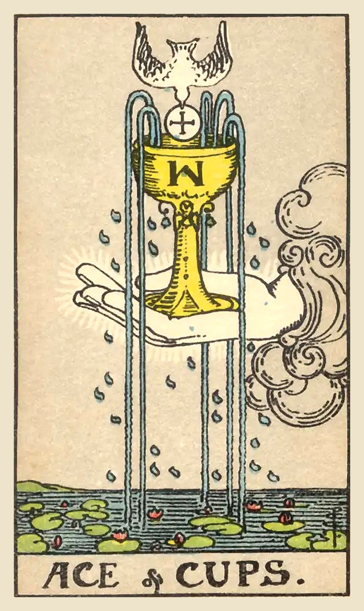

**Upright:** *new love, emotional renewal, compassion, open heart, overflowing feelings*  
A fresh start for the heart. Love, kindness or joy is overflowing; let it in.

**Reversed:** *blocked emotions, emptiness, self-love needed, repressed feelings, closed heart*  
Your feelings are bottled up or running low. Start by filling your own cup.

**Yes/No:** Yes · **Element:** Water · **Astrology:** Root of the powers of Water

### Upright meaning
A hand reaches out of a cloud holding a cup that overflows into a pond of water lilies, while a dove descends toward it. The Ace of Cups is the beginning of something emotional: new love, a deepening friendship, a creative spark, or simply a heart that feels open again. It can also point to compassion, forgiveness or a spiritual experience that leaves you feeling full. Aces are offers, and this one is an offer of feeling. Notice where love is reaching toward you, and let yourself receive it.

### Reversed meaning
Reversed, the cup tips over and its contents are lost, or it stays sealed. You may be holding feelings in, feeling emotionally drained, or struggling to let love in after being hurt. Sometimes it points to giving so much to others that your own cup is empty. The card invites you to begin with yourself: rest, honest feelings, small acts of self-care. Love that starts within has somewhere to flow from. Let yourself feel what you feel, without judging it.

**Love:** A new relationship, or new tenderness in an existing one. Open your heart.  
**Work:** Creative inspiration, or work that feels meaningful. Lead with care.  
**Advice:** Let love in, starting with love for yourself.

### Symbolism
- Hand from a cloud: a gift being offered.
- Overflowing cup: emotions and love more than enough to share.
- Dove with a wafer: peace and spiritual blessing.
- Five streams of water: feeling flowing to all the senses.
- Water lilies on the pond: emotional depth and beauty rising from it.

### Reflection
- Where is love or kindness being offered to me right now?
- What feelings have I been holding back?
- How can I fill my own cup today?

Waite, 1910

**Upright:** House of the true heart, joy, content, abode, nourishment, abundance, fertility; Holy Table, felicity hereof.  
**Reversed:** House of the false heart, mutation, instability, revolution.

 

---
## Two of Cups

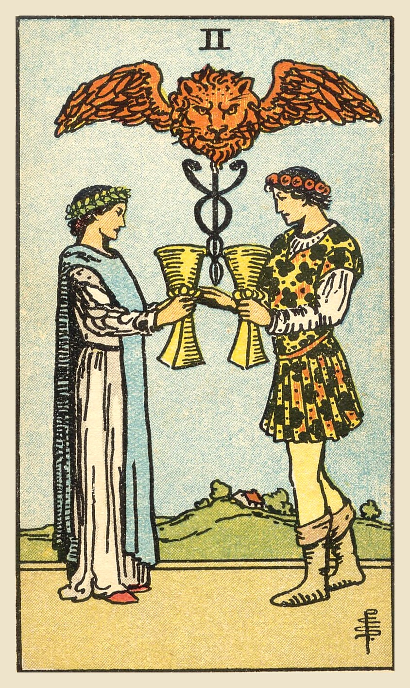

**Upright:** *partnership, mutual attraction, unity, respect, harmony*  
A meaningful bond between two people. Mutual respect, attraction and care.

**Reversed:** *one-sidedness, broken connection, mistrust, separation, misunderstanding*  
A connection is out of balance or strained. Talk honestly to restore it.

**Yes/No:** Yes · **Element:** Water · **Astrology:** Venus in Cancer

### Upright meaning
Two people face each other and exchange cups, while above them a winged lion's head rises from a staff entwined by two snakes. The Two of Cups is about connection between equals: romance, a close friendship, a business partnership or a reconciliation. What makes it special is the balance. Each person gives and receives, sees the other clearly, and chooses them anyway. This card often marks the start of a meaningful relationship, or a moment of real understanding with someone. Value it, and keep showing up for it.

### Reversed meaning
Reversed, the exchange between the two cups is uneven. A relationship might feel one-sided, tense, or quietly drifting apart. There may be a misunderstanding, broken trust, or a mismatch in what each person wants. Sometimes the imbalance is internal: you may be at odds with yourself, wanting closeness but not trusting it. The card asks for honesty and curiosity rather than blame. What does each side need? A calm, open conversation can often bring the cups level again, even if it starts with one small admission.

**Love:** Attraction, a new romance or a deepening bond. The feeling is mutual.  
**Work:** A strong partnership or collaboration. Find people who share your values.  
**Advice:** Meet others as equals and give as much as you receive.

### Symbolism
- Two figures exchanging cups: a mutual promise and equal exchange.
- Staff with two snakes: healing and balance between two people.
- Winged lion's head: passion lifted into something higher.
- Garlands on their heads: celebration of the bond.
- House on the hill: a shared home or future together.

### Reflection
- Which relationship in my life feels truly mutual?
- Where am I giving much more, or much less, than I receive?
- What would help me connect more honestly with someone?

Waite, 1910

**Upright:** Love, passion, friendship, affinity, union, concord, sympathy, the inter-relation of the sexes, and—as a suggestion apart from all offices of divination—that desire which is not in Nature, but by which Nature is sanctified.  
**Reversed:** Passion.

 

---
## Three of Cups

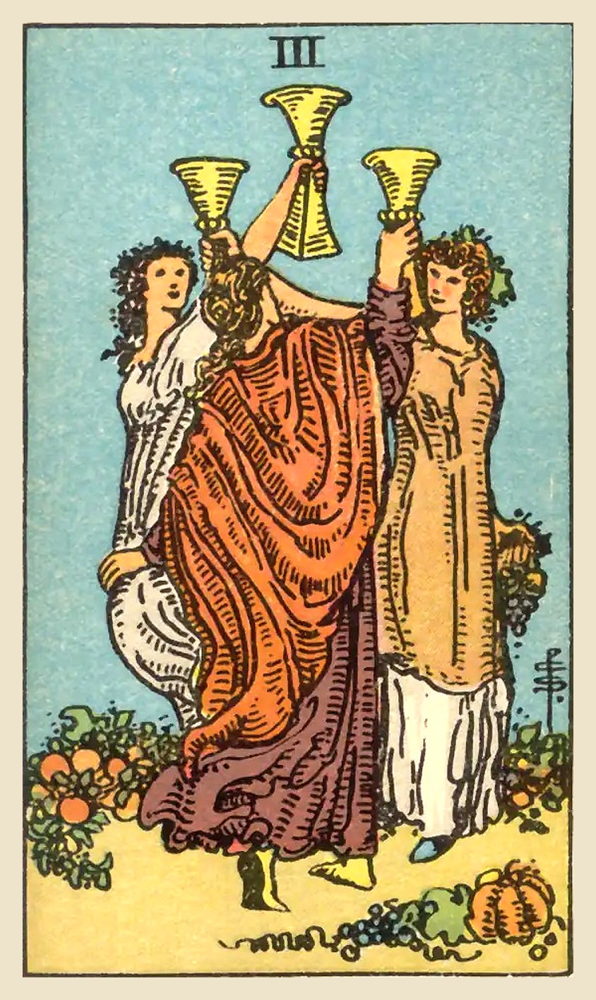

**Upright:** *friendship, celebration, community, joy, reunion*  
Celebrate with the people who lift you up. Friendship, community and good times.

**Reversed:** *overindulgence, gossip, isolation, third-party trouble, cancelled plans*  
The party has tipped into excess, drama or isolation. Check in with your circle.

**Yes/No:** Yes · **Element:** Water · **Astrology:** Mercury in Cancer

### Upright meaning
Three women dance in a circle, raising their cups toward each other, with ripe fruit and flowers at their feet. The Three of Cups is a card of friendship and celebration. It can point to a party, a wedding, a reunion or simply a joyful time with people who get you. It's also about community: the support of a group that celebrates your wins and holds you through the hard times. This card reminds you that joy grows when it's shared. Make time for your people, and let yourself enjoy it.

### Reversed meaning
Reversed, the celebration loses its balance. You might be overindulging, whether in drinking, partying or keeping busy to avoid something. It can point to gossip, a falling-out within a friend group, or a third person complicating a relationship. Sometimes it shows the opposite: feeling left out, isolated or disconnected from your community. Ask what's really going on in your circle, and whether you're showing up as the friend you'd want to have. Healthy friendships should leave you feeling lighter, not drained.

**Love:** Fun, flirtation and celebrating together. Watch out for a third party complicating things.  
**Work:** Teamwork, shared wins and good collaboration. Celebrate progress together.  
**Advice:** Gather your people and celebrate something.

### Symbolism
- Three women dancing in a circle: friendship and mutual support.
- Raised cups: a toast to shared joy.
- Fruit and flowers at their feet: abundance and harvest.
- Flower crowns: celebration and festivity.

### Reflection
- Who are the people who lift me up?
- What deserves celebrating in my life right now?
- Is there a friendship that needs attention or honesty?

Waite, 1910

**Upright:** The conclusion of any matter in plenty, perfection and merriment; happy issue, victory, fulfilment, solace, healing.  
**Reversed:** Expedition, dispatch, achievement, end. It signifies also the side of excess in physical enjoyment, and the pleasures of the senses.

 

---
## Four of Cups

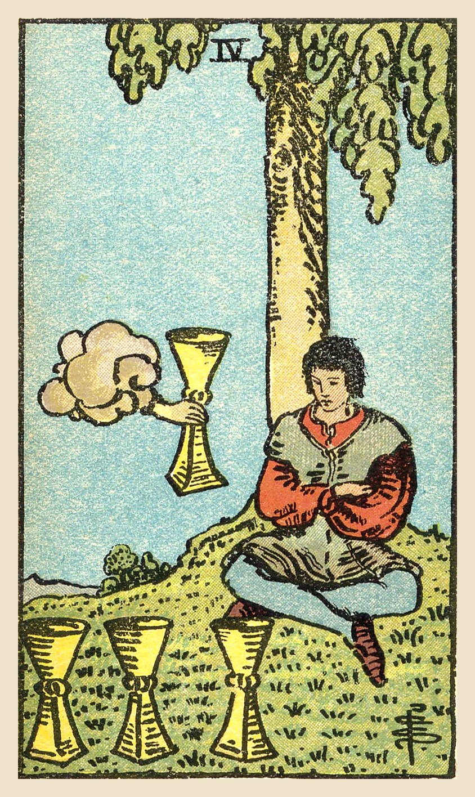

**Upright:** *apathy, contemplation, discontent, missed opportunity, withdrawal*  
You're turned inward and unimpressed. Look up; something good is being offered.

**Reversed:** *renewed interest, acceptance, moving on, new motivation, seizing chances*  
The fog is lifting. You're ready to re-engage and say yes to something new.

**Yes/No:** Maybe · **Element:** Water · **Astrology:** Moon in Cancer

### Upright meaning
A young man sits under a tree with his arms crossed, staring at three cups in front of him. He doesn't notice a hand reaching out of a cloud to offer a fourth. The Four of Cups is about feeling flat, bored or dissatisfied, even when there's nothing obviously wrong. Sometimes this inward time is useful: you're reflecting, reassessing what really matters. But the card also warns that you might be so focused on what's missing that you overlook an opportunity right in front of you. Look up and take another look around.

### Reversed meaning
Reversed, the Four of Cups shows the moment you start paying attention again. A period of apathy or withdrawal is ending, and you're ready to accept what's on offer, or to go looking for something new. It can also mean finally letting go of something that stopped fulfilling you a long time ago. Sometimes the reversal warns that a funk is deepening. If so, small steps help: a walk, a call to a friend, one thing you used to enjoy. Motivation often follows action, not the other way around.

**Love:** Feeling bored or unsure about a relationship. Don't overlook the love already offered to you.  
**Work:** Lack of motivation, or overlooking a good opportunity. Reassess what you actually want.  
**Advice:** Look up. Notice what's being offered.

### Symbolism
- Crossed arms: closing off and refusing what's offered.
- Three cups on the ground: what he already has, and is tired of.
- Hand offering a fourth cup: a new opportunity he doesn't see.
- Sitting under a tree: retreat, contemplation and stillness.

### Reflection
- What am I taking for granted right now?
- Is there an opportunity I've been ignoring?
- Am I resting and reflecting, or just stuck?

Waite, 1910

**Upright:** Weariness, disgust, aversion, imaginary vexations, as if the wine of this world had caused satiety only; another wine, as if a fairy gift, is now offered the wastrel, but he sees no consolation therein. This is also a card of blended pleasure.  
**Reversed:** Novelty, presage, new instruction, new relations.

 

---
## Five of Cups

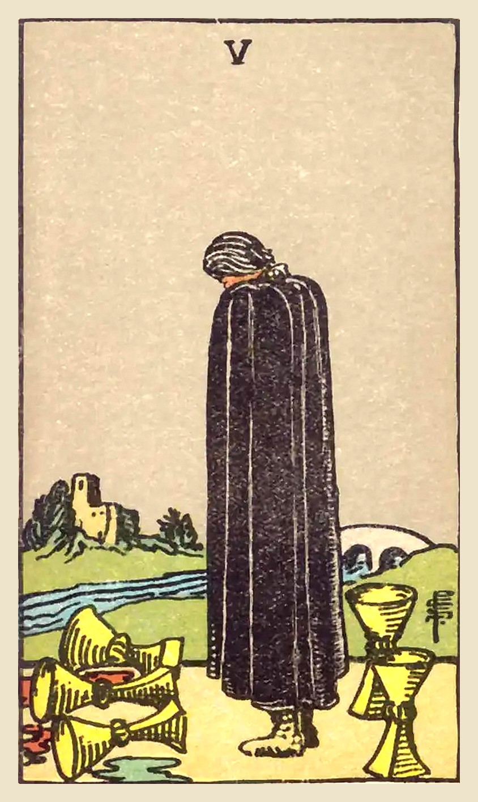

**Upright:** *loss, regret, disappointment, grieving, focusing on the negative*  
Something has been lost and it hurts. Grieve it, then notice what's still standing.

**Reversed:** *acceptance, healing, forgiveness, moving forward, finding what remains*  
You're beginning to heal and accept the loss. Turn around; there's still a way forward.

**Yes/No:** No · **Element:** Water · **Astrology:** Mars in Scorpio

### Upright meaning
A figure in a black cloak stands with head bowed over three spilled cups. Behind them, two cups still stand, and a bridge leads across the river to a house. The Five of Cups is about loss, disappointment and regret: a plan that failed, a relationship that ended, a mistake you keep replaying. The grief is real and deserves time. But the card also gently points out that not everything is gone. When you're ready, turn around and look at what remains. There is still something to carry forward.

### Reversed meaning
Reversed, the Five of Cups suggests you're starting to come to terms with a loss. You might be forgiving yourself or someone else, accepting what happened, or noticing the cups that are still standing. Healing is underway, even if it isn't finished. It can also point to a reunion, or a return to something you thought was gone. If you're still deep in regret, the card encourages you to talk about it and take one small step toward the bridge.

**Love:** Heartache, regret or disappointment. Grieve, but don't overlook the love that remains.  
**Work:** A setback or failed plan. Learn from it, then look at the options still open to you.  
**Advice:** Feel the loss, then turn toward what remains.

### Symbolism
- Three spilled cups: what has been lost or wasted.
- Two standing cups: what remains, unnoticed for now.
- Black cloak and bowed head: mourning and sorrow.
- River: the emotions that must be crossed.
- Bridge leading to a house: the path to healing and home.

### Reflection
- What loss am I still grieving?
- What do I still have that I've been overlooking?
- What would help me take the first step toward healing?

Waite, 1910

**Upright:** It is a card of loss, but something remains over; three have been taken, but two are left; it is a card of inheritance, patrimony, transmission, but not corresponding to expectations; with some interpreters it is a card of marriage, but not without bitterness or frustration.  
**Reversed:** News, alliances, affinity, consanguinity, ancestry, return, false projects.

 

---
## Six of Cups

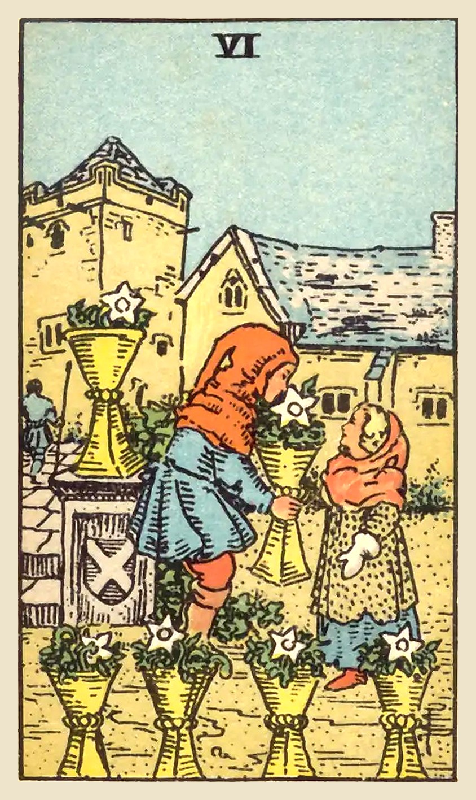

**Upright:** *nostalgia, childhood memories, innocence, kindness, reunion with the past*  
Sweet memories and simple kindness. The past offers comfort, or someone from it returns.

**Reversed:** *stuck in the past, idealizing memories, moving forward, outgrowing, leaving home*  
Looking back too much keeps you from moving forward. Honor the past, then let it go.

**Yes/No:** Yes · **Element:** Water · **Astrology:** Sun in Scorpio

### Upright meaning
In an old village courtyard, a child offers another child a cup filled with white flowers. The Six of Cups is a card of nostalgia, memories and innocence. It may point to happy childhood memories, a visit to an old place, or someone from your past coming back into your life. It's also about simple kindness and generosity, giving without expecting anything back. This card invites you to reconnect with the playful, open-hearted part of yourself. What did you love before life got complicated?

### Reversed meaning
Reversed, the Six of Cups suggests you may be holding on to the past too tightly. You might be idealizing how things used to be, or comparing the present to memories that look rosier than they really were. It can also show you outgrowing old patterns, places or relationships, and that's a healthy thing. The card asks you to keep the lessons and warmth of the past, but live in the present. Nostalgia is a lovely place to visit, but not a place to stay.

**Love:** An old flame, sweet affection or a gentle, innocent connection. Enjoy simple tenderness.  
**Work:** Returning to an old skill or passion, or a kind, supportive work environment.  
**Advice:** Reconnect with what you loved as a child.

### Symbolism
- Child offering a cup of flowers: innocent kindness and giving freely.
- White flowers: purity and good intentions.
- Old village courtyard: the past, home and familiar places.
- Figure walking away in the background: time passing.

### Reflection
- What did I love doing as a child?
- Is there someone from my past I've been thinking about?
- Am I learning from the past, or living in it?

Waite, 1910

**Upright:** A card of the past and of memories, looking back, as—for example—on childhood; happiness, enjoyment, but coming rather from the past; things that have vanished. Another reading reverses this, giving new relations, new knowledge, new environment, and then the children are disporting in an unfamiliar precinct.  
**Reversed:** The future, renewal, that which will come to pass presently.

 

---
## Seven of Cups

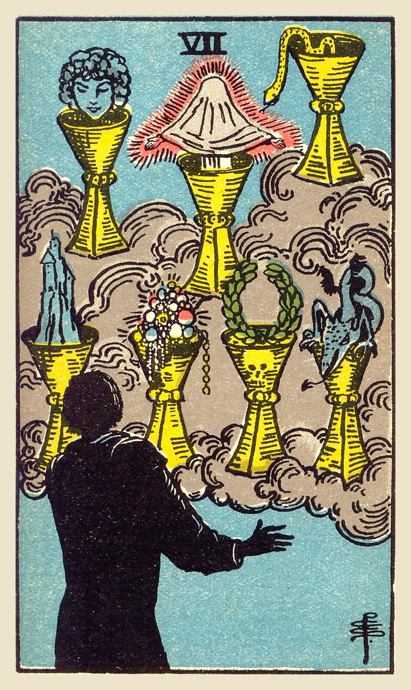

**Upright:** *choices, fantasy, wishful thinking, illusion, daydreaming*  
Too many options, and not all of them are real. Separate dreams from what's achievable.

**Reversed:** *clarity, decisiveness, reality check, focus, sobering up*  
The fog is clearing. You're ready to choose one path and commit to it.

**Yes/No:** Maybe · **Element:** Water · **Astrology:** Venus in Scorpio

### Upright meaning
A figure in silhouette stares at seven cups floating in the clouds, each holding something different: a castle, jewels, a wreath, a dragon, a snake, a face and a veiled glowing figure. The Seven of Cups is about choices and imagination. You may have many options, or many daydreams, but some of them are illusions. It's easy to get lost in "what if" and never decide. This card asks you to look closely at each possibility. Which ones are real, and which are wishful thinking? Pick one and take a concrete step toward it.

### Reversed meaning
Reversed, the Seven of Cups often shows clarity arriving. The fantasies are fading, and you can see which options are real. You may be ready to make a decision, focus your energy, or let go of a dream that was never really yours. Sometimes it's a reality check: something that looked perfect turns out not to be. That can feel disappointing, but it frees you to put your energy into something solid. Decide what matters most, and go after that.

**Love:** Many options, or idealizing someone. Look at the real person, not the fantasy.  
**Work:** Too many ideas and no clear direction. Prioritize and commit to one plan.  
**Advice:** Choose one dream and make it real.

### Symbolism
- Seven cups in the clouds: many choices, floating in the realm of imagination.
- Castle: security and ambition.
- Jewels: wealth and material desires.
- Laurel wreath: success and recognition.
- Snake and dragon: temptation and fear hiding among the choices.
- Glowing veiled figure: a spiritual path, or a mystery yet to be revealed.

### Reflection
- Which of my options are real, and which are fantasy?
- What would I choose if I could only pick one?
- Am I using daydreams to avoid deciding?

Waite, 1910

**Upright:** Fairy favours, images of reflection, sentiment, imagination, things seen in the glass of contemplation; some attainment in these degrees, but nothing permanent or substantial is suggested.  
**Reversed:** Desire, will, determination, project.

 

---
## Eight of Cups

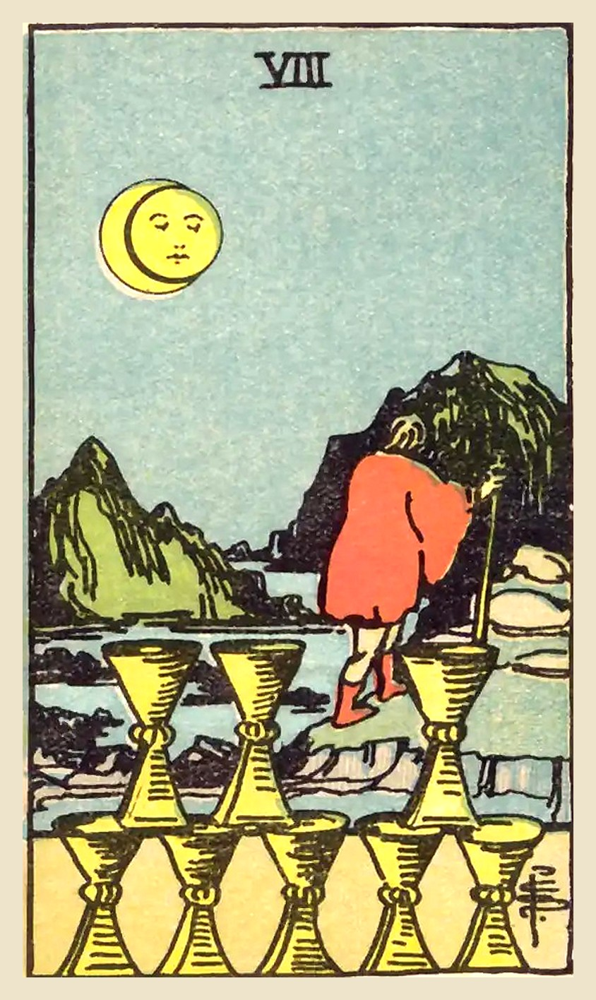

**Upright:** *walking away, seeking more, disappointment, letting go, searching*  
It's time to walk away from what no longer fulfills you and seek something deeper.

**Reversed:** *fear of leaving, staying too long, aimless drifting, avoidance, returning*  
You know something isn't right, but you're afraid to leave. Be honest about why.

**Yes/No:** No · **Element:** Water · **Astrology:** Saturn in Pisces

### Upright meaning
Under a moon, a figure with a walking staff turns away from eight neatly stacked cups and heads toward the mountains. The Eight of Cups is about leaving something behind, not because it's terrible, but because it no longer fulfills you. It might be a job, a relationship, a habit or a way of living. Notice the gap in the stacked cups: something is missing, and the traveler has decided to go find it. This kind of leaving takes courage. It's a search for meaning, and it's often the start of something truer.

### Reversed meaning
Reversed, the Eight of Cups can show hesitation. You may know a situation isn't working but feel too afraid, comfortable or guilty to leave. You might keep walking away and coming back, unable to commit to either. Sometimes it shows aimless drifting: leaving things without a clear sense of what you're looking for. The card asks for honesty. What are you really searching for? If it can't be found here, gather your courage. If it can, maybe it's time to recommit and stop looking elsewhere.

**Love:** Leaving a relationship that no longer fulfills you, or wanting more emotional depth.  
**Work:** Moving on from a job or path that feels empty, to look for real meaning.  
**Advice:** Walk away from what no longer fills you up.

### Symbolism
- Figure walking away: choosing to leave the familiar behind.
- Eight stacked cups with a gap: something important is missing.
- Moon in eclipse: a turning point and a time of reflection.
- Walking staff: a long journey and self-reliance.
- Rocky mountains: a hard but meaningful road ahead.

### Reflection
- What in my life no longer fulfills me?
- What am I really searching for?
- What makes it hard for me to walk away?

Waite, 1910

**Upright:** The card speaks for itself on the surface, but other readings are entirely antithetical—giving joy, mildness, timidity, honour, modesty. In practice, it is usually found that the card shews the decline of a matter, or that a matter which has been thought to be important is really of slight consequence—either for good or evil.  
**Reversed:** Great joy, happiness, feasting.

 

---
## Nine of Cups

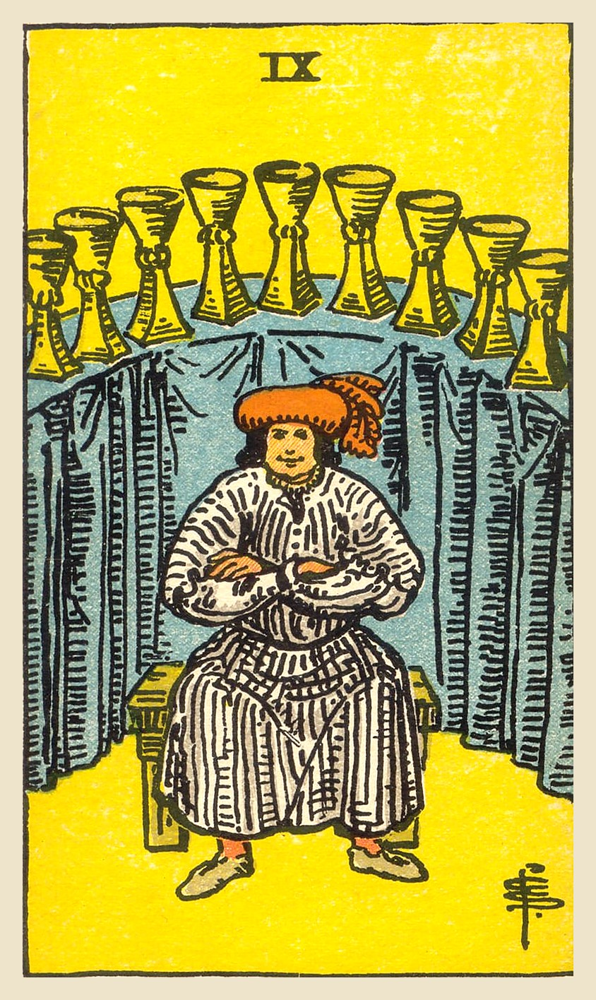

**Upright:** *contentment, wishes fulfilled, satisfaction, gratitude, pleasure*  
The wish card. Satisfaction and contentment are within reach, so enjoy them.

**Reversed:** *smugness, dissatisfaction, materialism, unmet wishes, indulgence*  
You have plenty, but it doesn't feel like enough. Look for what would truly satisfy you.

**Yes/No:** Yes · **Element:** Water · **Astrology:** Jupiter in Pisces

### Upright meaning
A well-fed man sits contentedly with his arms crossed, nine cups lined up on a curved table behind him. Often called the "wish card," the Nine of Cups brings satisfaction, comfort and the feeling that things have worked out. It can point to a wish coming true, a goal reached, or simply a time of enjoying life's pleasures. It's a good moment for gratitude: noticing what you have and letting yourself enjoy it without guilt. Celebrate how far you've come, and share your good fortune if you can.

### Reversed meaning
Reversed, the Nine of Cups suggests that contentment is missing or a little hollow. You might have what you thought you wanted, yet still feel unsatisfied. It can point to overindulgence, valuing appearances over real happiness, or becoming smug. It can also show a wish that hasn't come true yet. The card invites you to ask what truly satisfies you, beyond things and status. Sometimes the answer is connection, purpose or simply rest, rather than more of anything. Enough can be a wonderful place to stand.

**Love:** Happiness and satisfaction in love. A wish for a relationship may come true.  
**Work:** Success and a sense of accomplishment. Enjoy the rewards of your work.  
**Advice:** Count your blessings and enjoy them.

### Symbolism
- Man seated with arms crossed: contentment and pride in what he has.
- Nine cups lined up: a complete and abundant collection.
- Curved table with a blue cloth: a secure, comfortable life.
- Satisfied smile: pleasure and fulfillment.

### Reflection
- What wish has already come true for me?
- What am I grateful for right now?
- What would truly satisfy me, beyond more things?

Waite, 1910

**Upright:** Concord, contentment, physical bien-être; also victory, success, advantage; satisfaction for the Querent or person for whom the consultation is made.  
**Reversed:** Truth, loyalty, liberty; but the readings vary and include mistakes, imperfections, etc.

 

---
## Ten of Cups

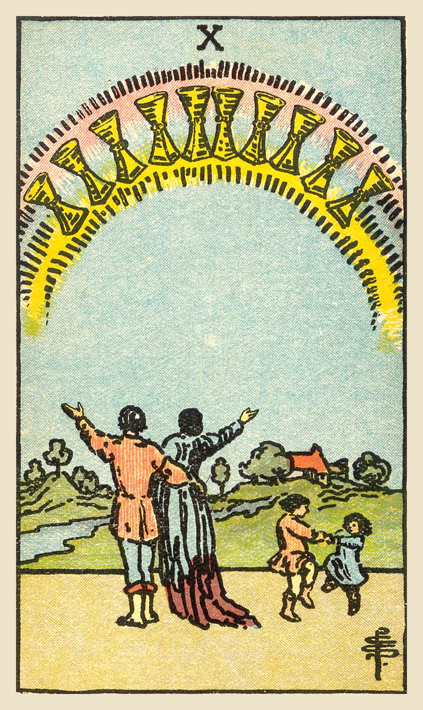

**Upright:** *happy family, emotional fulfillment, harmony, home, lasting love*  
Deep happiness, harmony at home and lasting love. A dream of belonging comes true.

**Reversed:** *family tension, broken harmony, unrealistic ideals, disconnection, misaligned values*  
Harmony at home is strained. Let go of the perfect picture and reconnect honestly.

**Yes/No:** Yes · **Element:** Water · **Astrology:** Mars in Pisces

### Upright meaning
A couple stands with their arms raised toward a rainbow of ten cups, while two children dance happily beside them and a home sits in the distance. The Ten of Cups is the card of emotional fulfillment: a loving family, a happy home, a sense of belonging. "Family" can mean any group of people who love and support you. This card often appears when relationships feel harmonious, or as a reminder of what truly matters. Notice the love around you, and nurture it. This kind of happiness is built and kept through care.

### Reversed meaning
Reversed, the Ten of Cups suggests tension at home or in close relationships. Family members may be out of sync, communication may be breaking down, or values may no longer line up. Sometimes the problem is an ideal of the perfect family or relationship that real life can't match. The card invites you to drop the picture of how things "should" look and reconnect with how things actually are. Real harmony includes imperfection, honesty and a willingness to repair, again and again.

**Love:** Long-term happiness, commitment or family life. A relationship that feels like home.  
**Work:** A happy, supportive team, or work that fits well with your home life.  
**Advice:** Invest in the people who feel like home.

### Symbolism
- Rainbow of cups: blessings, and promises kept.
- Couple with arms raised: shared gratitude and joy.
- Dancing children: carefree happiness passed to the next generation.
- House in the distance: home, security and belonging.
- Flowing river: emotions moving freely and peacefully.

### Reflection
- Who feels like home to me?
- What makes my relationships feel harmonious?
- Am I holding on to a "perfect" picture that isn't real?

Waite, 1910

**Upright:** Contentment, repose of the entire heart; the perfection of that state; also perfection of human love and friendship; if with several picture-cards, a person who is taking charge of the Querent's interests; also the town, village or country inhabited by the Querent.  
**Reversed:** Repose of the false heart, indignation, violence.

 

---
## King of Cups

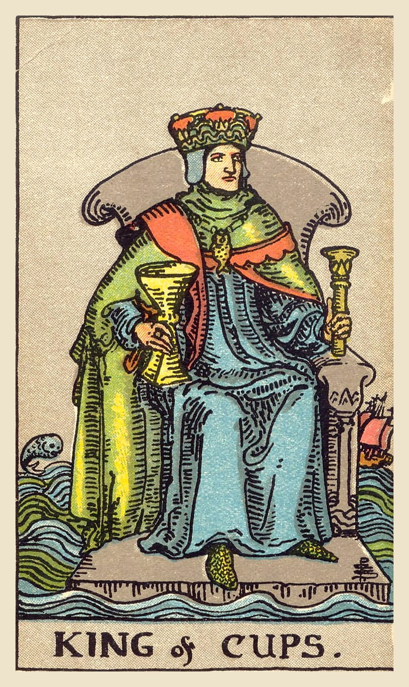

**Upright:** *emotional balance, calm leadership, diplomacy, wisdom, generosity*  
Calm in the storm. Lead with compassion while keeping your emotions steady.

**Reversed:** *emotional manipulation, volatility, coldness, bottled-up feelings, moodiness*  
Emotions are either bottled up or spilling over. Find your center before you act.

**Yes/No:** Yes · **Element:** Air of Water · **Astrology:** Late Libra to mid Scorpio

### Upright meaning
A king sits on a stone throne floating in a rough sea, holding a cup and a scepter. A ship sails on one side and a fish leaps on the other, yet he stays calm. The King of Cups represents emotional maturity: the ability to feel deeply without being swept away. He listens, stays steady under pressure, and leads with compassion. This card may point to a wise, caring person in your life, or ask you to become that calm center yourself. Respond rather than react, and use your empathy to guide others.

### Reversed meaning
Reversed, the King's calm can crack. You may be bottling up feelings until they leak out as coldness or sudden outbursts. It can also point to someone using emotions to manipulate, guilt-trip or control. Sometimes it shows emotional burnout: always being the steady one, with no one to steady you. The card asks you to find healthy outlets for what you feel and to set boundaries with people who play emotional games. True balance includes letting yourself be supported too.

**Love:** A mature, caring partner, or a relationship that feels emotionally secure.  
**Work:** Diplomatic leadership. Stay calm and treat people with kindness.  
**Advice:** Stay calm, and lead with your heart.

### Symbolism
- Throne floating on rough sea: steadiness amid emotional turmoil.
- Cup and scepter: emotional wisdom joined with authority.
- Fish amulet: creativity and a connection to the depths.
- Ship and leaping fish: the world of feeling moving around him.

### Reflection
- How do I stay calm when emotions run high?
- Am I bottling something up?
- Who supports me when I'm the steady one?

Waite, 1910

**Upright:** Fair man, man of business, law, or divinity; responsible, disposed to oblige the Querent; also equity, art and science, including those who profess science, law and art; creative intelligence.  
**Reversed:** Dishonest, double-dealing man; roguery, exaction, injustice, vice, scandal, pillage, considerable loss.

 

---
## Knight of Cups

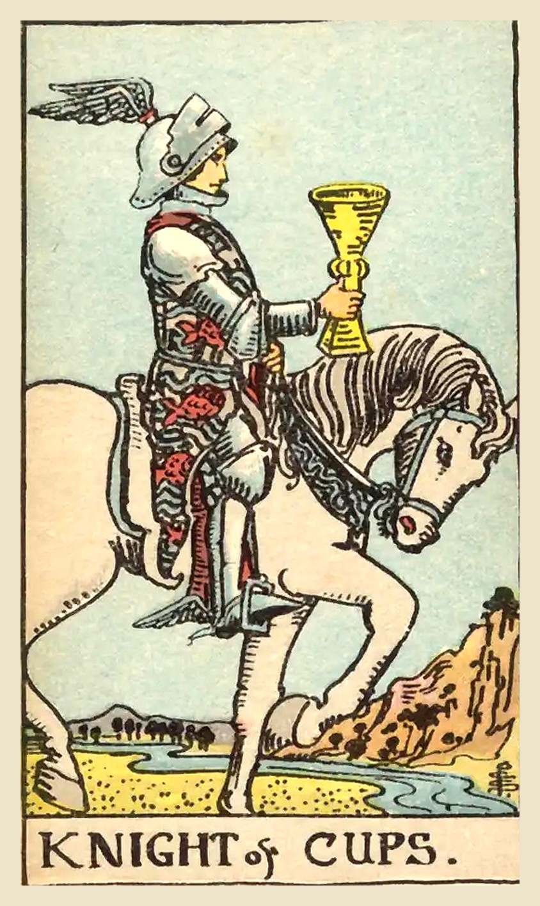

**Upright:** *romance, charm, invitations, following your heart, idealism*  
An offer of love or inspiration arrives. Follow your heart, with grace.

**Reversed:** *moodiness, unrealistic expectations, jealousy, empty promises, disappointment*  
Charm without substance, or moods driving decisions. Check if promises are real.

**Yes/No:** Yes · **Element:** Fire of Water · **Astrology:** Late Aquarius to mid Pisces

### Upright meaning
A knight in armor rides a white horse slowly forward, holding out a cup as if offering it. Unlike other knights, he isn't charging into battle: he's calm, romantic and guided by feeling. The Knight of Cups can point to an invitation, a proposal, a romantic gesture or a creative opportunity coming your way. It may represent someone charming and idealistic, or your own wish to follow your heart. This card encourages you to act on your feelings and values, gracefully and sincerely.

### Reversed meaning
Reversed, the Knight of Cups can show feelings getting out of balance. You might meet someone charming whose promises don't hold up, or you might be the one getting carried away by moods and fantasies. It can also point to jealousy, sulking, or disappointment when reality doesn't match the dream. The card asks you to look at actions, not just words, in others and in yourself. Romance and idealism are wonderful, but they need honesty and steady follow-through to last over time.

**Love:** Romance, an invitation or a heartfelt gesture. Someone may be ready to show their feelings.  
**Work:** A creative offer or a role that matches your passions. Follow your inspiration.  
**Advice:** Follow your heart, and follow through.

### Symbolism
- Cup held forward: an offer, an invitation or a message of love.
- White horse walking slowly: gentle, purposeful action.
- Winged helmet and heels: imagination and inspiration.
- River and mountains: crossing emotions toward a goal.

### Reflection
- What does my heart want me to pursue?
- Am I acting on feelings, or just dreaming about them?
- Do the promises in my life match the actions?

Waite, 1910

**Upright:** Arrival, approach—sometimes that of a messenger; advances, proposition, demeanour, invitation, incitement.  
**Reversed:** Trickery, artifice, subtlety, swindling, duplicity, fraud.

 

---
## Page of Cups

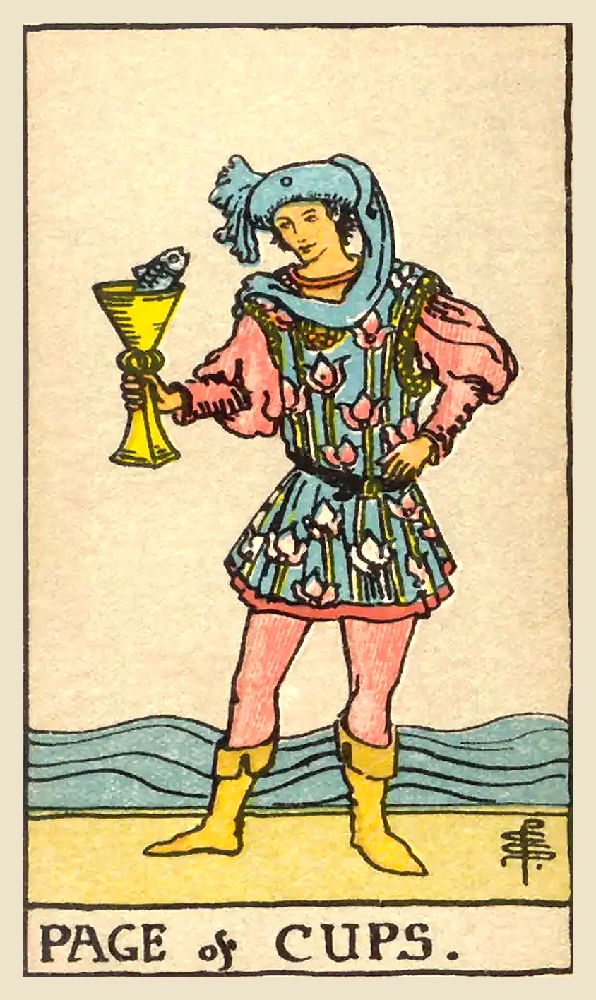

**Upright:** *curiosity, creative beginnings, sensitivity, intuitive messages, playfulness*  
A sweet surprise or creative idea. Stay curious and open to unexpected feelings.

**Reversed:** *emotional immaturity, creative block, insecurity, escapism, oversensitivity*  
Feelings are raw or immature. Be gentle with yourself and grounded in reality.

**Yes/No:** Yes · **Element:** Earth of Water · **Astrology:** 

### Upright meaning
A young page in a flowered tunic stands by the sea, holding up a cup and looking at a fish that has popped out of it. The Page of Cups is playful, imaginative and emotionally open. It can point to a creative idea, a surprising message, a new feeling, or an intuitive nudge that doesn't quite make sense yet. It may also represent someone in your life who is gentle, dreamy or sensitive. The card encourages you to approach your feelings and creativity with curiosity rather than judgment. Let yourself be surprised.

### Reversed meaning
Reversed, the Page of Cups suggests emotions are getting the better of you. You may be taking things too personally, sulking, or retreating into daydreams to avoid real life. It can also show creative block, or insecurity about sharing your ideas or feelings. The card asks you to be gentle with yourself without indulging every mood. Notice what you're feeling, name it, and choose how to respond. Your sensitivity is a gift when it's balanced with groundedness, and with a little patience for yourself.

**Love:** A sweet message, a crush or a new romantic feeling. Be open and genuine.  
**Work:** Creative ideas and fresh inspiration. Try something imaginative.  
**Advice:** Follow your curiosity and your heart.

### Symbolism
- Fish rising from the cup: an unexpected idea or message from the imagination.
- Flowered tunic: creativity and a gentle nature.
- Sea behind the page: deep emotions and the subconscious.
- Playful pose: openness and curiosity.

### Reflection
- What creative idea or feeling is trying to get my attention?
- Where could I be more playful?
- Am I taking something too personally?

Waite, 1910

**Upright:** Fair young man, one impelled to render service and with whom the Querent will be connected; a studious youth; news, message; application, reflection, meditation; also these things directed to business.  
**Reversed:** Taste, inclination, attachment, seduction, deception, artifice.

 

---
## Queen of Cups

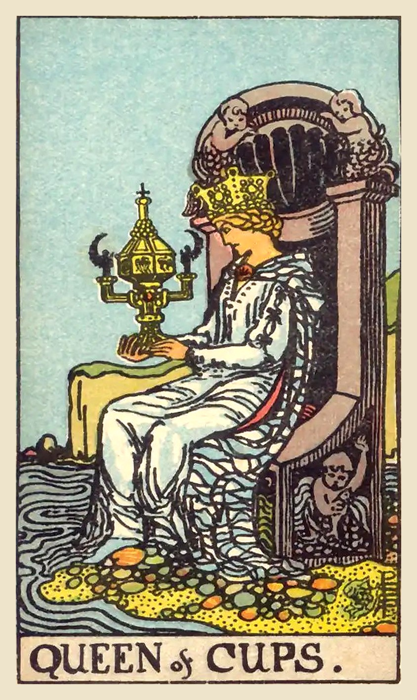

**Upright:** *compassion, emotional depth, intuition, care, calm*  
Deep empathy and intuition. Lead with your heart while keeping your feet on solid ground.

**Reversed:** *overwhelm, people-pleasing, self-neglect, emotional dependence, moodiness*  
Feelings are flooding in, or you're giving care you never give yourself. Refill your own cup.

**Yes/No:** Yes · **Element:** Water (Water of Water) · **Astrology:** Late Gemini to mid Cancer

### Upright meaning
The Queen of Cups sits at the edge of the sea, at ease with deep feelings, her own and other people's. She listens closely, notices what isn't said, and offers care without being swept away by it. When she appears, she may point to your own intuition and emotional wisdom, or to a caring, sensitive person in your life. Notice that her throne is on dry land, though the water reaches her feet: she feels deeply but stays steady. The card invites you to trust what your feelings are telling you, and to treat yourself with the same tenderness you give others.

### Reversed meaning
Reversed, the Queen's gift for empathy can tip into overwhelm. You may be absorbing everyone's moods, saying yes when you mean no, or caring for others while running on empty. It can also show feelings being shut away because they seem like too much to handle, or leaning on someone else to steady them for you. This card asks for boundaries: you can be kind without carrying everyone's emotions for them. Spend some of that care on yourself, and look for the steady ground beneath the waves.

**Love:** A caring, emotionally open partner, or the call to be one. Listen deeply and say what you feel.  
**Work:** Supportive roles and emotional intelligence at work. Trust your read on people.  
**Advice:** Trust your intuition, and give yourself the care you give others.

### Symbolism
- Covered, ornate cup: the only closed cup in the suit. Intuitions and feelings kept private and treasured.
- Throne at the water's edge: balanced between feeling (the sea) and stability (the land).
- Sea-child carvings and shell-shaped throne: imagination and the world of emotion.
- Calm water and pebbles at her feet: deep feelings held peacefully.

### Reflection
- What is my intuition telling me that I've been ignoring?
- Where am I giving care that I also need to give myself?
- How can I stay kind without taking on other people's emotions?

Waite, 1910

**Upright:** Good, fair woman; honest, devoted woman, who will do service to the Querent; loving intelligence, and hence the gift of vision; success, happiness, pleasure; also wisdom, virtue; a perfect spouse and a good mother.  
**Reversed:** The accounts vary; good woman; otherwise, distinguished woman but one not to be trusted; perverse woman; vice, dishonour, depravity.

 

---
