# Review: Major Arcana

Generated by `tools/build_review.py` from the card files. Edit the YAML files, not this page.

## The Fool

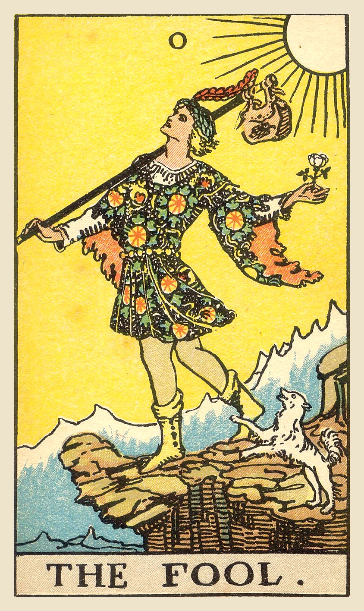

**Upright:** *beginnings, trust, spontaneity, freedom, leap of faith*  
A fresh start taken on trust. Step forward with an open heart, even without the whole map.

**Reversed:** *hesitation, recklessness, fear of the unknown, naivety, holding back*  
The leap is stuck, either held back by fear or taken without looking. Find the balance.

**Yes/No:** Yes · **Element:** Air · **Astrology:** Uranus (modern); Air (traditional)

### Upright meaning
The Fool stands at the very start of the journey, carrying almost nothing and worrying about even less. This card shows up when something new is possible: a move, a project, a relationship, a different way of seeing yourself. It doesn't promise the path will be easy, only that it's open. The Fool's gift is willingness: to begin before you feel ready, to be a beginner, to let curiosity lead. Ask yourself where you've been waiting for a certainty that may never come. Sometimes the wisest step is the one you take with a light pack and an open mind.

### Reversed meaning
Reversed, the Fool's energy tips out of balance in one of two directions. You might be hovering at the edge, so afraid of getting it wrong that nothing begins. Or you might be rushing ahead, ignoring the warning the little dog is trying to give. Notice which one feels true. If it's fear, the card asks what the smallest possible first step would be. If it's haste, it asks you to slow down long enough to check the ground. Either way, the new beginning is still there; it just needs more honesty about how you're approaching it.

**Love:** New feelings, or a chance to see love with fresh eyes. Enjoy the openness, but don't skip the warning signs.  
**Work:** A new role, project or path. Say yes to learning, and do a little homework before you leap.  
**Advice:** Begin. You can figure out the rest as you go.

### Symbolism
- Cliff edge: the moment just before a leap, where risk and possibility meet.
- White rose: innocence and a pure intention.
- Small bundle on a staff: traveling light; what you need is already with you.
- White dog: instinct and loyalty, a reminder to stay alert.
- Bright sun and yellow sky: optimism and clear, open energy.
- Mountains behind: challenges and lessons still ahead.

### Reflection
- Where in my life am I waiting to feel ready?
- What would I try if I didn't have to be good at it yet?
- What could I leave behind to travel lighter?

Waite, 1910

**Upright:** Folly, mania, extravagance, intoxication, delirium, frenzy, bewrayment.  
**Reversed:** Negligence, absence, distribution, carelessness, apathy, nullity, vanity.

 

---
## The Magician

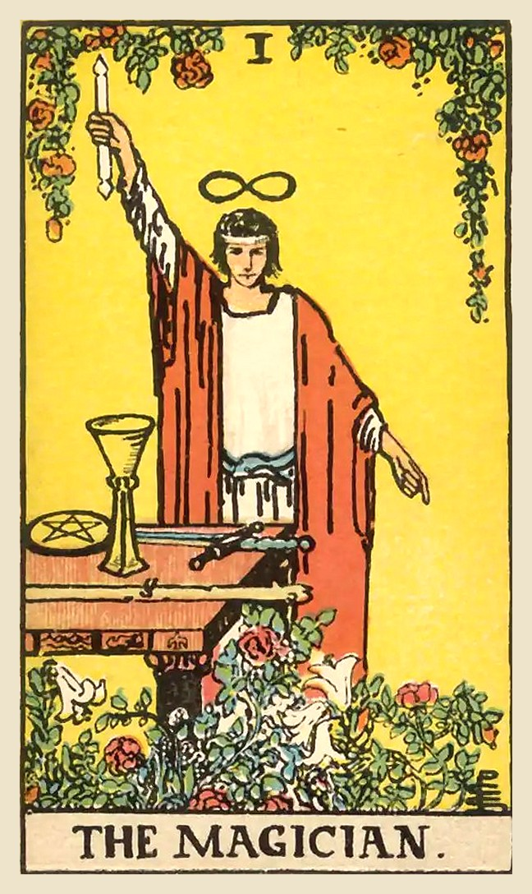

**Upright:** *willpower, skill, focus, resourcefulness, manifestation*  
You have the tools you need. Focus your will and turn an idea into something real.

**Reversed:** *scattered energy, manipulation, self-doubt, untapped talent, trickery*  
Your talents are scattered or misused. Check your motives and gather your focus.

**Yes/No:** Yes · **Element:** Air · **Astrology:** Mercury

### Upright meaning
The Magician stands with one hand raised to the sky and the other pointing to the earth, a living bridge between idea and action. On the table before him lie the symbols of all four suits: everything he needs is already within reach. This card appears when you have more power over a situation than you might think. Your skills, your words and your focus are tools, and now is a good time to use them on purpose. Decide what you want, gather what you have, and take the first concrete step. The Magician reminds you that intention matters most when it's followed by action.

### Reversed meaning
Reversed, the Magician's energy loses its direction. You might be juggling too many plans and finishing none of them, or doubting skills you clearly have. It can also be a warning about manipulation, whether someone is using clever words to steer you or you're tempted to bend the truth to get your way. Ask yourself whether your talents are serving what you actually care about. Bring your attention back to one goal, be honest about your methods, and the Magician's power returns.

**Love:** Confident, intentional connection. Say what you want clearly, and watch for charm without substance.  
**Work:** A great time to launch, pitch or build. Your skills are ready; use them with focus.  
**Advice:** Stop waiting for more tools. Use what you already have.

### Symbolism
- Raised wand and pointing hand: 'as above, so below,' drawing ideas down into the world.
- Infinity sign above his head: limitless potential and focused will.
- Cup, sword, pentacle and wand on the table: all four elements at his command.
- Roses and lilies in the garden: passion and pure intention growing together.
- Snake biting its own tail as a belt: renewal and energy that keeps flowing.

### Reflection
- What resources do I already have that I'm not using?
- Where am I scattering my energy instead of focusing it?
- What is one concrete step I can take today toward what I want?

Waite, 1910

**Upright:** Skill, diplomacy, address, subtlety; sickness, pain, loss, disaster, snares of enemies; self-confidence, will; the Querent, if male.  
**Reversed:** Physician, Magus, mental disease, disgrace, disquiet.

 

---
## The High Priestess

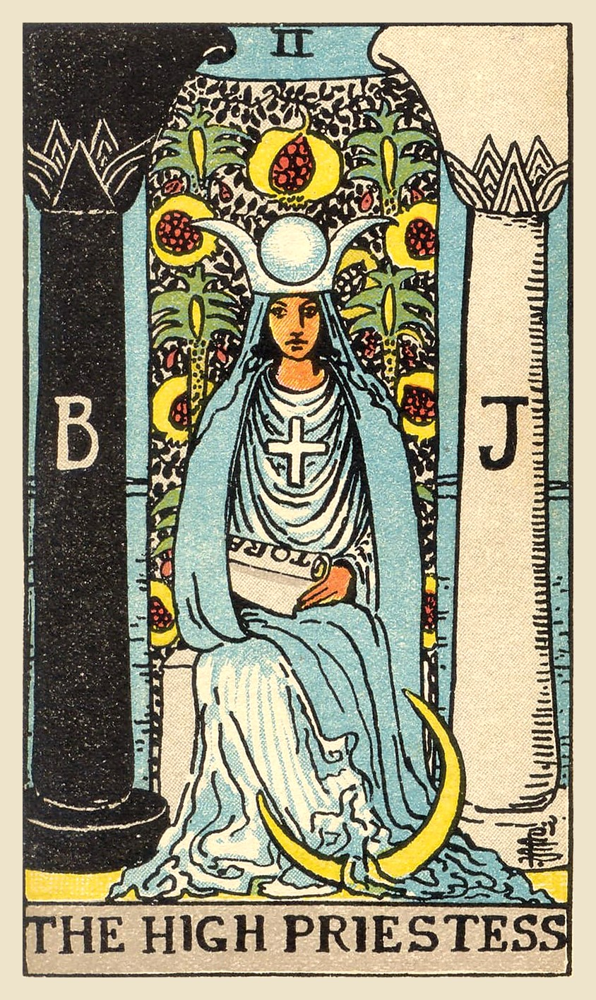

**Upright:** *intuition, inner knowing, mystery, stillness, the subconscious*  
Be still and listen inward. Your intuition knows more than you've put into words.

**Reversed:** *ignored intuition, secrets, disconnection, surface thinking, withdrawal*  
You're tuning out your inner voice, or something is being kept hidden. Make space to listen.

**Yes/No:** Maybe · **Element:** Water · **Astrology:** The Moon

### Upright meaning
The High Priestess sits quietly between a dark pillar and a light one, holding a scroll she doesn't fully reveal. She is the keeper of what can't be rushed: intuition, dreams and the knowing that comes from beneath the surface. When she appears, the answer you're looking for probably won't come from more research or more opinions. It will come from slowing down, paying attention to your gut, and noticing signs and feelings you've been brushing aside. Not everything needs to be explained right away. Trust that some things become clear only when you stop chasing them.

### Reversed meaning
Reversed, the High Priestess suggests a gap between you and your inner voice. Life may be so loud or busy that you can't hear yourself think, or you may be overriding a gut feeling because it's inconvenient. Sometimes this card points to secrets, either something hidden from you or something you're keeping from yourself. Rather than forcing answers, create quiet: a walk, a journal page, a night's sleep. Notice what keeps coming back to you. That is usually the message.

**Love:** Unspoken feelings and slow-building connection. Trust your instincts about someone, and don't rush to define things.  
**Work:** Hold your cards close and observe before acting. Your quiet read on the situation is valuable.  
**Advice:** Get quiet and trust your gut.

### Symbolism
- Black and white pillars, marked B and J: opposites, with her sitting calmly between them.
- Partly hidden scroll marked TORA: wisdom that is revealed only in part.
- Crescent moon at her feet: intuition, cycles and the subconscious.
- Veil of pomegranates behind her: hidden knowledge and the mysteries beyond.
- Flowing blue robe: water, feeling and depth.

### Reflection
- What does my gut already know about this?
- What am I trying to figure out that might need patience instead?
- When do I feel most connected to my inner voice?

Waite, 1910

**Upright:** Secrets, mystery, the future as yet unrevealed; the woman who interests the Querent, if male; the Querent herself, if female; silence, tenacity; mystery, wisdom, science.  
**Reversed:** Passion, moral or physical ardour, conceit, surface knowledge.

 

---
## The Empress

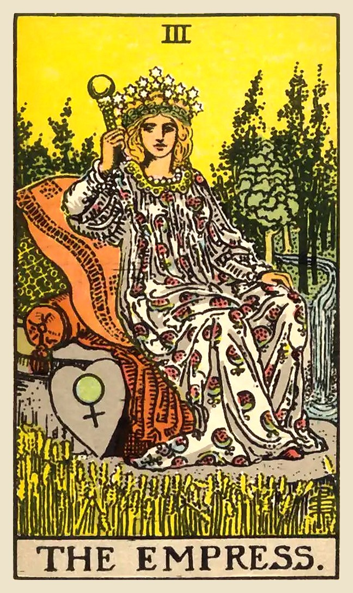

**Upright:** *abundance, nurturing, creativity, comfort, growth*  
Growth, creativity and care. Nurture what matters and let it flourish in its own time.

**Reversed:** *neglect, creative block, overgiving, dependence, stagnation*  
Something needs tending, maybe you. Refill your well before you pour out more.

**Yes/No:** Yes · **Element:** Earth · **Astrology:** Venus

### Upright meaning
The Empress sits at ease in a ripe field of wheat, surrounded by trees and running water. She represents abundance in every sense: creativity, comfort, pleasure, and the patient work of helping things grow. This card can point to a creative project, a home or relationship you're nurturing, or a season of plenty. It also invites you to enjoy your senses: good food, beauty, rest, time in nature. Growth here isn't forced. It comes from steady care and from trusting the natural pace of things. Treat yourself as something worth tending, too.

### Reversed meaning
Reversed, the Empress shows that the flow of care has gotten blocked. You may be giving so much to others that you're running dry, or neglecting your own body, home or creative life. It can also show a creative block, or a project that feels stuck because it's being pushed instead of nurtured. Sometimes it points to being smothering, holding on too tightly to someone or something that needs room. The remedy is gentle: rest, get back into your body, and give yourself the kindness you so easily give others.

**Love:** Warm, nurturing affection and a relationship that grows. Can point to family or fertility.  
**Work:** Creative projects flourish. Steady care and patience will bring real results.  
**Advice:** Nurture yourself the way you nurture others.

### Symbolism
- Ripe wheat at her feet: abundance and a harvest that's coming.
- Venus symbol on her heart-shaped shield: love, beauty and creativity.
- Crown of twelve stars: the cycles of the year and natural rhythms.
- Forest and waterfall: life flowing freely and growth without force.
- Pomegranate pattern on her gown: fertility and abundance.

### Reflection
- What in my life is ready to grow if I give it care?
- How can I bring more comfort and beauty into my days?
- Where am I giving more than I'm receiving?

Waite, 1910

**Upright:** Fruitfulness, action, initiative, length of days; the unknown, clandestine; also difficulty, doubt, ignorance.  
**Reversed:** Light, truth, the unravelling of involved matters, public rejoicings; according to another reading, vacillation.

 

---
## The Emperor

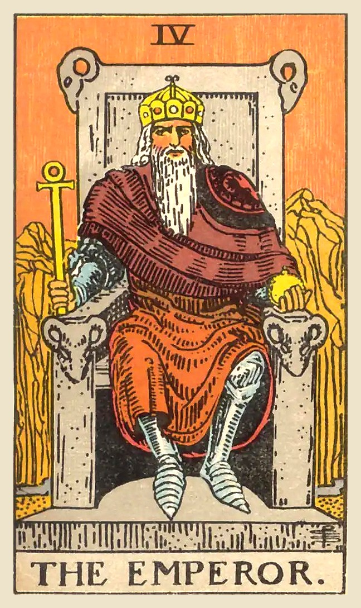

**Upright:** *structure, authority, stability, leadership, protection*  
Build structure and take charge. Clear rules and steady leadership create safety.

**Reversed:** *rigidity, control, domination, lack of discipline, chaos*  
Too much control, or not enough. Find the balance between order and flexibility.

**Yes/No:** Yes · **Element:** Fire · **Astrology:** Aries

### Upright meaning
The Emperor sits on a stone throne carved with rams' heads, mountains rising bare behind him. He represents order: plans, boundaries, routines and the kind of steady leadership that makes others feel safe. This card can point to an authority figure in your life, or to the part of you that can take charge and get things organized. It asks where some structure would help: a schedule, a budget, a clear decision, a firm boundary. Stability isn't the opposite of freedom. Often it's what makes freedom possible.

### Reversed meaning
Reversed, the Emperor's strength becomes unbalanced. It can show rigid thinking, controlling behavior, or someone using authority in a way that feels heavy rather than protective. It can also show the opposite: life without enough structure, with plans that never land and boundaries that keep slipping. Notice which side feels true for you right now. If you're gripping too tightly, loosen up and listen. If things feel chaotic, choose one small area to bring order to, and build from there.

**Love:** Commitment, stability and clear expectations. Watch that care doesn't turn into control.  
**Work:** Leadership, planning and structure. Take charge, set clear goals, and follow through.  
**Advice:** Make a plan and stick to it.

### Symbolism
- Stone throne: solid foundations and lasting power.
- Rams' heads: Aries, drive and determination.
- Ankh-shaped scepter and orb: rule over life and the world.
- Armor under his robe: readiness to defend what he has built.
- Barren mountains: discipline, and strength earned through effort.

### Reflection
- Where would more structure make my life easier?
- Am I holding on too tightly to control somewhere?
- What boundary do I need to set or strengthen?

Waite, 1910

**Upright:** Stability, power, protection, realization; a great person; aid, reason, conviction; also authority and will.  
**Reversed:** Benevolence, compassion, credit; also confusion to enemies, obstruction, immaturity.

 

---
## The Hierophant

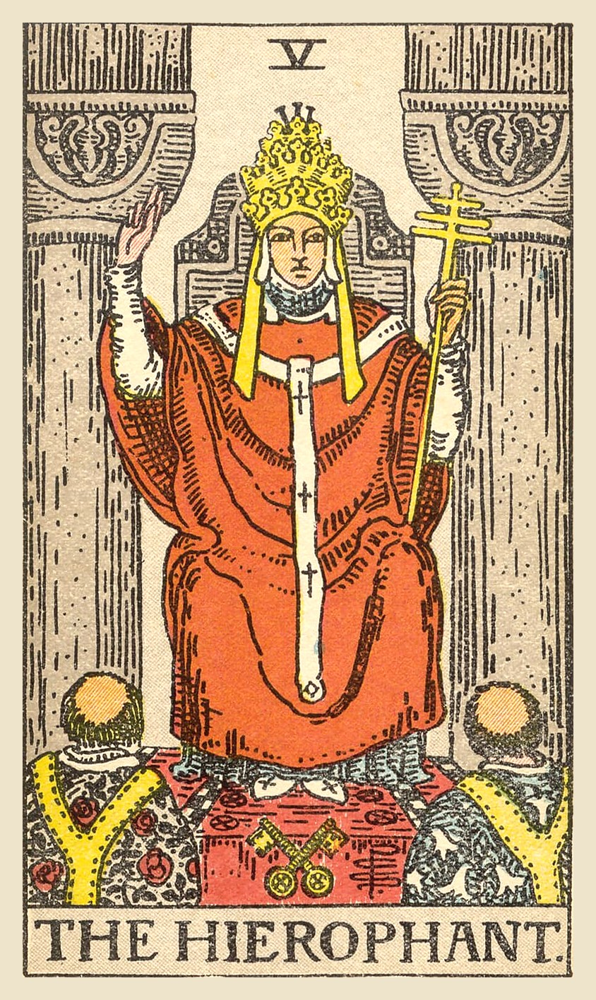

**Upright:** *tradition, teaching, belief, community, guidance*  
Learn from tradition and trusted teachers. Shared wisdom and community can guide you.

**Reversed:** *rebellion, questioning, nonconformity, dogma, personal path*  
An old rule no longer fits. Question it, and find the path that's truly yours.

**Yes/No:** Yes · **Element:** Earth · **Astrology:** Taurus

### Upright meaning
The Hierophant sits between two pillars, raising a hand in blessing over two students at his feet. He represents tradition and the wisdom passed from teacher to student: religion, education, mentors, rituals and community values. When this card appears, there may be value in learning the established way before you change it, or in seeking out someone with experience. It can also point to commitments made within a group, such as ceremonies or memberships. Belonging to something larger than yourself can offer real support and meaning.

### Reversed meaning
Reversed, the Hierophant suggests that a rule, belief or expectation no longer fits who you are. You might be questioning what you were taught, pushing back against a group, or feeling pressure to conform. This isn't automatically rebellion for its own sake: sometimes growth means writing your own rules. The card asks you to examine beliefs honestly. Keep what still rings true, and let go of what you only follow out of habit or fear. It can also warn against rigid thinking, in others or in yourself.

**Love:** Traditional commitment, shared values, or a relationship blessed by family or community.  
**Work:** Mentorship, training and working within established systems. Learn the rules before you break them.  
**Advice:** Seek out a teacher or a tradition that speaks to you.

### Symbolism
- Raised hand in blessing: passing on spiritual knowledge.
- Two students at his feet: learning, and wisdom shared across generations.
- Crossed keys: access to hidden knowledge, and the keys to understanding.
- Triple crown and triple cross: authority over body, mind and spirit.
- Two pillars: the structure of established institutions.

### Reflection
- Which of the beliefs I was raised with still feel true to me?
- Who could I learn from right now?
- Where am I following a rule that no longer serves me?

Waite, 1910

**Upright:** Marriage, alliance, captivity, servitude; by another account, mercy and goodness; inspiration; the man to whom the Querent has recourse.  
**Reversed:** Society, good understanding, concord, overkindness, weakness.

 

---
## The Lovers

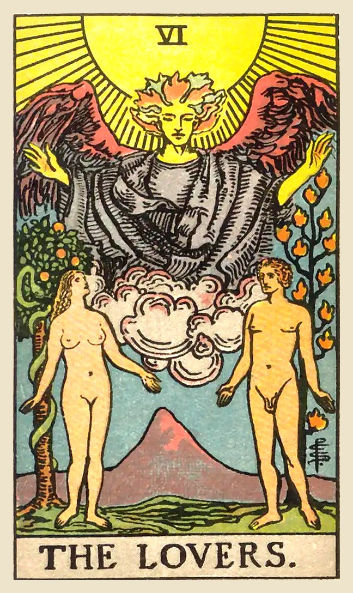

**Upright:** *love, connection, choice, alignment, values*  
Deep connection and an important choice. Choose what truly aligns with your values.

**Reversed:** *disharmony, imbalance, misaligned values, avoidance, temptation*  
Something is out of alignment, in a relationship or within yourself. Be honest about it.

**Yes/No:** Yes · **Element:** Air · **Astrology:** Gemini

### Upright meaning
Under a radiant angel, two figures stand open to each other in a garden. The Lovers is about deep connection, and romance is only one form of it. At its heart, this card is about choice: the decisions that show what you truly value. It may point to a meaningful relationship, a partnership, or a crossroads where you have to choose between two paths. The card asks you to choose with your whole self, heart and mind together. When your actions match your values, relationships and decisions feel right, even when they're hard.

### Reversed meaning
Reversed, the Lovers points to something out of balance. In relationships, it can show poor communication, mismatched values, or one person giving far more than the other. It can also show an inner conflict: you may want one thing but keep choosing another, or avoid a decision because both options feel risky. Temptation can play a role too. The card asks for honesty, with the other person and with yourself. What do you actually value, and are your choices reflecting it?

**Love:** Strong connection, attraction and partnership. A relationship may be ready to deepen.  
**Work:** An important decision or partnership. Choose the option that fits your values, not just the easy one.  
**Advice:** Choose with your heart and your head together.

### Symbolism
- Angel above the couple: blessing, and a higher purpose behind the connection.
- The two figures: openness and vulnerability with each other.
- Tree with a serpent behind her: temptation and the knowledge that comes with choice.
- Tree of flames behind him: passion and desire.
- Mountain between them: the challenges a relationship must climb together.

### Reflection
- What do I truly value in this situation?
- Is there a choice I keep putting off?
- Where are my actions out of step with what I say I want?

Waite, 1910

**Upright:** Attraction, love, beauty, trials overcome.  
**Reversed:** Failure, foolish designs. Another account speaks of marriage frustrated and contrarieties of all kinds.

 

---
## The Chariot

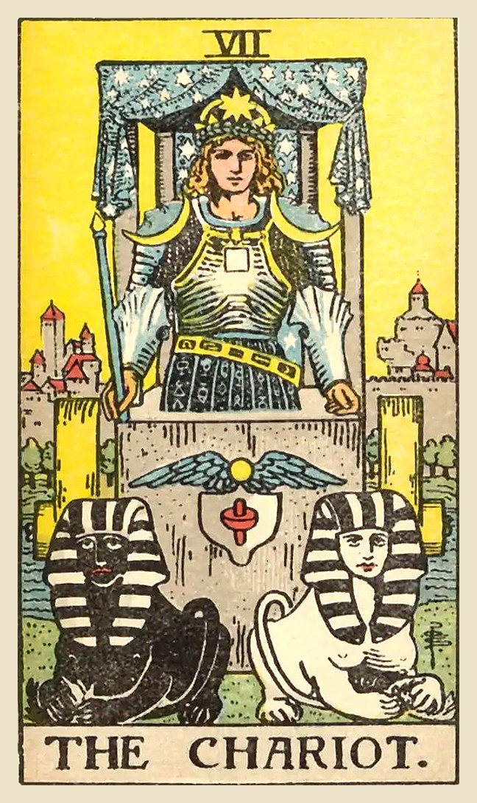

**Upright:** *determination, willpower, victory, direction, self-control*  
Move forward with focus and determination. Steer conflicting forces toward one goal.

**Reversed:** *lack of direction, scattered effort, aggression, losing control, obstacles*  
You're pulled in different directions. Regain control before pushing harder.

**Yes/No:** Yes · **Element:** Water · **Astrology:** Cancer

### Upright meaning
A charioteer stands tall in his chariot, guiding two sphinxes, one black and one white, without any reins. The Chariot is about moving forward through willpower and focus. It often appears when you're facing a challenge that needs commitment: a goal to reach, a test to pass, an obstacle to push through. The two sphinxes show opposite forces, and the card suggests you can steer both in the same direction. Success comes from discipline and confidence, not from force. Keep your eyes on where you're going.

### Reversed meaning
Reversed, the Chariot loses its steering. You may feel stuck, pulled in two directions, or pushing hard without getting anywhere. Sometimes this card shows frustration turning into aggression, or a need to win that has become more important than the goal itself. Pause before you push harder. Ask what you're really aiming for, and whether your energy is pointed at it. It may help to drop one of the things pulling at you, so the rest can move together. Getting clear on direction usually brings the momentum back.

**Love:** Taking charge of a relationship's direction. Pursue what you want with confidence, not pressure.  
**Work:** Drive, ambition and a win within reach. Stay focused and keep going.  
**Advice:** Pick your direction and commit to it.

### Symbolism
- Black and white sphinxes: opposing forces brought under control.
- No reins: control that comes from willpower, not force.
- Starry canopy: guidance from above and a higher purpose.
- City behind him: leaving the familiar to pursue a goal.
- Armor with crescent moons: protection and emotional resilience.

### Reflection
- What goal deserves my full focus right now?
- Which conflicting parts of me need to work together?
- Am I steering, or just pushing?

Waite, 1910

**Upright:** Succour, providence; also war, triumph, presumption, vengeance, trouble.  
**Reversed:** Riot, quarrel, dispute, litigation, defeat.

 

---
## Strength

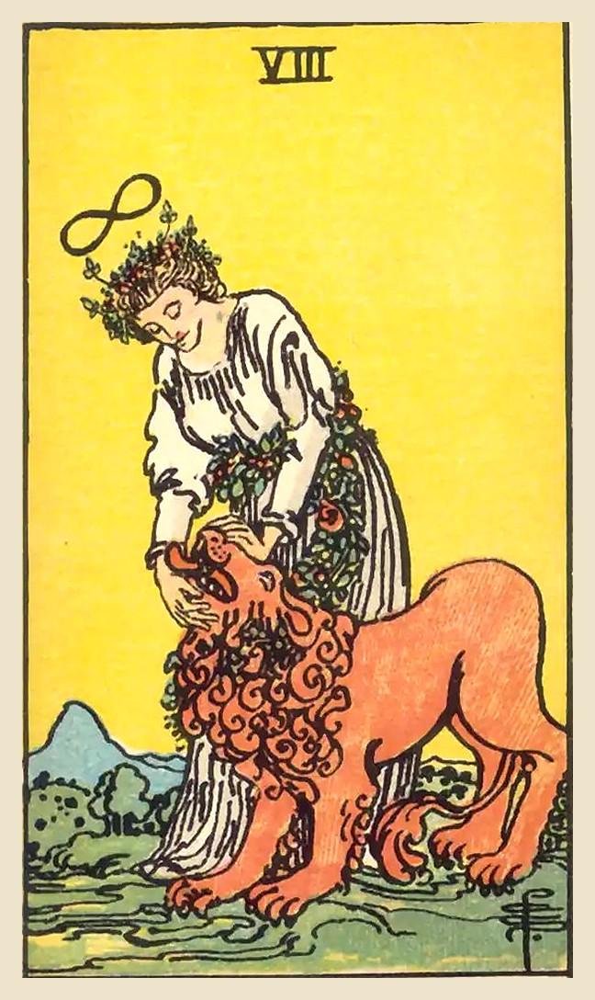

**Upright:** *inner strength, courage, compassion, patience, gentle power*  
True strength is gentle. Meet challenges with patience, courage and compassion.

**Reversed:** *self-doubt, fear, insecurity, low energy, harshness*  
Self-doubt or fear is getting the upper hand. Be kind to yourself and rebuild your confidence.

**Yes/No:** Yes · **Element:** Fire · **Astrology:** Leo

### Upright meaning
A woman calmly closes the mouth of a lion, not with force, but with a gentle touch. Strength is about a quiet kind of power: courage, patience, and the ability to stay calm when emotions run high. The lion can stand for anger, fear, desire or any wild feeling. This card doesn't ask you to fight it, but to befriend it and guide it. It often appears when you're stronger than you realize, or when a situation calls for softness rather than force. Compassion, for yourself and others, is the real source of your strength here.

### Reversed meaning
Reversed, Strength suggests your inner lion feels out of control, or that you've lost touch with your own courage. You may be doubting yourself, feeling drained, or letting fear make decisions. Sometimes it shows frustration coming out sideways, as harshness toward others or yourself. The way back isn't to try harder or be tougher. It's to slow down, take care of your energy, and speak to yourself the way you'd speak to someone you love. Your strength hasn't gone anywhere; it just needs gentleness to return.

**Love:** Patience and kindness strengthen the bond. Handle tension with softness, not force.  
**Work:** Quiet confidence and persistence win out. Lead calmly under pressure.  
**Advice:** Be gentle and brave at the same time.

### Symbolism
- Woman calming the lion: mastering strong feelings through gentleness.
- Infinity sign above her head: endless patience and spiritual strength.
- White robe: a pure heart and good intentions.
- Garland of flowers: beauty and nature as sources of strength.
- Bright yellow sky: optimism and warmth.

### Reflection
- What strong feeling in me needs gentleness instead of a fight?
- Where have I been braver than I give myself credit for?
- How can I be kinder to myself today?

Waite, 1910

**Upright:** Power, energy, action, courage, magnanimity; also complete success and honours.  
**Reversed:** Despotism, abuse of power, weakness, discord, sometimes even disgrace.

 

---
## The Hermit

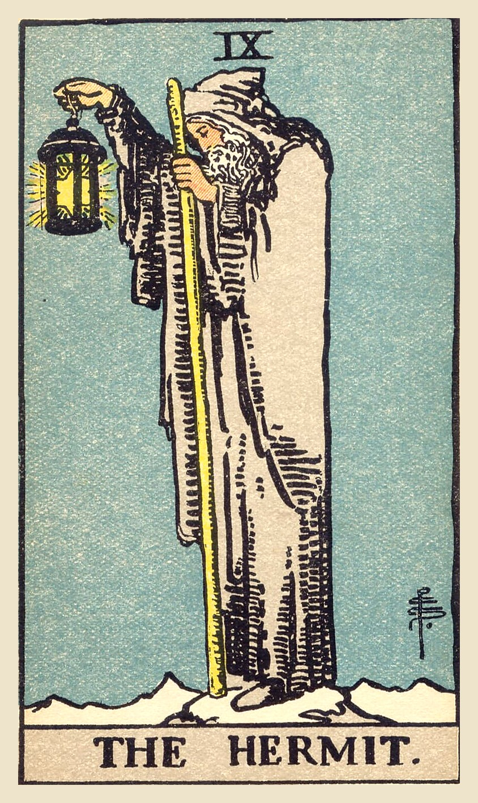

**Upright:** *solitude, reflection, inner guidance, wisdom, searching*  
Step back and look within. Time alone will light the way forward.

**Reversed:** *isolation, loneliness, withdrawal, avoidance, losing your way*  
Solitude has turned into isolation. Reach out, or find your way back to yourself.

**Yes/No:** Maybe · **Element:** Earth · **Astrology:** Virgo

### Upright meaning
An old figure in a grey cloak stands alone on a snowy peak, holding up a lantern with a star inside. The Hermit is about turning inward: taking time away from noise and opinions to figure out what you really think and want. This is a card of reflection, study and spiritual searching. It may appear when you need a break from social life, or when answers will only come through quiet thought. The lantern lights just a few steps ahead, and that's enough. You don't need to see the whole path to keep walking it wisely.

### Reversed meaning
Reversed, the Hermit can show solitude that has tipped into isolation or loneliness. You may be pulling away from people in a way that no longer helps you, or hiding from something you need to face. It can also show the opposite: being so busy and surrounded by others that you never get time alone with your thoughts. Ask what you need right now. If you've been withdrawn, reach out to one person. If you've been constantly busy, carve out some quiet time and check in with yourself.

**Love:** Time apart, or space to understand what you need. A slow, thoughtful approach to love.  
**Work:** Deep focus, study or independent work. Step back to see the bigger picture.  
**Advice:** Take some time alone to think.

### Symbolism
- Lantern with a six-pointed star: inner wisdom lighting the next step.
- Snowy mountain peak: wisdom reached through effort and solitude.
- Grey cloak: humility and withdrawal from the world.
- Staff: patience, support and steady progress.
- Head bowed: looking inward and paying attention.

### Reflection
- What question needs quiet time before I can answer it?
- Am I resting in solitude, or hiding in it?
- What do I know when I tune out other people's opinions?

Waite, 1910

**Upright:** Prudence, circumspection; also and especially treason, dissimulation, roguery, corruption.  
**Reversed:** Concealment, disguise, policy, fear, unreasoned caution.

 

---
## Wheel of Fortune

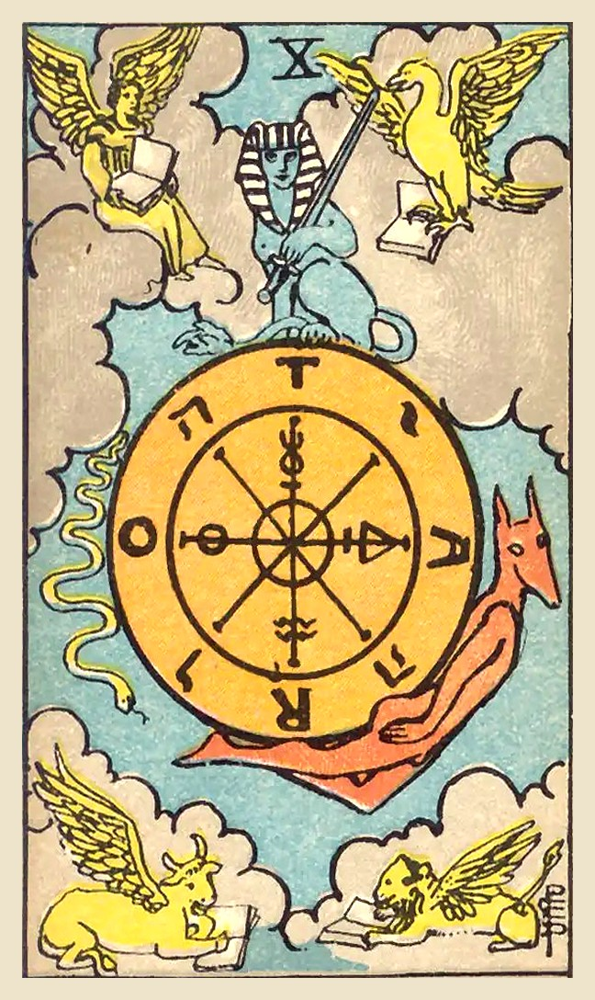

**Upright:** *cycles, change, luck, turning point, fate*  
The wheel is turning. Change is coming, so ride the cycle instead of fighting it.

**Reversed:** *resisting change, bad luck, setbacks, repeating patterns, feeling stuck*  
A rough patch or a pattern on repeat. Look at what you can change, and let go of what you can't.

**Yes/No:** Yes · **Element:** Fire · **Astrology:** Jupiter

### Upright meaning
A great wheel turns in the clouds, with creatures rising and falling around it and a sphinx sitting calmly on top. The Wheel of Fortune is about cycles: nothing stays the same, good times or hard ones. This card often marks a turning point, a stroke of luck, or circumstances shifting in ways you didn't plan. You can't control the wheel, but you can choose how you respond to it. If things are going well, enjoy them and stay grounded. If things are hard, remember the wheel keeps turning. Look for the opportunity hidden in the change.

### Reversed meaning
Reversed, the Wheel can feel like a run of bad luck, or like being stuck in the same pattern again and again. You might be resisting a change that's already happening, or feeling powerless about events outside your control. The card asks two questions: what part of this is truly out of your hands, and what part repeats because of your own choices? Let go of the first. Change the second. Even a stuck wheel starts turning once you stop holding it in place.

**Love:** A turning point or a fated-feeling meeting. Things are shifting; go with the flow.  
**Work:** New opportunities and changes in fortune. Be ready to adapt and take your chance.  
**Advice:** Go with the change instead of fighting it.

### Symbolism
- Turning wheel: the cycles of life, and the fact that nothing stays the same.
- Sphinx on top: calm wisdom that stays balanced while everything moves.
- Snake going down and jackal-headed figure rising: falling and rising fortunes.
- Four winged creatures reading books: stability and learning amid change.
- Letters on the wheel: hidden laws and the order behind change.

### Reflection
- What cycle am I in right now, and what is it teaching me?
- What pattern keeps repeating in my life?
- What change am I resisting that might actually help me?

Waite, 1910

**Upright:** Destiny, fortune, success, elevation, luck, felicity.  
**Reversed:** Increase, abundance, superfluity.

 

---
## Justice

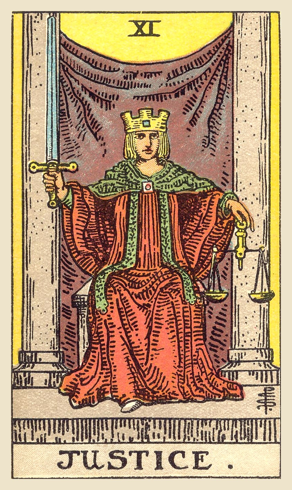

**Upright:** *fairness, truth, accountability, cause and effect, clarity*  
Truth and fairness. Your choices have consequences, so weigh things honestly and act with integrity.

**Reversed:** *unfairness, dishonesty, avoiding responsibility, bias, imbalance*  
Something is unfair or unbalanced. Take honest responsibility for your part.

**Yes/No:** Maybe · **Element:** Air · **Astrology:** Libra

### Upright meaning
Justice sits between two pillars, holding an upright sword in one hand and balanced scales in the other. This card is about truth, fairness and cause and effect: what you put out, you eventually get back. It may appear when you're facing a decision that needs clear, honest thinking, or when the results of past choices are coming in. It can also point to contracts, agreements or legal matters. The card asks you to look at the facts without bias, take responsibility for your part, and choose what you can stand behind.

### Reversed meaning
Reversed, Justice points to something out of balance. You might be treated unfairly, or you might be avoiding responsibility for your own role in a situation. It can show dishonesty, bias, or a decision made on emotion instead of facts. This isn't a call to blame yourself or others, but to get honest. What really happened? What part was yours? Where can you make things right? If you've been wronged, it's fair to ask for accountability. Owning your part, even quietly, is often what restores the balance.

**Love:** Honesty and fairness in a relationship. Balance give and take, and talk openly.  
**Work:** Fair decisions, contracts and accountability. Integrity will be noticed.  
**Advice:** Be honest, even when it's uncomfortable.

### Symbolism
- Upright sword: clear thinking and decisive truth.
- Balanced scales: fairness and weighing each side.
- Two pillars: law, structure and balance.
- Steady, direct gaze: impartiality and seeing things as they are.
- Purple veil behind the figure: wisdom, and truth that can't be hidden.

### Reflection
- What would a fair decision look like here?
- Is there something I need to take responsibility for?
- Where am I letting feelings override the facts?

Waite, 1910

**Upright:** Equity, rightness, probity, executive; triumph of the deserving side in law.  
**Reversed:** Law in all its departments, legal complications, bigotry, bias, excessive severity.

 

---
## The Hanged Man

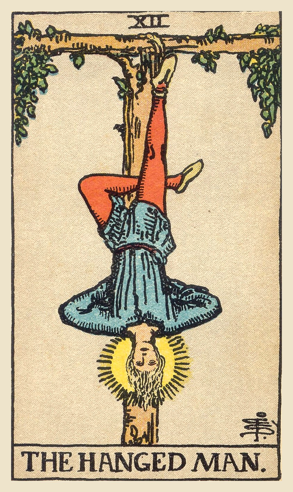

**Upright:** *surrender, pause, new perspective, letting go, waiting*  
Pause and see things from a new angle. Letting go may bring the insight you need.

**Reversed:** *stalling, resistance, indecision, pointless sacrifice, stuck*  
You're stuck in limbo or resisting a needed pause. Decide what to release.

**Yes/No:** Maybe · **Element:** Water · **Astrology:** Neptune (modern); Water (traditional)

### Upright meaning
A man hangs upside down by one foot from a living tree, yet his face is calm and a halo glows around his head. The Hanged Man is about the wisdom of pausing. Sometimes the way forward is to stop pushing, let go of control, and see the situation from a completely different angle. This card can point to a waiting period, a sacrifice made for something more important, or a shift in perspective that changes everything. It may feel uncomfortable, but this suspension has a purpose. Insight often arrives once you stop struggling.

### Reversed meaning
Reversed, the Hanged Man suggests a pause that has gone on too long, or one you keep resisting. You may be stalling on a decision, waiting for a perfect moment that won't come, or making sacrifices that no longer serve anyone. It can also show restlessness: trying to force progress when things genuinely need time. Ask yourself whether you need to let go of something, or simply make a choice and move. Either way, staying in limbo is a choice too.

**Love:** A pause or a shift in how you see the relationship. Let go of expectations to see clearly.  
**Work:** Projects on hold, or a fresh angle on a problem. Don't force it; reframe it.  
**Advice:** Stop pushing and look at it from another angle.

### Symbolism
- Hanging upside down: seeing the world from a completely new perspective.
- Calm face and glowing halo: peace and insight in surrender.
- Living tree: growth, even during a pause.
- Crossed leg and hands behind his back: willing stillness and patience.
- Red and blue clothing: passion and calm wisdom held together.

### Reflection
- What would I see if I looked at this from the opposite side?
- What am I holding onto that I could release?
- Is this pause a gift, or am I stalling?

Waite, 1910

**Upright:** Wisdom, circumspection, discernment, trials, sacrifice, intuition, divination, prophecy.  
**Reversed:** Selfishness, the crowd, body politic.

 

---
## Death

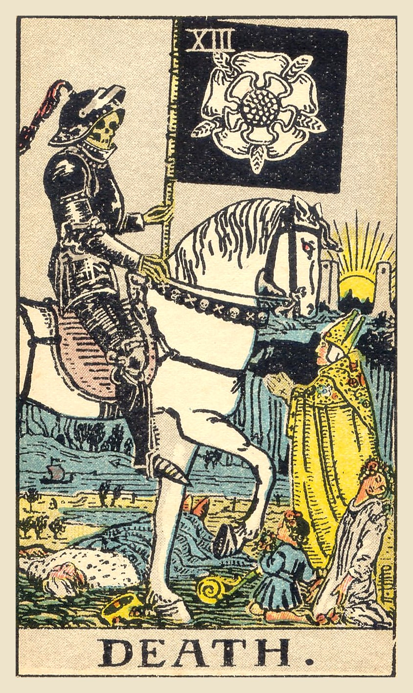

**Upright:** *endings, transformation, transition, release, renewal*  
An ending that makes room for something new. Let go of what's finished so you can move on.

**Reversed:** *resisting change, holding on, stagnation, fear of endings, slow transition*  
You're holding on to something that's already over. Release it, and let the change happen.

**Yes/No:** No · **Element:** Water · **Astrology:** Scorpio

### Upright meaning
Despite its name, the Death card is almost never about physical death. It's about endings and transformation. A skeleton in armor rides a white horse, and everyone, from king to child, meets it in the end. On the horizon, the sun rises between two towers. This card marks the close of a chapter: a relationship, a job, a habit, an old version of you. Endings can be painful, but they also clear space. Something new can only begin once the old has truly ended. Let it go with respect, and look toward the rising sun.

### Reversed meaning
Reversed, Death suggests an ending you're resisting. You might be holding on to a situation, a relationship or an identity that has already run its course, because letting go feels frightening. The change may be happening slowly, dragged out by fear. It's understandable: endings bring grief, even when they're right. The card gently asks what you're keeping alive out of habit or fear. Releasing it doesn't erase what it meant to you. It simply makes room for what comes next, and that may be something good.

**Love:** A relationship transforms or a chapter closes. Make room for a deeper or different kind of love.  
**Work:** A job, role or project ends, opening the way to something new. Embrace the transition.  
**Advice:** Let what's finished be finished.

### Symbolism
- Skeleton in armor: change that comes to everyone and can't be stopped.
- White horse: purity, and transformation as a natural process.
- Black banner with a white rose: beauty and new life within endings.
- King, bishop, maiden and child: no one escapes change, whatever their status.
- Sun rising between two towers: renewal and the dawn after an ending.

### Reflection
- What in my life has already ended, even if I haven't accepted it yet?
- What am I afraid to let go of, and why?
- What could grow in the space an ending leaves?

Waite, 1910

**Upright:** End, mortality, destruction, corruption; also, for a man, the loss of a benefactor; for a woman, many contrarieties; for a maid, failure of marriage projects.  
**Reversed:** Inertia, sleep, lethargy, petrifaction, somnambulism; hope destroyed.

 

---
## Temperance

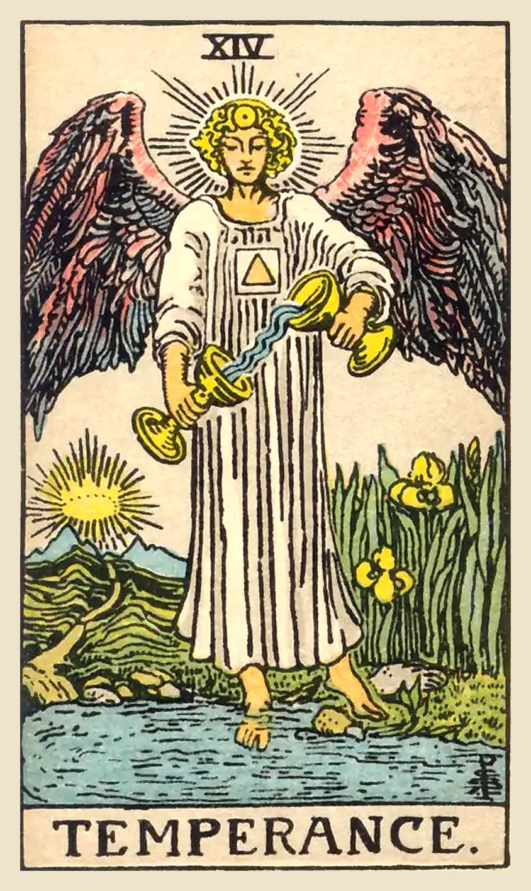

**Upright:** *balance, moderation, patience, healing, harmony*  
Balance and patience. Blend the right ingredients slowly and let healing happen.

**Reversed:** *excess, imbalance, impatience, overdoing, discord*  
Something is out of balance, too much or too little. Find your middle ground again.

**Yes/No:** Yes · **Element:** Fire · **Astrology:** Sagittarius

### Upright meaning
A winged angel stands with one foot on land and one in the water, carefully pouring liquid between two cups. Temperance is about balance, patience and the art of blending opposites into something new. It's a card of healing and moderation: not too much, not too little. It often appears when a situation needs a calm, steady hand rather than a dramatic move. Small adjustments made patiently will bring harmony. The path behind the angel leads toward distant mountains, a reminder that real progress is gradual.

### Reversed meaning
Reversed, Temperance points to imbalance. You may be overdoing something, such as work, spending, partying or worrying, or neglecting something you need. Impatience could be pushing you to rush a process that needs time. Relationships might feel out of sync. The card asks you to notice where the scales have tipped and gently bring them back. Not through a big dramatic fix, but through small, steady changes: an earlier night, a quieter week, one honest talk. Balance is something you practice, not something you achieve once.

**Love:** Harmony, compromise and healing between partners. Go slowly and meet in the middle.  
**Work:** Steady progress, teamwork and balanced effort. Avoid extremes.  
**Advice:** Find the middle way, and be patient.

### Symbolism
- Water poured between two cups: blending opposites and the flow of healing.
- One foot on land and one in water: balancing the practical and the emotional.
- Angel's wings: guidance and spiritual calm.
- Triangle within a square on the robe: spirit grounded in the material world.
- Path leading to the mountains: a long, gradual journey toward a goal.

### Reflection
- Where in my life have I gone to an extreme?
- What two parts of my life need to be blended better?
- What would patience look like here?

Waite, 1910

**Upright:** Economy, moderation, frugality, management, accommodation.  
**Reversed:** Things connected with churches, religions, sects, the priesthood, sometimes even the priest who will marry the Querent; also disunion, unfortunate combinations, competing interests.

 

---
## The Devil

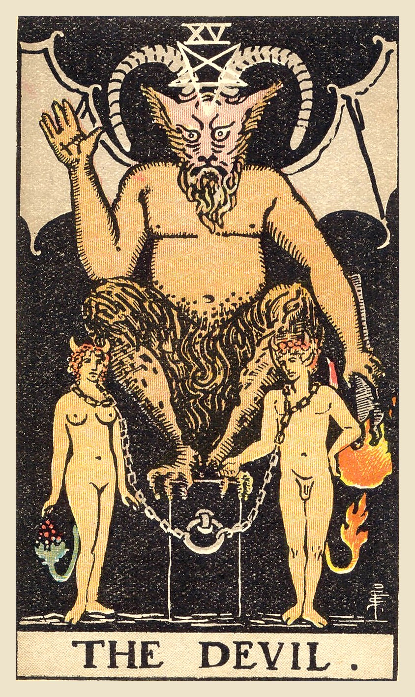

**Upright:** *attachment, temptation, unhealthy patterns, materialism, feeling trapped*  
Something has a hold on you. Name the habit or attachment, and remember the chains are loose.

**Reversed:** *breaking free, release, awareness, reclaiming power, detachment*  
You're breaking free from something that held you back. Keep going.

**Yes/No:** No · **Element:** Earth · **Astrology:** Capricorn

### Upright meaning
A horned figure crouches on a dark pedestal, and two people stand chained below. But look closer: the chains around their necks are loose enough to lift off. The Devil is about the things that hold us without our full consent: habits, addictions, toxic relationships, money worries, or beliefs that keep us small. It isn't about evil. It shows where you've given your power away, often without noticing. Naming what has a hold on you is the first step. Ask honestly what you're getting from it, and what it's costing you.

### Reversed meaning
Reversed, the Devil often shows the moment the chains start to come off. You may be recognizing an unhealthy pattern for what it is, setting a boundary, or walking away from something that drained you. It can be uncomfortable, since what binds us is often familiar. Sometimes the reversal is a warning instead: a pattern you thought you'd escaped is pulling you back in. Either way, the card reminds you that you have more freedom than you think. Keep choosing it, one step at a time.

**Love:** Intense attraction, or a pattern that isn't healthy. Look honestly at what's binding you.  
**Work:** Feeling trapped by money, a job or pressure. Look for the way out you've been overlooking.  
**Advice:** Name what's holding you, then loosen its grip.

### Symbolism
- Loose chains around their necks: the trap is real, but escape is possible.
- Horned figure on a pedestal: the power we hand to our fears and desires.
- Small horns and tails on the couple: becoming like what controls you.
- Inverted pentagram: material concerns placed above spirit.
- Torch pointed downward: energy turned toward its lowest use.

### Reflection
- What habit or pattern has more control over me than I'd like?
- What do I get from it, and what does it cost me?
- What would one small step toward freedom look like?

Waite, 1910

**Upright:** Ravage, violence, vehemence, extraordinary efforts, force, fatality; that which is predestined but is not for this reason evil.  
**Reversed:** Evil fatality, weakness, pettiness, blindness.

 

---
## The Tower

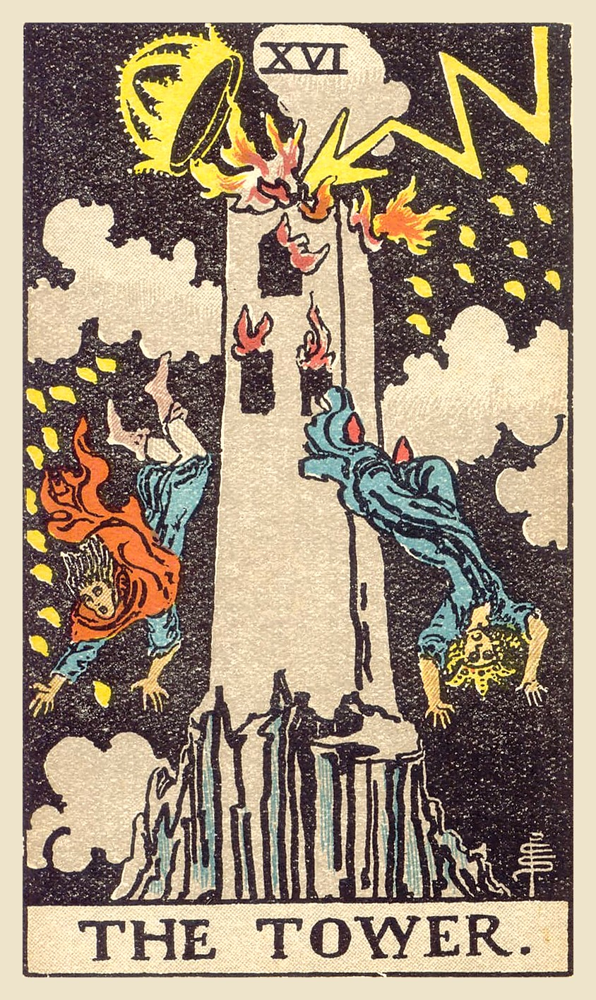

**Upright:** *sudden change, upheaval, revelation, breakdown, awakening*  
Sudden change shakes what was built on shaky ground. It's hard, and it clears the way for truth.

**Reversed:** *avoiding change, delayed upheaval, inner shift, fear of collapse, rebuilding*  
Change you've been avoiding is building up. Face it now, gently, before it forces itself on you.

**Yes/No:** No · **Element:** Fire · **Astrology:** Mars

### Upright meaning
Lightning strikes a tall tower, knocking off its crown, and two figures fall through the dark sky. The Tower is one of the most dramatic cards in the deck. It represents sudden change: a revelation, a shake-up, or the collapse of something built on false foundations. It's rarely comfortable. But the Tower only destroys what wasn't stable to begin with, whether that's a belief, a plan or a situation that was never as solid as it looked. Once the dust settles, you have a clearer view and room to rebuild on truer ground.

### Reversed meaning
Reversed, the Tower can show a change you're trying to hold back, or a crisis that's been postponed rather than resolved. You might sense that something needs to fall apart, but keep propping it up out of fear. It can also show a quieter, inner upheaval: beliefs shifting without any outside drama. Sometimes it means the worst has passed and rebuilding has begun. The card asks you to stop bracing against the inevitable. Choosing change willingly is usually gentler than having it forced on you.

**Love:** A sudden shake-up or revelation. Hard truths can clear the way for something real.  
**Work:** Unexpected change, restructuring or a plan falling through. Adapt, and rebuild more solidly.  
**Advice:** Let what's unstable fall, and build on truth.

### Symbolism
- Lightning bolt: sudden insight or change from outside.
- Crown knocked off: false ideas and ego brought down.
- Falling figures: being forced out of old certainties.
- Tower on a rocky peak: structures built on unstable ground.
- Falling flames: divine sparks, and truth arriving amid chaos.

### Reflection
- What in my life is built on a shaky foundation?
- What truth have I been avoiding?
- What could I rebuild more honestly after this change?

Waite, 1910

**Upright:** Misery, distress, indigence, adversity, calamity, disgrace, deception, ruin. It is a card in particular of unforeseen catastrophe.  
**Reversed:** According to one account, the same in a lesser degree; also oppression, imprisonment, tyranny.

 

---
## The Star

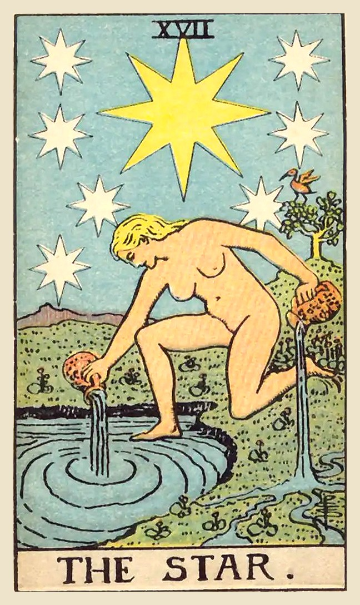

**Upright:** *hope, healing, renewal, inspiration, faith*  
Hope and healing after a hard time. Trust that things can and will get better.

**Reversed:** *discouragement, lost faith, disconnection, despair, self-doubt*  
Hope feels far away right now. Look for one small light and hold on to it.

**Yes/No:** Yes · **Element:** Air · **Astrology:** Aquarius

### Upright meaning
After the storm of the Tower comes the Star. A woman kneels by a pool under a sky full of stars, pouring water onto the land and back into the pool. This is a card of hope, healing and quiet renewal. It often appears after a hard time, reminding you that things can get better and that you're allowed to rest and recover. It also brings inspiration and a renewed sense of purpose. The Star doesn't promise everything will be fixed overnight. It promises that you're on the way, and that the light hasn't gone out.

### Reversed meaning
Reversed, the Star suggests that hope feels far away. You may feel discouraged, disconnected from what used to inspire you, or doubtful that things will improve. This is a very human place to be, especially after a difficult stretch. The card asks you not to give up, but to look for small sources of light: one good conversation, one thing to look forward to, one moment of rest. If the heaviness lasts, reach out for support. Hope often returns through small steps, not big leaps.

**Love:** Healing and renewed hope in love. Open your heart again, gently.  
**Work:** Inspiration returns and the path ahead looks brighter. Follow what gives you purpose.  
**Advice:** Keep hoping, and take care of yourself while you heal.

### Symbolism
- Large eight-pointed star: hope and guidance shining after darkness.
- Water poured onto land and into the pool: renewal flowing to body and spirit.
- Her openness: honesty and vulnerability, nothing left to hide.
- One foot in the water, one on land: balance between feeling and practicality.
- Bird in the tree: thoughts lifting toward higher ideals.

### Reflection
- What gives me hope right now, even a little?
- What do I need in order to heal?
- What inspired me before, and how can I reconnect with it?

Waite, 1910

**Upright:** Loss, theft, privation, abandonment; another reading says—hope and bright prospects.  
**Reversed:** Arrogance, haughtiness, impotence.

 

---
## The Moon

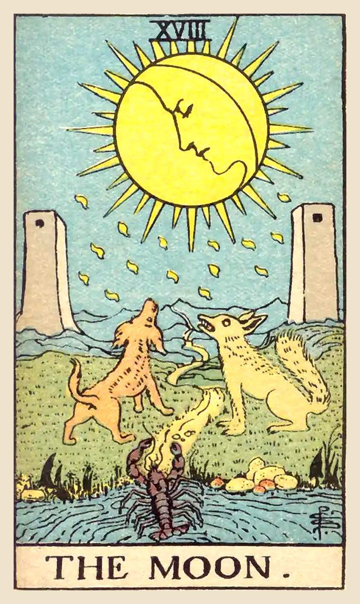

**Upright:** *uncertainty, illusion, intuition, dreams, fear*  
Things aren't fully clear yet. Move carefully, trust your intuition, and question your fears.

**Reversed:** *clarity returning, released fear, truth revealed, confusion, inner turmoil*  
The fog is lifting and the truth is coming out. Let go of fears that no longer fit.

**Yes/No:** Maybe · **Element:** Water · **Astrology:** Pisces

### Upright meaning
A full moon shines over a path that winds between two towers. A dog and a wolf howl at the sky, and a crayfish crawls up from a pool. The Moon is a card of uncertainty: things aren't what they seem, and you can't see the whole picture yet. Fears and imagination can feel louder than facts. It's also the card of dreams and intuition, which can guide you where logic can't. Move forward slowly. Pay attention to your dreams and gut feelings, but double-check your fears before you act on them. Clarity will come.

### Reversed meaning
Reversed, the Moon often shows the fog beginning to clear. A confusing situation may be making more sense, a hidden truth may come to light, or a fear may be losing its grip on you. Sometimes, though, it shows confusion turning inward: anxiety, mixed signals, or being unable to tell what's real. If that feels familiar, ground yourself in the facts you do know and talk things through with someone you trust. The light you're waiting for is closer than it seems.

**Love:** Uncertainty or mixed signals. Don't assume the worst, and don't ignore red flags either.  
**Work:** Unclear information or hidden factors. Get the facts before making big moves.  
**Advice:** Trust your intuition, but check your fears against the facts.

### Symbolism
- Moon with a face: reflected light, intuition and illusion.
- Dog and wolf: the tame and wild sides of our nature.
- Crayfish rising from the pool: fears and feelings emerging from the subconscious.
- Winding path between two towers: a journey through the unknown.
- Falling drops of light: subtle guidance in the dark.

### Reflection
- Which of my fears are facts, and which are stories?
- What is my intuition telling me that logic can't explain?
- What would help me see this situation more clearly?

Waite, 1910

**Upright:** Hidden enemies, danger, calumny, darkness, terror, deception, occult forces, error.  
**Reversed:** Instability, inconstancy, silence, lesser degrees of deception and error.

 

---
## The Sun

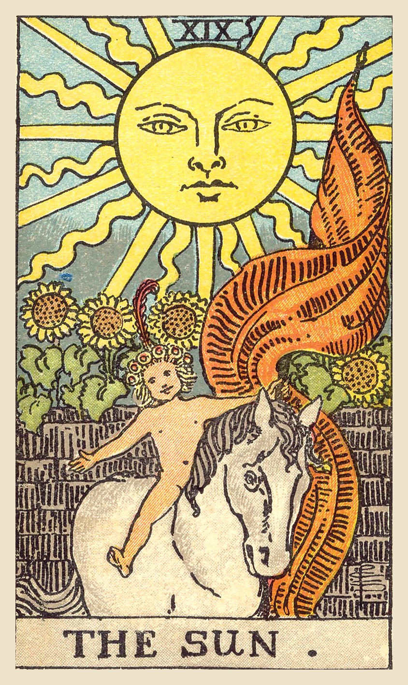

**Upright:** *joy, success, vitality, positivity, warmth*  
Joy, warmth and success. Things are bright, so enjoy it and let yourself shine.

**Reversed:** *dimmed joy, temporary setback, overconfidence, burnout, inner child neglected*  
The sun is still there, just behind a cloud. Reconnect with simple joys.

**Yes/No:** Yes · **Element:** Fire · **Astrology:** The Sun

### Upright meaning
A bright sun beams down on a child riding a white horse, arms spread wide, with sunflowers growing over the wall behind. The Sun is one of the most joyful cards in the deck. It brings warmth, success, energy and a feeling that things are going well. It can mean clarity after confusion, good health and happiness, or simply a season to enjoy life. The child reminds you of the playful, open part of yourself. Let yourself be seen, celebrate what's going right, and share your warmth with others.

### Reversed meaning
Reversed, the Sun's light is dimmed but not gone. You may feel a bit flat, stressed or disconnected from what usually makes you happy. Success might be delayed, or you may be too busy or burnt out to enjoy what you have. Occasionally it warns against overconfidence, assuming things will work out without effort. The card invites you to reconnect with simple pleasures: sunlight, play, laughter, something that makes you feel like a kid again. Joy often comes back when you stop chasing it.

**Love:** Happiness, warmth and openness in love. A joyful, honest connection.  
**Work:** Success, recognition and positive energy. Your work shines.  
**Advice:** Celebrate what's going well and let yourself shine.

### Symbolism
- Radiant sun with a face: life, energy and clarity.
- Child on a white horse: innocence, joy and freedom.
- Sunflowers: growth that turns toward the light.
- Red banner: vitality and celebration.
- Wall behind the child: the safety that lets you play freely.

### Reflection
- What is going well in my life right now?
- When did I last feel playful and free?
- How can I share my warmth with someone today?

Waite, 1910

**Upright:** Material happiness, fortunate marriage, contentment.  
**Reversed:** The same in a lesser sense.

 

---
## Judgement

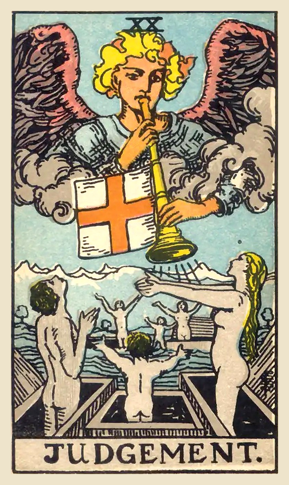

**Upright:** *awakening, reflection, renewal, calling, forgiveness*  
A wake-up call. Reflect on the past, forgive what you can, and answer what's calling you.

**Reversed:** *self-judgment, doubt, ignoring the call, regret, stagnation*  
Harsh self-judgment is holding you back. Learn from the past and let it go.

**Yes/No:** Yes · **Element:** Fire · **Astrology:** Pluto (modern); Fire (traditional)

### Upright meaning
An angel blows a trumpet from the clouds, and people rise up below with open arms. Judgement is a card of awakening: a moment when you see your life clearly and feel called toward something new. It often comes after a long period of growth, asking you to reflect on where you've been, accept it, and step into the next version of yourself. It can also be about forgiveness, of others or of yourself. This isn't about being judged harshly. It's about hearing a call and choosing to rise to meet it.

### Reversed meaning
Reversed, Judgement suggests something is getting in the way of that awakening. You may be judging yourself too harshly, stuck replaying past mistakes, or doubting that you deserve a fresh start. It can also show a calling you keep ignoring because it feels too big or too risky. The card asks you to be fair to your past self: you did what you could with what you knew. Take the lesson, release the guilt, and listen again for what's calling you.

**Love:** Reflection and a fresh start. Old wounds can heal, and a relationship can be reborn.  
**Work:** A calling, a career shift or an important decision. Listen to what truly motivates you.  
**Advice:** Forgive the past and answer the call.

### Symbolism
- Angel's trumpet: a wake-up call, and a message you can't ignore.
- Figures rising with open arms: renewal, and saying yes to a new life.
- Flag with a cross: balance and spiritual transformation.
- Mountains in the distance: the challenges you've already passed.
- Water below: emotional cleansing before a fresh start.

### Reflection
- What is calling me right now?
- What do I need to forgive, in myself or in others?
- What have I learned from my past that I can carry forward?

Waite, 1910

**Upright:** Change of position, renewal, outcome. Another account specifies total loss through lawsuit.  
**Reversed:** Weakness, pusillanimity, simplicity; also deliberation, decision, sentence.

 

---
## The World

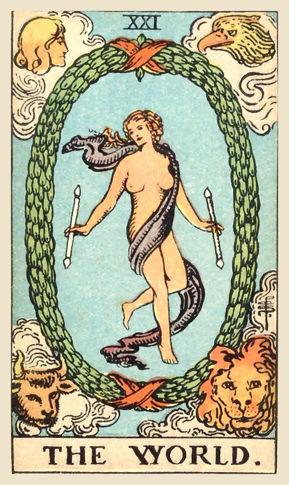

**Upright:** *completion, fulfillment, wholeness, achievement, travel*  
A cycle completes. Celebrate how far you've come before the next journey begins.

**Reversed:** *incompletion, loose ends, delays, lack of closure, shortcuts*  
Almost there, but something is unfinished. Tie up loose ends before moving on.

**Yes/No:** Yes · **Element:** Earth · **Astrology:** Saturn

### Upright meaning
A dancer moves freely inside a large wreath, surrounded at the corners by four winged figures. The World is the final card of the Major Arcana, and it represents completion: a goal reached, a lesson fully learned, a chapter wrapped up with a feeling of wholeness. It can mean graduation, achievement, travel, or simply feeling at home in yourself. Take time to celebrate and to recognize how much you've grown. Every ending in the tarot leads to a new beginning, and the Fool's journey is ready to start again.

### Reversed meaning
Reversed, the World suggests that something isn't quite finished. You may be close to a goal but stalled by loose ends, delays or a lack of closure. Sometimes you might be looking for a shortcut, or moving on before a chapter has really ended. The card asks what still needs your attention. Finish the last steps, have the conversation, wrap things up. It can also ask you to notice progress you've overlooked; you may be closer to the finish than it feels. Completion is satisfying because it's whole, and you're nearly there.

**Love:** Fulfillment and a sense of wholeness together. A relationship reaches a meaningful milestone.  
**Work:** Completion, success and recognition. A project or phase ends well.  
**Advice:** Finish what you started, then celebrate.

### Symbolism
- Dancer in the wreath: freedom, joy and being whole.
- Laurel wreath: victory and successful completion.
- Four creatures in the corners: the four elements in balance.
- Two wands held lightly: mastery and balance between opposites.
- Red ribbons tied in an infinity shape: endless cycles of growth.

### Reflection
- What have I completed that I haven't fully celebrated?
- What loose ends still need tying up?
- What new journey am I ready for?

Waite, 1910

**Upright:** Assured success, recompense, voyage, route, emigration, flight, change of place.  
**Reversed:** Inertia, fixity, stagnation, permanence.

 

---
