# Review: Pentacles

Generated by `tools/build_review.py` from the card files. Edit the YAML files, not this page.

## Ace of Pentacles

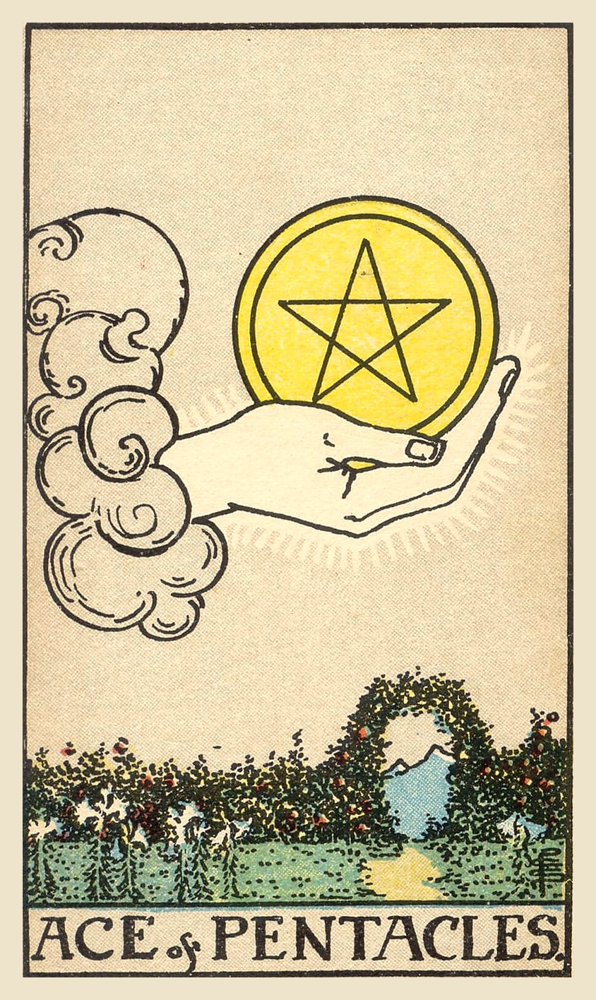

**Upright:** *new opportunity, prosperity, manifestation, solid start, abundance*  
A real-world opportunity, like money, work or health. Plant the seed and it can grow.

**Reversed:** *missed opportunity, poor planning, financial worry, lack of foresight, shaky foundations*  
An opportunity may slip by or rest on shaky ground. Plan carefully before you invest.

**Yes/No:** Yes · **Element:** Earth · **Astrology:** Root of the powers of Earth

### Upright meaning
A hand reaches from a cloud holding a large golden pentacle above a lush garden. An archway in the hedge opens onto a path toward distant mountains. The Ace of Pentacles is the start of something tangible: a job offer, a financial opportunity, a new home, a fresh start for your health, or a practical project. It's a seed with real potential, but it needs tending to grow. The card encourages you to take the opportunity seriously, make a practical plan and commit to it. Small, steady steps can build something lasting.

### Reversed meaning
Reversed, the Ace of Pentacles suggests an opportunity may not be what it seems, or that you might miss it through hesitation or poor planning. It can point to money worries, a deal falling through, or a plan built on weak foundations. The card asks you to look carefully at the practical details before committing time or money. It can also be a nudge to get your basics in order: budget, health, routines. Strong roots make the next opportunity much easier to catch when it arrives.

**Love:** A relationship with real, practical potential. Build something stable together.  
**Work:** A job offer, a raise or a promising venture. Make a concrete plan.  
**Advice:** Plant the seed, then tend it.

### Symbolism
- Hand holding a golden pentacle: a tangible gift or opportunity.
- Lush garden: fertile ground for growth.
- Archway in the hedge: a doorway to new possibilities.
- Path to the mountains: a long-term journey toward success.

### Reflection
- What practical opportunity is in front of me?
- What would help this seed grow?
- Are my foundations strong enough for what I want to build?

Waite, 1910

**Upright:** Perfect contentment, felicity, ecstasy; also speedy intelligence; gold.  
**Reversed:** The evil side of wealth, bad intelligence; also great riches. In any case it shows prosperity, comfortable material conditions, but whether these are of advantage to the possessor will depend on whether the card is reversed or not.

 

---
## Two of Pentacles

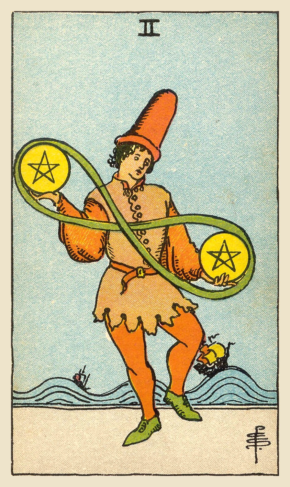

**Upright:** *juggling priorities, adaptability, balance, multitasking, flexibility*  
You're juggling a lot and keeping it together. Stay flexible and keep your rhythm.

**Reversed:** *stretched thin, dropping the ball, disorganization, overcommitted, financial strain*  
Too many balls in the air. Prioritize before something drops.

**Yes/No:** Maybe · **Element:** Earth · **Astrology:** Jupiter in Capricorn

### Upright meaning
A young man in a tall hat dances while juggling two pentacles, joined by a ribbon that loops like an infinity sign. Behind him, ships ride high waves. The Two of Pentacles is about juggling: work and home, money and time, competing priorities. Life is moving and you're keeping up, with some grace and even some fun. The card encourages you to stay flexible and light on your feet. Keep an eye on the balance, adjust as things shift, and don't forget to enjoy the dance.

### Reversed meaning
Reversed, the Two of Pentacles suggests the juggling act is slipping. You may be overcommitted, disorganized, or stretched thin with money, time or energy. Small things are starting to fall through the cracks. The card asks you to stop and look at everything you're carrying. What really matters? What can wait, be shared, or be dropped on purpose? Choosing what to let go of is much easier than having things fall by accident. A simpler plan can bring your rhythm back.

**Love:** Balancing a relationship with busy lives. Make time for each other.  
**Work:** Multitasking and shifting priorities. Stay organized and adaptable.  
**Advice:** Stay flexible, and keep your balance.

### Symbolism
- Juggling two pentacles: balancing competing demands.
- Infinity-shaped ribbon: the endless flow of give and take.
- Dancing pose: handling challenges with lightness.
- Ships on high waves: life's ups and downs going on around you.
- Tall hat: playfulness and confidence.

### Reflection
- What am I juggling right now?
- What could I set down to keep my balance?
- How can I bring more lightness to a busy time?

Waite, 1910

**Upright:** On the one hand it is represented as a card of gaiety, recreation and its connections, which is the subject of the design; but it is read also as news and messages in writing, as obstacles, agitation, trouble, embroilment.  
**Reversed:** Enforced gaiety, simulated enjoyment, literal sense, handwriting, composition, letters of exchange.

 

---
## Three of Pentacles

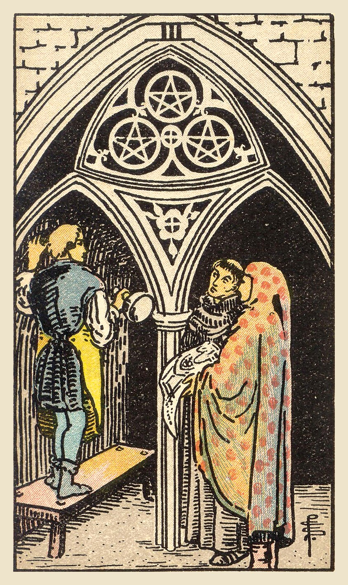

**Upright:** *teamwork, collaboration, skill, building together, recognition of work*  
Good work happens together. Combine your skills with others to build something lasting.

**Reversed:** *poor teamwork, misalignment, working alone, lack of effort, unclear roles*  
The team isn't working well. Clarify roles, listen, and recommit to the shared goal.

**Yes/No:** Yes · **Element:** Earth · **Astrology:** Mars in Capricorn

### Upright meaning
A stonemason stands on a bench, carving an archway in a cathedral, while a monk and a person holding building plans watch and discuss the work. Three pentacles are carved into the arch above. The Three of Pentacles is about collaboration and skill. Great things get built when people with different talents work together and respect each other's expertise. It can point to teamwork, learning from mentors, or having your skill recognized. The card encourages you to share ideas, ask for input and take pride in good work.

### Reversed meaning
Reversed, the Three of Pentacles points to problems in teamwork. People may be pulling in different directions, roles may be unclear, or someone may not be pulling their weight. It can also show you trying to do everything alone, or not getting the recognition your work deserves. The card asks you to improve communication: clarify who does what, listen to other perspectives, and agree on the goal. Sometimes it also asks you to raise the quality of your own effort. Solid work builds trust.

**Love:** Building a relationship as a team. Respect each other's strengths.  
**Work:** Collaboration, apprenticeship or skilled work. Your expertise is valued.  
**Advice:** Build it together.

### Symbolism
- Stonemason at work: skill and craftsmanship.
- Monk and person with plans: different roles working toward one goal.
- Cathedral archway: building something meaningful and lasting.
- Three pentacles in the arch: shared effort turned into structure.

### Reflection
- Who could I collaborate with on something important?
- What skill of mine deserves more recognition, from me or others?
- Is everyone on my team clear about their role?

Waite, 1910

**Upright:** Métier, trade, skilled labour; usually, however, regarded as a card of nobility, aristocracy, renown, glory.  
**Reversed:** Mediocrity, in work and otherwise, puerility, pettiness, weakness.

 

---
## Four of Pentacles

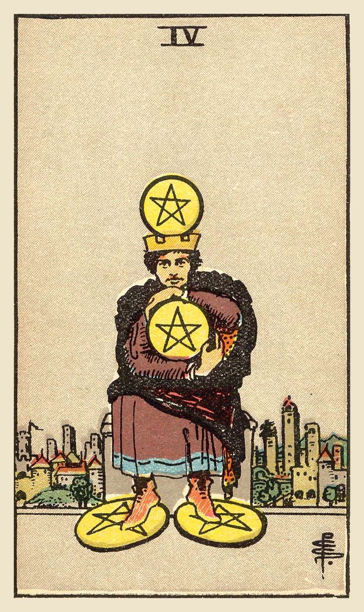

**Upright:** *saving, security, control, possessiveness, holding on tightly*  
You're holding on tightly for security. Make sure caution hasn't turned into fear.

**Reversed:** *openhandedness, letting go of control, overspending, financial insecurity, loosening up*  
Your grip is loosening, toward generosity or toward overspending. Find the balance.

**Yes/No:** Maybe · **Element:** Earth · **Astrology:** Sun in Capricorn

### Upright meaning
A crowned man sits outside a city, clutching one pentacle to his chest, with another balanced on his crown and two more under his feet. The Four of Pentacles is about security and control. Saving money, protecting your resources and being careful can be wise. But this figure is holding on so tightly that he can't move or reach out. The card asks whether your caution is serving you or trapping you. Security matters, and so do generosity, flexibility and trust.

### Reversed meaning
Reversed, the Four of Pentacles can show a loosening grip. You might be letting go of the need for control, becoming more generous, or learning to trust that you'll be okay. It can also show the opposite extreme: overspending, financial instability, or letting go of things you actually need. The card asks you to find a healthy middle ground between holding on and letting go. Money, possessions and control are tools. They're meant to support your life, not run it, and a balanced hand can both give and keep.

**Love:** Possessiveness or fear of losing someone. Trust grows when you loosen your grip.  
**Work:** Financial caution and protecting what you've built. Don't let fear stop growth.  
**Advice:** Hold on to what matters, but loosen your grip.

### Symbolism
- Pentacle clutched to his chest: holding tightly to what he has.
- Pentacle on his crown: thoughts dominated by money or security.
- Pentacles under his feet: standing on material foundations.
- City behind him: separation from others in order to protect his wealth.

### Reflection
- What am I holding on to out of fear?
- Is my caution protecting me or limiting me?
- Where could I be a little more generous?

Waite, 1910

**Upright:** The surety of possessions, cleaving to that which one has, gift, legacy, inheritance.  
**Reversed:** Suspense, delay, opposition.

 

---
## Five of Pentacles

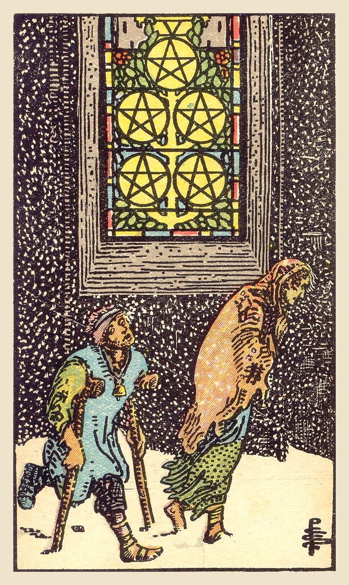

**Upright:** *hardship, financial loss, feeling left out, worry, hard times*  
A hard time, with money, health or belonging. Help is closer than it seems; look for the light.

**Reversed:** *getting back on your feet, help arriving, improvement, accepting support, end of hardship*  
The worst is passing. Accept help and let things improve.

**Yes/No:** No · **Element:** Earth · **Astrology:** Mercury in Taurus

### Upright meaning
Two figures struggle through the snow, one on crutches and both wrapped in thin, worn clothes. They pass a church window glowing with light, without looking up. The Five of Pentacles is about hardship: money troubles, health worries, job loss or feeling shut out. It can bring a sense of being left out in the cold. The card doesn't pretend this is easy. But notice the lit window: help and warmth may be closer than you think. Reach out, and let people in.

### Reversed meaning
Reversed, the Five of Pentacles suggests a hard time is beginning to ease. You might be getting back on your feet financially, recovering from illness, or finding the support you needed. It can mean finally accepting help after trying to struggle through alone. Sometimes it shows a lingering sense of lack even after things have improved. The card encourages you to notice the progress you've made and keep reaching for support. You don't have to stay out in the snow, and asking for help is a strength.

**Love:** Feeling left out or unsupported. Ask for what you need, and let others help.  
**Work:** Financial strain or job worries. Look for support and resources.  
**Advice:** Look up, and ask for help.

### Symbolism
- Figures in the snow: hardship, cold and struggle.
- Crutches and bandages: illness or injury.
- Lit church window: help and shelter close at hand.
- Five pentacles in the window: resources that aren't being seen.

### Reflection
- Where am I struggling right now?
- What help might be available that I haven't noticed?
- Who could I reach out to?

Waite, 1910

**Upright:** The card foretells material trouble above all, whether in the form illustrated—that is, destitution—or otherwise. For some cartomancists, it is a card of love and lovers—wife, husband, friend, mistress; also concordance, affinities. These alternatives cannot be harmonized.  
**Reversed:** Disorder, chaos, ruin, discord, profligacy.

 

---
## Six of Pentacles

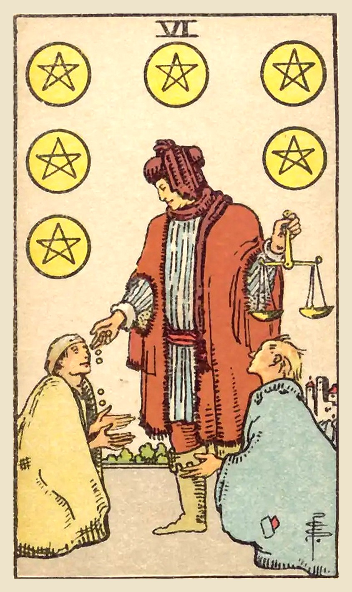

**Upright:** *generosity, giving and receiving, charity, sharing wealth, fairness*  
Give and receive with an open hand. Generosity flows both ways.

**Reversed:** *strings attached, debt, one-sided giving, power imbalance, selfishness*  
Giving comes with strings, or the exchange feels unequal. Check the balance of power.

**Yes/No:** Yes · **Element:** Earth · **Astrology:** Moon in Taurus

### Upright meaning
A well-dressed merchant holds a pair of balanced scales in one hand and gives coins to a kneeling person with the other, while another person waits. The Six of Pentacles is about generosity and the flow of resources: giving, receiving and sharing. You may be in a position to help someone, or you may be on the receiving end of support. Both are part of life. The card encourages fairness and kindness, and reminds you that accepting help is just as important as offering it.

### Reversed meaning
Reversed, the Six of Pentacles suggests the exchange has become unbalanced. Help might come with strings attached, generosity might be used to control, or one person might always be giving while the other always takes. It can also point to debt or financial dependence. The card asks you to look at the power behind the giving. Is it truly generous, and is it fair? Healthy giving leaves both people with their dignity. Set boundaries where you need them, and give freely where you can.

**Love:** Balanced give and take. Make sure both partners feel supported.  
**Work:** Fair pay, mentorship or sharing resources. Be generous, and be fair.  
**Advice:** Give freely, and let yourself receive.

### Symbolism
- Merchant giving coins: generosity and sharing resources.
- Balanced scales: fairness in giving.
- Kneeling figures: those in need, and the humility of receiving.
- One hand gives, one holds the scales: kindness guided by fairness.

### Reflection
- Where can I be generous right now?
- Am I comfortable receiving help?
- Is any giving in my life coming with strings attached?

Waite, 1910

**Upright:** Presents, gifts, gratification; another account says attention, vigilance; now is the accepted time, present prosperity, etc.  
**Reversed:** Desire, cupidity, envy, jealousy, illusion.

 

---
## Seven of Pentacles

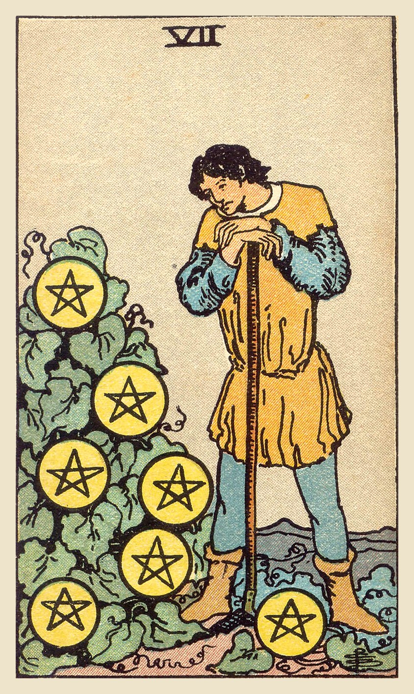

**Upright:** *patience, long-term investment, assessing progress, slow growth, perseverance*  
Growth is slow but real. Pause, assess your progress and keep tending your garden.

**Reversed:** *frustration with slow results, poor returns, wasted effort, rethinking investments, giving up too soon*  
Effort isn't paying off yet. Decide whether to wait, change course or let it go.

**Yes/No:** Maybe · **Element:** Earth · **Astrology:** Saturn in Taurus

### Upright meaning
A farmer leans on his hoe, looking thoughtfully at seven pentacles growing on a leafy bush. He has put in the work; now he's waiting for the harvest. The Seven of Pentacles is about patience and long-term effort. Results may not be visible yet, but growth is happening. It's a good time to step back, review your progress, and decide where to focus next. The card encourages you to keep going. Meaningful things, whether careers, savings, skills or relationships, take time to grow.

### Reversed meaning
Reversed, the Seven of Pentacles can show frustration with slow progress. You might feel like your hard work isn't paying off, or be tempted to give up just before things take root. It can also point to putting energy into something that genuinely isn't growing. The card asks for an honest review. Is this worth more patience, or is it time to change your approach or invest elsewhere? Either answer is fine. What matters is choosing on purpose, rather than out of impatience or habit.

**Love:** A relationship that's growing slowly. Be patient, and keep investing in it.  
**Work:** Long-term projects and investments. Review progress, and stay the course.  
**Advice:** Be patient with what you're growing.

### Symbolism
- Farmer leaning on a hoe: pausing to assess the work.
- Pentacles growing on a bush: results that take time to ripen.
- Thoughtful expression: reflection and evaluation.
- Pentacle at his feet: the investment already made.

### Reflection
- What am I growing that needs more patience?
- Is my effort going to the right places?
- What progress have I overlooked?

Waite, 1910

**Upright:** These are exceedingly contradictory; in the main, it is a card of money, business, barter; but one reading gives altercation, quarrel—and another innocence, ingenuity, purgation.  
**Reversed:** Cause for anxiety regarding money which it may be proposed to lend.

 

---
## Eight of Pentacles

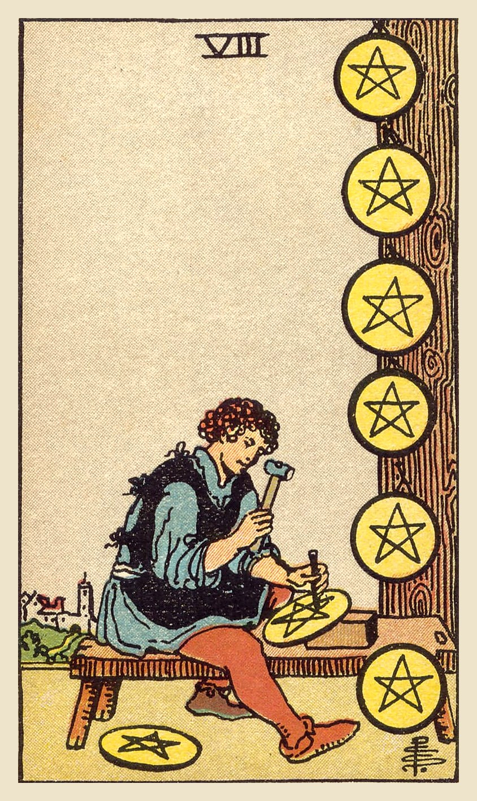

**Upright:** *craftsmanship, dedication, mastery, practice, attention to detail*  
Steady practice builds mastery. Focus on your craft, one careful piece at a time.

**Reversed:** *perfectionism, lack of focus, repetitive work, cutting corners, uninspired*  
The work feels repetitive, rushed or never good enough. Reconnect with why you started.

**Yes/No:** Yes · **Element:** Earth · **Astrology:** Sun in Virgo

### Upright meaning
A craftsman sits at his bench, carefully carving a pentacle, while finished ones hang on a post beside him. A town sits in the distance, far from his concentration. The Eight of Pentacles is about dedication and skill. It's the card of practice, study and steady improvement: doing the work, again and again, until you're good at it. It can point to training, an apprenticeship, or a period of focused effort. The card encourages you to take pride in the process. Mastery is built one careful piece at a time.

### Reversed meaning
Reversed, the Eight of Pentacles can show that the work has lost its meaning. It may feel repetitive and boring, or you may be rushing and cutting corners. It can also point to perfectionism, where nothing ever feels good enough to finish. The card asks you to reconnect with why you started. What did you love about this skill? Maybe you need a new challenge, a rest, or permission to be good enough rather than perfect. Quality comes from care, and care is easier when the work still matters to you.

**Love:** Putting real effort into a relationship. Small, consistent care builds trust.  
**Work:** Skill-building, training or focused work. Your effort is paying off.  
**Advice:** Keep practicing; mastery takes time.

### Symbolism
- Craftsman carving a pentacle: focus and skilled work.
- Finished pentacles on display: progress made through repetition.
- Town in the distance: setting distractions aside to focus.
- Workbench: dedication to a craft.

### Reflection
- What skill am I building right now?
- Do I take pride in the process, or only the result?
- Where am I cutting corners or chasing perfection?

Waite, 1910

**Upright:** Work, employment, commission, craftsmanship, skill in craft and business, perhaps in the preparatory stage.  
**Reversed:** Voided ambition, vanity, cupidity, exaction, usury. It may also signify the possession of skill, in the sense of the ingenious mind turned to cunning and intrigue.

 

---
## Nine of Pentacles

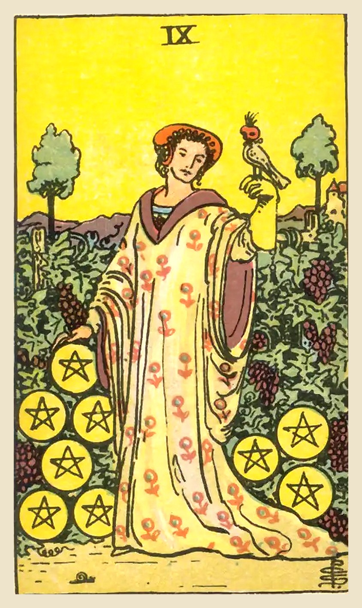

**Upright:** *self-sufficiency, luxury, independence, enjoying rewards, refinement*  
You've earned this. Enjoy the comfort and independence your hard work has built.

**Reversed:** *overworking, dependence, superficial success, financial setback, hollow comfort*  
Success that feels hollow or shaky. Check whether your comfort rests on solid ground.

**Yes/No:** Yes · **Element:** Earth · **Astrology:** Venus in Virgo

### Upright meaning
An elegant woman stands alone in a rich vineyard, a falcon resting on her gloved hand and nine pentacles around her. A snail crawls at her feet. The Nine of Pentacles is about independence and enjoying the rewards of your effort. It can point to financial security, a comfortable home, or simply a sense of self-sufficiency and confidence. You've worked for this, and you're allowed to enjoy it. The card encourages you to appreciate the life you've built and treat yourself with care.

### Reversed meaning
Reversed, the Nine of Pentacles suggests something is off with comfort and independence. You might be overworking to keep up appearances, relying on someone else more than you'd like, or finding that success doesn't feel as good as you expected. It can also point to a financial setback. The card asks you to look beneath the surface. What would real security and independence look like for you? Build toward that, rather than toward how things look from the outside. Real comfort feels peaceful, not anxious.

**Love:** Feeling secure and whole on your own, or a relationship between two independent people.  
**Work:** Financial independence and the rewards of hard work. Enjoy your success.  
**Advice:** Enjoy what you've built.

### Symbolism
- Woman alone in the vineyard: independence and self-sufficiency.
- Falcon on her glove: discipline and control of the mind.
- Grapevines heavy with fruit: abundance and the rewards of effort.
- Snail at her feet: slow, steady progress that led here.
- Fine robe: refinement and self-care.

### Reflection
- What have I built that I'm proud of?
- How can I enjoy my rewards without guilt?
- What does true independence mean to me?

Waite, 1910

**Upright:** Prudence, safety, success, accomplishment, certitude, discernment.  
**Reversed:** Roguery, deception, voided project, bad faith.

 

---
## Ten of Pentacles

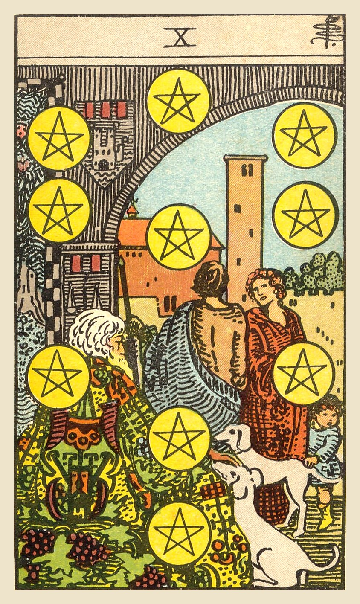

**Upright:** *legacy, family wealth, long-term security, tradition, belonging*  
Lasting security and family legacy. What you build now can support generations.

**Reversed:** *family conflict, financial loss, broken traditions, short-term thinking, inheritance disputes*  
Family or money matters feel unsettled. Look at what you truly want to pass on.

**Yes/No:** Yes · **Element:** Earth · **Astrology:** Mercury in Virgo

### Upright meaning
Under a stone archway, an old man in a richly patterned robe sits with two dogs, while a couple and a child stand nearby and ten pentacles hang in the air around them. The Ten of Pentacles is about lasting wealth and legacy: family, home, traditions and security that extend across generations. It can point to inheritance, property, a family business or simply the feeling of belonging to something bigger and older than yourself. The card encourages you to think long term and invest in what will last.

### Reversed meaning
Reversed, the Ten of Pentacles suggests trouble around family, money or legacy. There might be disagreements over inheritance, financial instability, or pressure to follow family traditions that don't fit you. It can also show short-term thinking that puts long-term security at risk. The card asks what you truly want to build and pass on. Legacy isn't only about money. It's also values, kindness and the way you treat the people around you, and those are always yours to give, whatever your circumstances.

**Love:** Long-term commitment, family and building a shared future.  
**Work:** Stable, long-term success, family business or financial security.  
**Advice:** Build something that lasts.

### Symbolism
- Old man with dogs: wisdom, loyalty and the elder generation.
- Couple and child: family continuing through time.
- Ten pentacles in a tree-of-life pattern: wealth woven into the structure of life.
- Archway into the estate: a secure home and an established place in the world.

### Reflection
- What do I want to leave behind for others?
- What traditions in my family do I want to keep, or change?
- How can I invest in long-term security?

Waite, 1910

**Upright:** Gain, riches; family matters, archives, extraction, the abode of a family.  
**Reversed:** Chance, fatality, loss, robbery, games of hazard; sometimes gift, dowry, pension.

 

---
## King of Pentacles

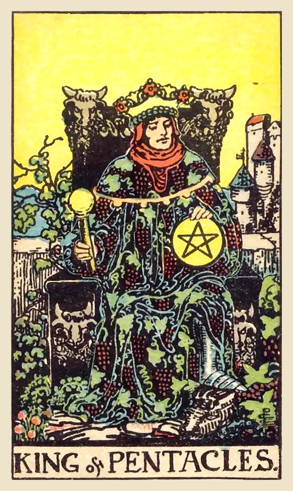

**Upright:** *abundance, security, business success, discipline, providing for others*  
Hard-earned success and security. Use your resources wisely and generously.

**Reversed:** *greed, materialism, stubbornness, poor financial decisions, status obsession*  
Money or status has taken over. Remember what your success is for.

**Yes/No:** Yes · **Element:** Air of Earth · **Astrology:** Late Aries to mid Taurus

### Upright meaning
A king sits on a throne decorated with bull heads, wearing a robe covered in grapevines, with a castle behind him. He holds a pentacle in one hand and a scepter in the other, perfectly at ease. The King of Pentacles represents success built through discipline and hard work: financial security, a thriving business, the ability to provide for others. He may represent a reliable, successful person in your life, or your own capacity to create stability. The card encourages you to manage resources wisely and enjoy what you've built.

### Reversed meaning
Reversed, the King of Pentacles suggests a troubled relationship with money or success. It can show greed, stubbornness, or putting status and possessions above people. It may also point to poor financial decisions or a fear of losing control. The card asks you to remember what your resources are for: security, freedom, and taking care of the people and things you love. Wealth used generously creates real abundance, while wealth hoarded tends to isolate. Ask whether your success is giving you more freedom, or less.

**Love:** A stable, generous, committed partner. Building security together.  
**Work:** Business success, leadership and financial stability. Lead with integrity.  
**Advice:** Build wisely, and share generously.

### Symbolism
- Bull heads on the throne: determination, strength and Taurus energy.
- Robe of grapevines: abundance and the fruits of hard work.
- Castle behind him: an established, secure life.
- Pentacle and scepter: wealth and the power to use it.

### Reflection
- What have I built through steady effort?
- Am I using my resources wisely and generously?
- What does true security mean to me?

Waite, 1910

**Upright:** Valour, intelligence, business, mathematical gifts, and success in these paths.  
**Reversed:** Vice, weakness, perversity, peril.

 

---
## Knight of Pentacles

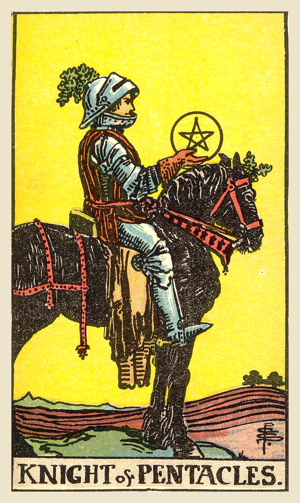

**Upright:** *reliability, hard work, routine, steady progress, responsibility*  
Slow and steady wins. Stay reliable, follow your routine and keep going.

**Reversed:** *boredom, being stuck in a rut, laziness, stubbornness, perfectionism*  
Routine has become a rut. Shake things up without losing your reliability.

**Yes/No:** Yes · **Element:** Fire of Earth · **Astrology:** Late Leo to mid Virgo

### Upright meaning
A knight sits on a heavy black horse that stands perfectly still in a plowed field, holding up a pentacle and looking at it calmly. Unlike the other knights, he's not rushing anywhere. The Knight of Pentacles is about steady, reliable effort: showing up, doing the work and keeping your commitments. It may point to a dependable person, or ask you to be one. The card encourages patience and consistency. Progress may be slow, but it's solid, and it will get you exactly where you need to go.

### Reversed meaning
Reversed, the Knight of Pentacles suggests steadiness has turned into stagnation or stubbornness. You might be stuck in a rut, bored with your routine, or resisting change because the familiar feels safe. It can also show the opposite: losing focus, being careless, or not following through. The card asks you to bring some fresh energy into your routine while keeping your reliability. Small changes can make steady work feel meaningful again. Consistency is valuable; inflexibility isn't. Try one new approach this week and see what it changes.

**Love:** A reliable, committed partner. Show love through consistency.  
**Work:** Steady work, routine and responsibility. Keep going; it's paying off.  
**Advice:** Be steady and dependable.

### Symbolism
- Horse standing still: patience, caution and stability.
- Pentacle held up: focus on practical goals.
- Plowed field: hard work and preparation.
- Heavy armor: endurance and protection.

### Reflection
- Where in my life does consistency matter most?
- Is my routine helping me or keeping me stuck?
- What small change could make my daily work feel fresh?

Waite, 1910

**Upright:** Utility, serviceableness, interest, responsibility, rectitude—all on the normal and external plane.  
**Reversed:** Inertia, idleness, repose of that kind, stagnation; also placidity, discouragement, carelessness.

 

---
## Page of Pentacles

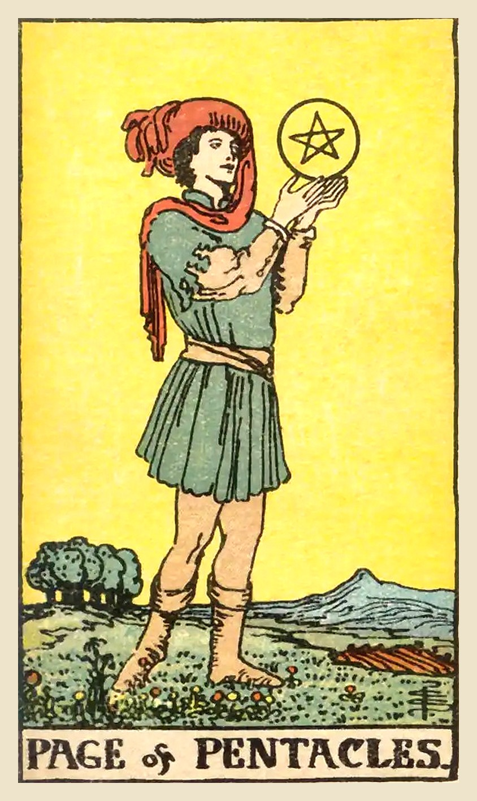

**Upright:** *studiousness, new skills, ambition, practical beginnings, diligence*  
A diligent student. Learn something practical and take the first steps toward a goal.

**Reversed:** *procrastination, lack of progress, unrealistic goals, missed lessons, laziness*  
Big plans, little progress. Make your goal concrete and start small.

**Yes/No:** Yes · **Element:** Earth of Earth · **Astrology:** 

### Upright meaning
A young figure stands in a green field, holding up a pentacle and studying it closely, with freshly plowed earth and trees nearby. The Page of Pentacles is about practical beginnings: learning a new skill, starting a course, a new job, or the first steps toward a financial goal. It's steady and focused rather than flashy. It may represent a diligent, grounded person in your life. The card encourages you to commit to learning and to take the slow, practical steps that turn dreams into reality.

### Reversed meaning
Reversed, the Page of Pentacles suggests a plan that isn't getting off the ground. You might be procrastinating, unsure where to start, or dreaming about goals without making a plan. It can also show a lack of follow-through, or learning that never gets applied. The card asks you to make your goals concrete and manageable. What is one small, practical step you can take today? Progress, even slow progress, builds confidence, and confidence makes the next step easier. Start where you are.

**Love:** A slow, steady, sincere start. Show your feelings through reliable actions.  
**Work:** A new job, training or practical goal. Be diligent and keep learning.  
**Advice:** Learn something practical, and start small.

### Symbolism
- Pentacle held up and studied: focus on a goal or opportunity.
- Green field: fertile ground for growth.
- Plowed earth: preparation and hard work ahead.
- Slow, careful stance: a patient approach.

### Reflection
- What practical skill do I want to learn?
- What concrete step would move my goal forward?
- Where am I dreaming instead of doing?

Waite, 1910

**Upright:** Application, study, scholarship, reflection; another reading says news, messages and the bringer thereof; also rule, management.  
**Reversed:** Prodigality, dissipation, liberality, luxury, unfavourable news.

 

---
## Queen of Pentacles

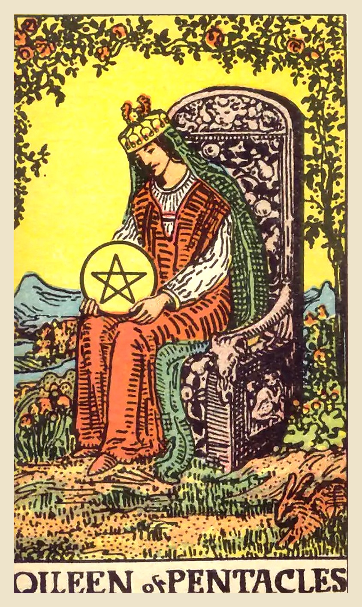

**Upright:** *nurturing, practicality, comfort, generosity, down-to-earth*  
Practical care and a warm home. Nurture others and yourself with grounded wisdom.

**Reversed:** *overwhelmed caregiver, neglecting self, smothering, work-life imbalance, material focus*  
You're caring for everyone except yourself. Rebalance work, home and rest.

**Yes/No:** Yes · **Element:** Water of Earth · **Astrology:** Late Sagittarius to mid Capricorn

### Upright meaning
A queen sits on a throne carved with goat heads and fruit, in a lush garden under an arch of roses. She holds a pentacle in her lap and looks at it lovingly. A rabbit sits in the corner. The Queen of Pentacles combines warmth with practicality. She creates comfort, manages resources wisely and takes care of people in very real ways. She may represent a nurturing, down-to-earth person, or your own ability to look after body, home and finances. The card encourages grounded care for yourself and others.

### Reversed meaning
Reversed, the Queen of Pentacles suggests care is out of balance. You might be looking after everyone else while neglecting yourself, or feeling overwhelmed by work and home responsibilities. It can also show smothering, or caring too much about appearances and material things. The card asks you to bring the nurturing back to yourself. Rest, eat well, ask for help, and let some things be good enough. You can only keep caring for others if you're cared for too. Let someone return the favor.

**Love:** A warm, nurturing, stable relationship. Show love through care and comfort.  
**Work:** Practical, generous leadership, or balancing work and home well.  
**Advice:** Take care of yourself as well as you care for others.

### Symbolism
- Pentacle held lovingly in her lap: valuing and nurturing resources.
- Lush garden and roses: abundance, comfort and beauty.
- Rabbit: fertility and a connection to nature.
- Goat heads on the throne: practicality and hard-won stability.

### Reflection
- How am I taking care of my body and home?
- Am I giving care that I also need to receive?
- Where could I create more comfort in my life?

Waite, 1910

**Upright:** Opulence, generosity, magnificence, security, liberty.  
**Reversed:** Evil, suspicion, suspense, fear, mistrust.

 

---
