# Review: Swords

Generated by `tools/build_review.py` from the card files. Edit the YAML files, not this page.

## Ace of Swords

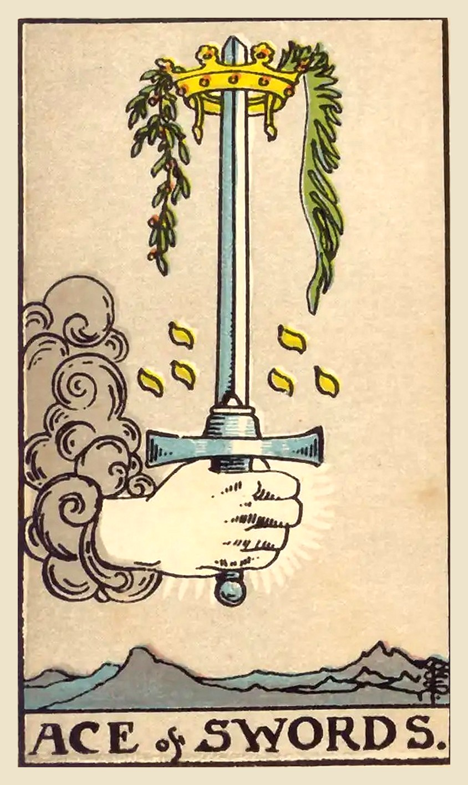

**Upright:** *clarity, breakthrough, truth, new idea, sharp focus*  
A breakthrough moment. Clear thinking cuts through confusion and the truth comes out.

**Reversed:** *confusion, mental fog, misused words, harsh truth, false starts*  
Thoughts are cloudy or words are cutting the wrong way. Pause before you speak or decide.

**Yes/No:** Yes · **Element:** Air · **Astrology:** Root of the powers of Air

### Upright meaning
A hand emerges from a cloud gripping an upright sword, its tip crowned and hung with an olive branch and a palm. The Ace of Swords is the start of mental clarity: a breakthrough idea, a moment when the truth becomes obvious, or the courage to say what needs to be said. Swords cut, and this one cuts through confusion and excuses. It's a good time for honest conversations, decisions, study and planning. Trust what you now see clearly, and use your words with both honesty and care.

### Reversed meaning
Reversed, the Ace of Swords suggests that clarity hasn't arrived yet, or that it's being misused. You might feel mentally foggy, overwhelmed by information, or unable to decide. It can also show harsh words, a truth delivered without kindness, or an idea launched before it was thought through. The card asks you to slow down. Gather the facts, separate what you know from what you fear, and wait until your mind is clear before acting. Clarity will come if you give it room.

**Love:** An honest conversation clears the air. Say what you mean, kindly.  
**Work:** A breakthrough idea or a clear decision. Great for planning, study and pitching.  
**Advice:** Seek the truth and say it clearly.

### Symbolism
- Hand from a cloud: a gift of insight.
- Upright sword: truth, clarity and a decisive mind.
- Crown on the tip: victory through clear thinking.
- Olive branch and palm: peace and success that come from the truth.
- Rugged mountains below: challenges seen clearly from above.

### Reflection
- What truth have I been avoiding?
- What decision would become easier with a clear head?
- How can I say something honest with kindness?

Waite, 1910

**Upright:** Triumph, the excessive degree in everything, conquest, triumph of force. It is a card of great force, in love as well as in hatred. The crown may carry a much higher significance than comes usually within the sphere of fortune-telling.  
**Reversed:** The same, but the results are disastrous; another account says—conception—childbirth, augmentation, multiplicity.

 

---
## Two of Swords

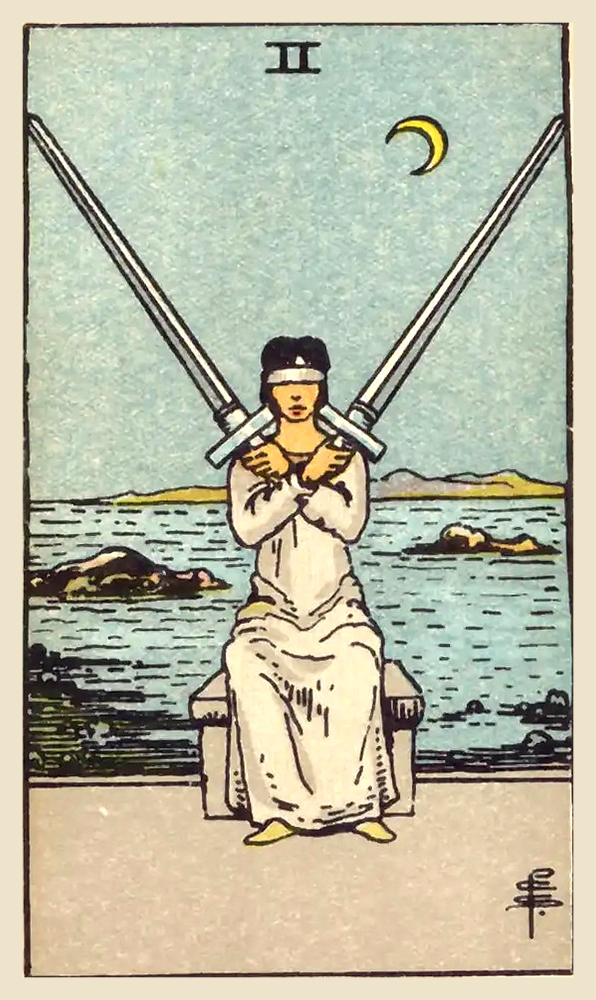

**Upright:** *indecision, stalemate, difficult choice, denial, guarded heart*  
You're stuck between two options and avoiding the choice. Take the blindfold off.

**Reversed:** *information revealed, decision made, overwhelm, lesser of two evils, relief*  
The stalemate is breaking. New information helps you finally choose.

**Yes/No:** Maybe · **Element:** Air · **Astrology:** Moon in Libra

### Upright meaning
A blindfolded woman sits by the sea at night, arms crossed over her chest, balancing a sword on each shoulder. The Two of Swords is about a choice you're avoiding. You may be torn between two options, stuck in a stalemate, or keeping your heart guarded so you don't have to feel anything. The calm pose hides tension: staying balanced like this takes a lot of energy. The card asks you to remove the blindfold. Gather information, listen to your feelings, and accept that not choosing is also a choice.

### Reversed meaning
Reversed, the Two of Swords suggests the stalemate is ending. New information might make the choice obvious, or you may simply be too tired to keep avoiding it. It can also show overwhelm: so many conflicting opinions that you can't think straight. Sometimes it points to choosing the lesser of two evils. Whatever's happening, the card encourages you to trust yourself, make the decision you can live with, and put the swords down. Relief usually follows once the choice is made.

**Love:** Indecision or emotional walls. Lower your guard and be honest about how you feel.  
**Work:** A tough decision or a deadlock. Get the facts you need, then decide.  
**Advice:** Take off the blindfold and make the choice.

### Symbolism
- Blindfold: refusing to see, or deciding without all the facts.
- Crossed arms and swords: a guarded heart and a defensive stance.
- Sea and rocks behind her: emotions and obstacles she can't see.
- Crescent moon: intuition, available if she listens.

### Reflection
- What choice am I avoiding?
- What would I see if I took the blindfold off?
- What is keeping my heart guarded?

Waite, 1910

**Upright:** Conformity and the equipoise which it suggests, courage, friendship, concord in a state of arms; another reading gives tenderness, affection, intimacy. The suggestion of harmony and other favourable readings must be considered in a qualified manner, as Swords generally are not symbolical of beneficent forces in human affairs.  
**Reversed:** Imposture, falsehood, duplicity, disloyalty.

 

---
## Three of Swords

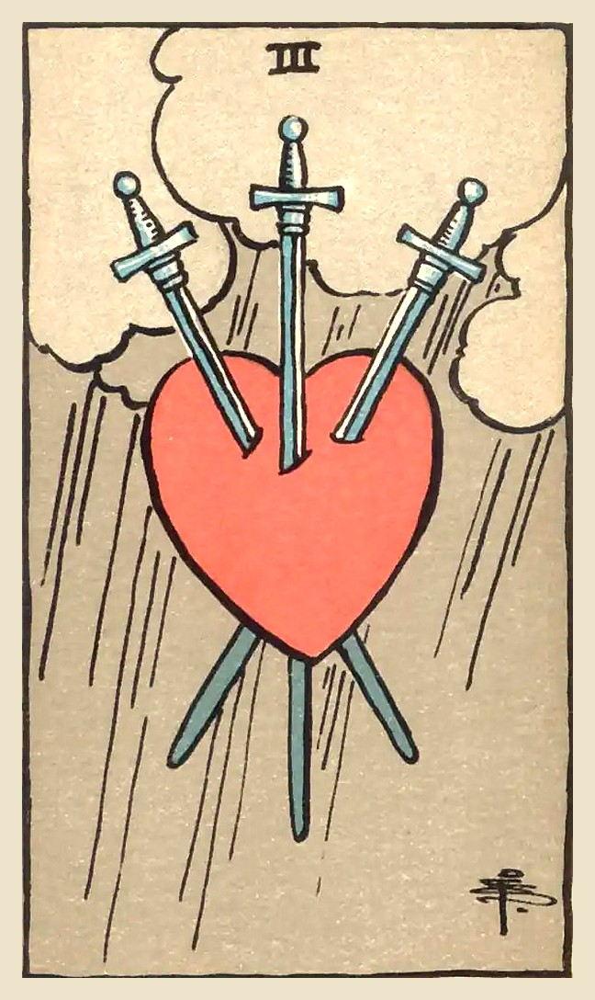

**Upright:** *heartbreak, grief, painful truth, sorrow, release*  
A painful truth or loss. It hurts, and naming the hurt is the first step to healing.

**Reversed:** *recovery, forgiveness, lingering hurt, suppressed grief, letting go*  
Healing has begun, or pain is being pushed down. Let it move through you.

**Yes/No:** No · **Element:** Air · **Astrology:** Saturn in Libra

### Upright meaning
Few cards are as direct as this one: a heart, three swords and rain. The Three of Swords speaks of grief, disappointment, or words that cut, whether they came from someone else or from your own inner critic. It doesn't mean you've done something wrong, and it isn't a prediction of disaster. It simply acknowledges that something hurts, and that pretending otherwise won't help. Like the storm behind the heart, this kind of pain passes through. Let yourself feel it, talk about it, and be gentle with yourself while it does.

### Reversed meaning
Reversed, this card often points to the time after the storm. The swords are loosening: you may be starting to forgive, to understand what happened, or simply to feel lighter. It can also show grief that's been bottled up, a hurt you keep insisting you're "fine" about. If that sounds familiar, the card asks you to find a safe place to let it out, whether that's a friend, a journal or a professional. Healing isn't a straight line, and feeling better one day and worse the next is part of it.

**Love:** Heartbreak, a painful discovery or a hard conversation. Honesty now makes room for real healing.  
**Work:** Disappointment, criticism or a setback. One sharp comment isn't the final verdict on you.  
**Advice:** Let it hurt, then let it go. Talk to someone you trust.

### Symbolism
- Heart: emotions and the core of who you are.
- Three swords: thoughts, words or truths that wound. Three can also point to three people involved.
- Storm clouds and rain: sorrow, but also cleansing. Storms pass.
- No people in the scene: a private pain, felt inside.

### Reflection
- What hurt am I carrying that I haven't said out loud?
- Are any of these painful words coming from my own inner critic?
- What would help me feel even a little lighter today?

Waite, 1910

**Upright:** Removal, absence, delay, division, rupture, dispersion, and all that the design signifies naturally, being too simple and obvious to call for specific enumeration.  
**Reversed:** Mental alienation, error, loss, distraction, disorder, confusion.

 

---
## Four of Swords

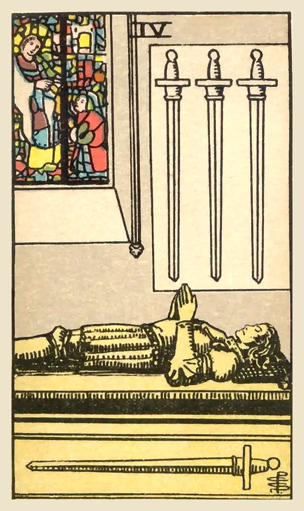

**Upright:** *rest, recovery, retreat, contemplation, recharging*  
Time to rest and recover. Step back and recharge before the next challenge.

**Reversed:** *burnout, restlessness, forced rest, returning to action, inertia*  
You're running on empty, or ready to get back up. Listen to what your body needs.

**Yes/No:** Maybe · **Element:** Air · **Astrology:** Jupiter in Libra

### Upright meaning
A knight lies still on a tomb, hands together in prayer, with three swords hanging on the wall above and one lying beside him. A stained-glass window glows behind. Despite the somber setting, the Four of Swords is about rest, not death. After stress or conflict, you need time to recover: sleep, quiet, a break from problem-solving. This card gives you permission to step back. Rest isn't laziness. It's what lets your mind heal and gather strength for what comes next.

### Reversed meaning
Reversed, the Four of Swords suggests rest is out of balance. You might be pushing through exhaustion and heading toward burnout, or feeling too restless to switch off. Sometimes it shows rest being forced on you, through illness or circumstances, because you wouldn't take it voluntarily. It can also mean a period of retreat is ending and you're ready to return to the world. Ask honestly what you need right now. If it's rest, take it before your body decides for you.

**Love:** Taking space to recover, or a quiet, restful phase in a relationship.  
**Work:** Time for a break, a vacation or a slower pace. Recharge before the next push.  
**Advice:** Rest. You've earned it, and you need it.

### Symbolism
- Knight lying on a tomb: deep rest and stillness, not death.
- Hands in prayer: peace, reflection and spiritual renewal.
- Three swords on the wall: problems set aside for now.
- One sword beside him: the one issue still close at hand.
- Stained-glass window: sanctuary and calm.

### Reflection
- When did I last truly rest?
- What could I set aside, just for now?
- What is my body or mind asking me for?

Waite, 1910

**Upright:** Vigilance, retreat, solitude, hermit's repose, exile, tomb and coffin. It is these last that have suggested the design.  
**Reversed:** Wise administration, circumspection, economy, avarice, precaution, testament.

 

---
## Five of Swords

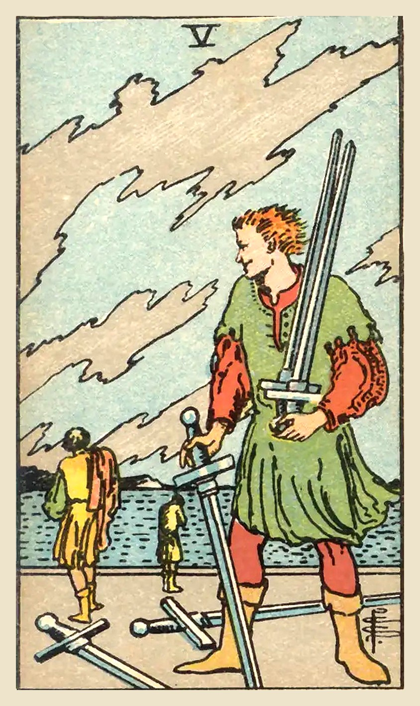

**Upright:** *conflict, hollow victory, winning at all costs, tension, defeat*  
A conflict where winning costs too much. Ask whether this fight is worth it.

**Reversed:** *reconciliation, moving past conflict, regret, making amends, walking away*  
The conflict is cooling. Time to make peace, or walk away with your dignity.

**Yes/No:** No · **Element:** Air · **Astrology:** Venus in Aquarius

### Upright meaning
A man smirks as he gathers swords from the ground, while two defeated figures walk away toward the water. Jagged clouds race across the sky. The Five of Swords is about conflict, and especially about victories that leave everyone worse off. You might be in an argument where being right matters more than the relationship, or facing someone who plays dirty. The card asks you to consider the cost. Sometimes the wisest move is to drop the fight, choose your battles, or accept that you can't win this one.

### Reversed meaning
Reversed, the Five of Swords suggests tension is starting to ease. You might be ready to apologize, make amends or simply let go of a grudge. It can also show regret over something said or done in the heat of the moment. Sometimes it means walking away from a conflict you can't resolve, which can be a strong choice rather than a defeat. The card encourages honest repair where it's possible, and peaceful distance where it's not. Pride is a heavy thing to carry.

**Love:** Arguments, power struggles or hurtful words. Ask whether winning matters more than connecting.  
**Work:** Office politics, competition or conflict. Choose your battles carefully.  
**Advice:** Don't win the fight and lose what matters.

### Symbolism
- Smirking figure gathering swords: victory gained at someone else's expense.
- Two figures walking away: defeat, hurt and disconnection.
- Swords on the ground: weapons dropped and battles lost.
- Jagged clouds: tension and unsettled feelings.
- Water in the distance: emotions and the need to move on.

### Reflection
- Is this conflict worth what it's costing me?
- Do I need to apologize to someone?
- When is walking away the stronger choice?

Waite, 1910

**Upright:** Degradation, destruction, revocation, infamy, dishonour, loss, with the variants and analogues of these.  
**Reversed:** The same; burial and obsequies.

 

---
## Six of Swords

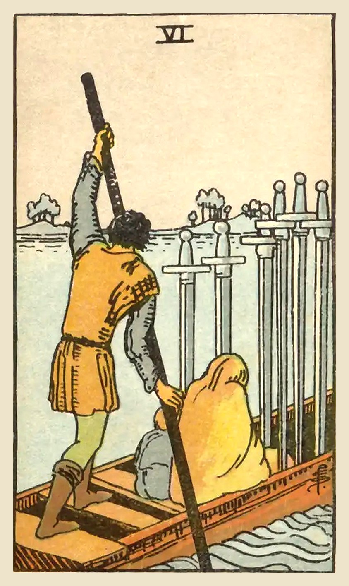

**Upright:** *transition, moving on, calmer waters, travel, leaving difficulty behind*  
You're moving toward calmer waters. The hardest part is behind you.

**Reversed:** *unfinished business, resistance to change, stuck, carrying baggage, rough passage*  
Something is holding you back from moving on. Look at what you're still carrying.

**Yes/No:** Yes · **Element:** Air · **Astrology:** Mercury in Aquarius

### Upright meaning
A ferryman guides a small boat across the water, carrying a woman wrapped in a cloak and a child, with six swords standing upright in the boat. The water near them is rough, but the water ahead is calm. The Six of Swords is about transition: leaving something difficult behind and moving toward a better place. It can point to a move, a journey, or an emotional shift after a painful period. You may still carry some sorrow with you, but you're on your way. Keep going.

### Reversed meaning
Reversed, the Six of Swords suggests the crossing is harder than expected. You might want to move on but feel stuck, or keep turning back toward the shore you left. Sometimes it shows unresolved issues coming along with you, the swords in the boat that you never dealt with. It can also point to a delayed or difficult journey. The card asks what's holding you back. You may need to face an old hurt before you can truly leave it behind, and that's okay. Calm water is still ahead.

**Love:** Moving past a hard time together, or leaving a painful relationship behind.  
**Work:** A transition to a better role or situation. Things are improving.  
**Advice:** Keep moving toward calmer waters.

### Symbolism
- Boat crossing the water: a transition from one place or state to another.
- Ferryman: help and guidance through a hard passage.
- Cloaked woman and child: vulnerability and what we protect.
- Six swords in the boat: troubles that come along on the journey.
- Rough water near, calm water ahead: things are getting better.

### Reflection
- What am I moving away from, and what am I moving toward?
- What am I carrying with me that I could set down?
- Who is helping me through this transition?

Waite, 1910

**Upright:** Journey by water, route, way, envoy, commissionary, expedient.  
**Reversed:** Declaration, confession, publicity; one account says that it is a proposal of love.

 

---
## Seven of Swords

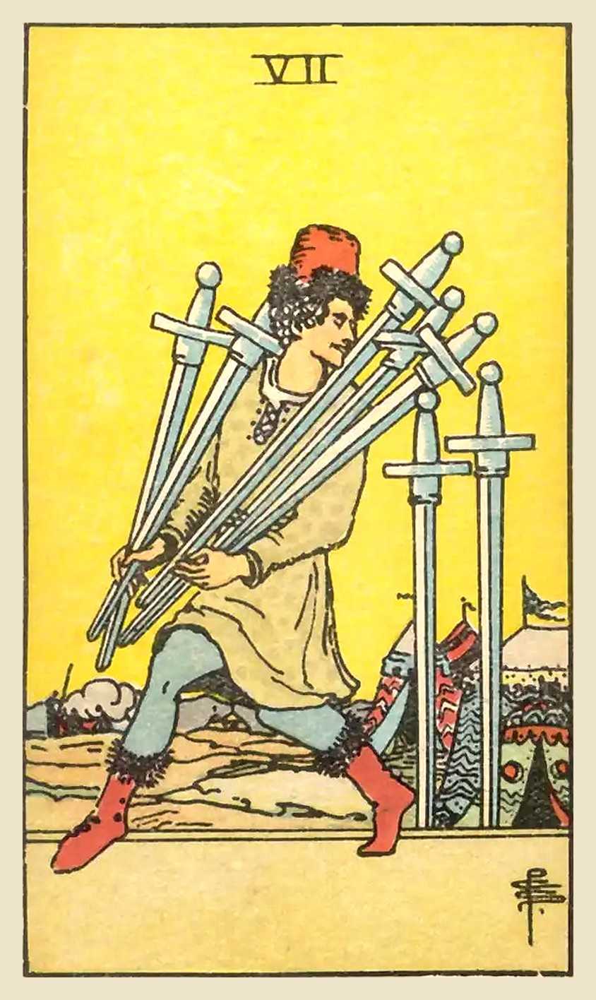

**Upright:** *deception, strategy, secrecy, getting away with something, going it alone*  
Someone is being sneaky, maybe you. Look closely at strategy, honesty and motives.

**Reversed:** *coming clean, getting caught, conscience, self-deception, rethinking a plan*  
Secrets are coming out, or a conscience is speaking up. Honesty is the way forward.

**Yes/No:** No · **Element:** Air · **Astrology:** Moon in Aquarius

### Upright meaning
A man tiptoes away from a camp, carrying five swords and glancing back over his shoulder. Two swords stay stuck in the ground behind him. The Seven of Swords is about secrecy and strategy. Sometimes it points to deception: someone isn't being honest, or you're tempted to cut corners. Other times it's about acting cleverly and independently, finding a way around a problem instead of confronting it head-on. The card asks you to look at motives. Are you being smart, or are you avoiding something you should face openly?

### Reversed meaning
Reversed, the Seven of Swords suggests secrets are surfacing. Someone may be caught out, or you may feel the pull to come clean about something yourself. It can also point to self-deception, telling yourself a story that lets you avoid the truth. Sometimes it shows a plan that isn't working and needs rethinking. The card encourages honesty, even when it's uncomfortable. Owning a mistake now is usually easier than having it discovered later, and it lets you move on with a clear conscience.

**Love:** Secrets, mixed signals or someone not being fully honest. Trust, but verify.  
**Work:** Strategy and working around obstacles. Protect your ideas, and play fair.  
**Advice:** Be clever, but be honest.

### Symbolism
- Man sneaking away with swords: taking what isn't freely given, or acting in secret.
- Glance over his shoulder: fear of being caught.
- Two swords left behind: plans that are incomplete or a job only half done.
- Camp in the distance: the group or authority being avoided.

### Reflection
- Is there something I'm not being honest about?
- Am I avoiding a problem instead of facing it?
- Do I trust the people around me, and do they have reason to trust me?

Waite, 1910

**Upright:** Design, attempt, wish, hope, confidence; also quarrelling, a plan that may fail, annoyance. The design is uncertain in its import, because the significations are widely at variance with each other.  
**Reversed:** Good advice, counsel, instruction, slander, babbling.

 

---
## Eight of Swords

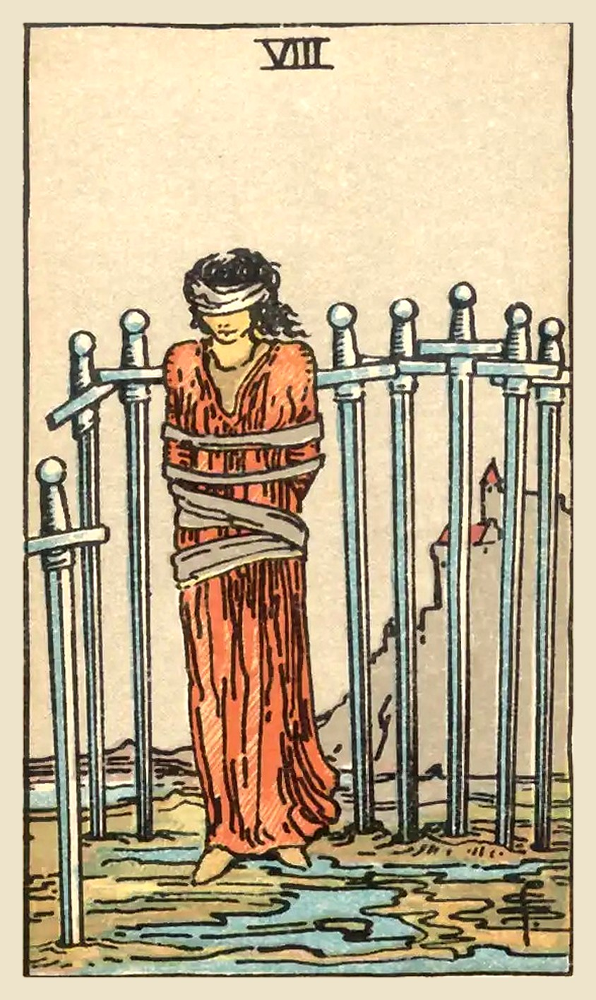

**Upright:** *feeling trapped, self-limiting beliefs, helplessness, restriction, victim mindset*  
You feel trapped, but the bonds are looser than they seem. Your thoughts are the cage.

**Reversed:** *self-acceptance, new perspective, freedom, releasing fear, taking back control*  
You're starting to see a way out. Take off the blindfold and step free.

**Yes/No:** No · **Element:** Air · **Astrology:** Jupiter in Gemini

### Upright meaning
A woman stands blindfolded and loosely bound, surrounded by eight swords stuck in the ground. A castle sits on the hill behind her. At first glance she looks trapped, but look again: the swords don't fully surround her and her legs are free. The Eight of Swords is about feeling stuck, often because of fear, worry or beliefs about what you can't do. The situation may be hard, but your thinking may be making it feel hopeless. The card asks you to question the story. What would happen if you took one step?

### Reversed meaning
Reversed, the Eight of Swords shows the bonds starting to loosen. You might be seeing your situation more clearly, letting go of a limiting belief, or finding the courage to ask for help. It can mark the moment you stop waiting to be rescued and start walking. Sometimes the reversal warns that fear is tightening its grip instead. If that feels true, talk to someone you trust, or a professional. A fresh perspective can show you exits you couldn't see alone.

**Love:** Feeling stuck or powerless in a relationship. You have more choices than you think.  
**Work:** Feeling trapped in a job or situation. Question the limits you've accepted.  
**Advice:** Question the story that's keeping you stuck.

### Symbolism
- Blindfold: not seeing the situation clearly.
- Loose bindings: restrictions that can be slipped.
- Eight swords around her: fears and thoughts that feel like walls, with gaps.
- Castle on the hill: the safety and authority she believes is out of reach.
- Puddles at her feet: emotions keeping her rooted to the spot.

### Reflection
- What belief is making me feel trapped?
- What is one small step I could take toward freedom?
- Who could help me see my situation differently?

Waite, 1910

**Upright:** Bad news, violent chagrin, crisis, censure, power in trammels, conflict, calumny; also sickness.  
**Reversed:** Disquiet, difficulty, opposition, accident, treachery; what is unforeseen; fatality.

 

---
## Nine of Swords

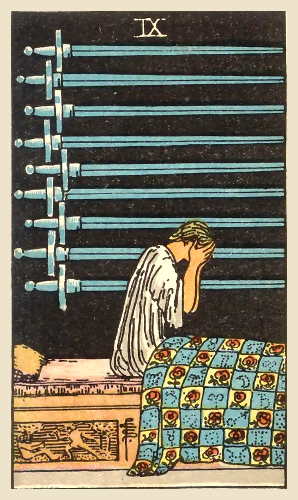

**Upright:** *anxiety, worry, sleepless nights, guilt, overthinking*  
Worry is keeping you up at night. The fear is real, but it may be bigger than the problem.

**Reversed:** *hope returning, reaching out, easing fear, recovery from anxiety, facing fears*  
The worst of the anxiety is lifting. Talk about it, and let the light back in.

**Yes/No:** No · **Element:** Air · **Astrology:** Mars in Gemini

### Upright meaning
A figure sits up in bed in the dark, face buried in their hands, while nine swords hang on the black wall behind them. The Nine of Swords is the card of anxiety, worry and sleepless nights. It often shows a mind caught in a loop of fear, guilt or "what ifs." Notice that the swords hang on the wall rather than piercing the person: much of the pain is coming from thoughts. That doesn't make it any less real. The card gently suggests sharing your worries with someone you trust. Things often look smaller in daylight.

### Reversed meaning
Reversed, the Nine of Swords can show the night beginning to end. You may be finding ways to manage anxiety, opening up to someone, or realizing a fear was bigger in your head than in reality. Sometimes, though, it shows worry so bottled up that it feels impossible to share. If that's where you are, please reach out to a friend, a support line or a professional. You don't have to carry this alone, and asking for help is a sign of strength, not weakness.

**Love:** Worry or insecurity in a relationship. Talk openly instead of spiraling alone.  
**Work:** Stress, overthinking or fear of failure. Break problems into smaller steps.  
**Advice:** Share your worries; they shrink in the light.

### Symbolism
- Figure sitting up in bed: waking from a nightmare, unable to rest.
- Hands over the face: despair, shame or exhaustion.
- Nine swords on the wall: thoughts and fears hanging over the mind.
- Quilt of roses and astrological signs: comfort and hope still within reach.
- Black background: the darkness of night, which always ends.

### Reflection
- What worry keeps coming back to me?
- How much of this fear is fact, and how much is imagination?
- Who could I talk to about what's weighing on me?

Waite, 1910

**Upright:** Death, failure, miscarriage, delay, deception, disappointment, despair.  
**Reversed:** Imprisonment, suspicion, doubt, reasonable fear, shame.

 

---
## Ten of Swords

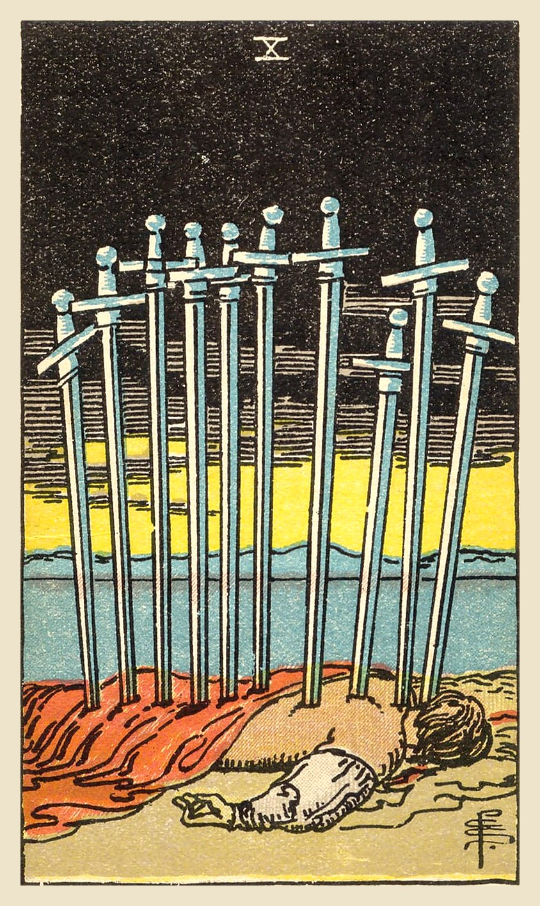

**Upright:** *rock bottom, painful ending, exhaustion, betrayal, it's over*  
A painful chapter has ended. It's hard, but this is the bottom; things can only rise.

**Reversed:** *recovery, survival, rising again, resisting an ending, lessons learned*  
You've survived the worst and are slowly getting back up. Healing has begun.

**Yes/No:** No · **Element:** Air · **Astrology:** Sun in Gemini

### Upright meaning
A figure lies face down by the water with ten swords in their back, under a black sky. But on the horizon, a golden dawn is breaking. The Ten of Swords is about a painful ending, a sense of hitting rock bottom, or feeling completely worn out. It can point to betrayal, a loss, or a situation that has finally run its course. This card is dramatic on purpose: it says this chapter is truly over. And once you've reached the bottom, the only way is up. Rest, accept the ending, and look toward the light.

### Reversed meaning
Reversed, the Ten of Swords shows the slow process of getting back up. The worst has passed and you're recovering, even if you still feel bruised. It can mean learning from a painful experience and refusing to let it define you. Sometimes it shows resistance: refusing to accept that something is over, which drags out the pain. The card encourages you to let the ending be complete, so the healing can begin. You're stronger than this moment, and the dawn is real.

**Love:** A painful breakup or betrayal. It hurts, but it also frees you to heal.  
**Work:** A job or project ending badly, or burnout. Time to rest and start again.  
**Advice:** Let it end, then let yourself rise.

### Symbolism
- Ten swords: a painful situation that has reached its end.
- Figure lying face down: exhaustion and defeat.
- Black sky: the darkest point.
- Golden dawn on the horizon: hope and a new day coming.
- Calm water: peace that follows after the storm.

### Reflection
- What chapter in my life has come to an end?
- What can I learn from this painful experience?
- What would help me get back up, one step at a time?

Waite, 1910

**Upright:** Whatsoever is intimated by the design; also pain, affliction, tears, sadness, desolation. It is not especially a card of violent death.  
**Reversed:** Advantage, profit, success, favour, but none of these are permanent; also power and authority.

 

---
## King of Swords

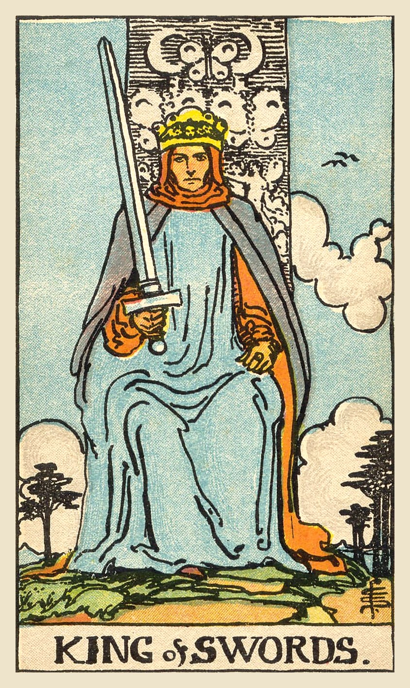

**Upright:** *intellect, authority, fairness, logic, principled leadership*  
Lead with reason and fairness. Make clear decisions based on truth.

**Reversed:** *manipulation, abuse of power, cold logic, rigid thinking, unfairness*  
Power or logic used coldly or unfairly. Check whether your mind is serving your heart.

**Yes/No:** Yes · **Element:** Air of Air · **Astrology:** Late Capricorn to mid Aquarius

### Upright meaning
A king sits squarely on his throne, facing forward, holding his sword slightly tilted and looking straight at you. Butterflies and crescent moons decorate the throne. The King of Swords stands for clear thinking, fairness and principled leadership. He makes decisions based on facts and ethics, not moods. This card may point to an expert, advisor or fair-minded authority, or ask you to take that role yourself. When a situation needs a cool head and a clear decision, trust your reasoning and stand by your principles.

### Reversed meaning
Reversed, the King of Swords' intellect can become cold or controlling. It can point to someone using logic or authority to manipulate, dismiss feelings, or win at any cost. It may also show your own thinking becoming rigid, or decisions made without considering how they affect people. The card asks you to bring fairness and humanity back into the picture. Ask who is affected by a decision, and whether you'd accept it if you were in their place. Clear thinking is powerful, but it works best alongside empathy and humility.

**Love:** A mature, honest connection, or a need for clear conversation about the relationship.  
**Work:** Leadership, expertise and fair decisions. Rely on facts and principles.  
**Advice:** Think clearly and act fairly.

### Symbolism
- Forward-facing king: directness and honesty.
- Upright sword: authority, judgment and truth.
- Butterflies on the throne: the transformation of thought into wisdom.
- Crescent moons: intuition balancing reason.
- Trees and clouds: steadiness above a changing landscape.

### Reflection
- What decision needs a clear, fair mind?
- Am I balancing logic with compassion?
- Where can I lead by example?

Waite, 1910

**Upright:** Whatsoever arises out of the idea of judgment and all its connections—power, command, authority, militant intelligence, law, offices of the crown, and so forth.  
**Reversed:** Cruelty, perversity, barbarity, perfidy, evil intention.

 

---
## Knight of Swords

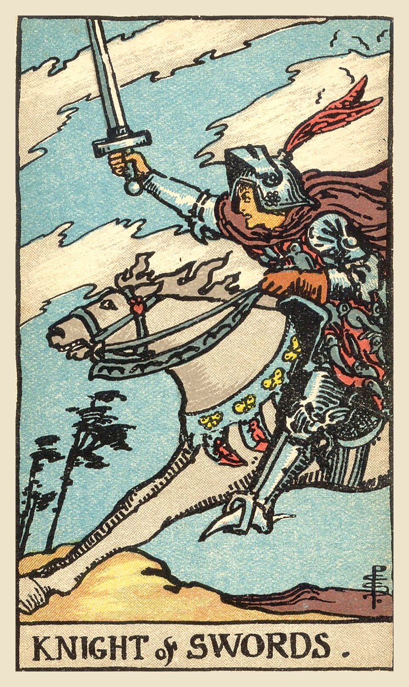

**Upright:** *ambition, fast action, drive, assertiveness, determination*  
Charge ahead with focus and courage. Act fast on what you believe in.

**Reversed:** *recklessness, impatience, aggression, burnout, rushing in*  
Speed without direction. Slow down before haste turns into harm.

**Yes/No:** Yes · **Element:** Fire of Air · **Astrology:** Late Taurus to mid Gemini

### Upright meaning
A knight charges forward on a galloping white horse, sword raised, while the wind whips the trees and clouds around him. The Knight of Swords is pure momentum: ambitious, determined and quick to act. It can point to a time to move fast, speak up, or fight for what you believe in. It may also represent someone bold, direct and driven. The card supports decisive action, especially when you've thought things through. Just make sure your speed is pointed in the right direction.

### Reversed meaning
Reversed, the Knight of Swords suggests that speed has become a problem. You or someone around you may be rushing in without a plan, saying things too bluntly, or steamrolling others to get results. It can also show burnout from pushing too hard for too long. The card asks you to slow down and think before you act. Consider who might get hurt by your haste, and whether a little patience would actually get you there faster. Momentum is only useful when it's carrying you somewhere you want to go.

**Love:** Fast-moving romance or blunt honesty. Don't rush, and choose your words carefully.  
**Work:** Ambition and fast progress. Push forward, but don't trample your team.  
**Advice:** Act boldly, but look where you're going.

### Symbolism
- Galloping horse: speed, urgency and forward motion.
- Raised sword: determination to cut through obstacles.
- Wind-blown trees and clouds: the force and chaos of fast action.
- Birds scattering: disruption in his wake.

### Reflection
- What goal deserves my full speed right now?
- Am I rushing into something without a plan?
- Who could get hurt if I move too fast?

Waite, 1910

**Upright:** Skill, bravery, capacity, defence, address, enmity, wrath, war, destruction, opposition, resistance, ruin. There is therefore a sense in which the card signifies death, but it carries this meaning only in its proximity to other cards of fatality.  
**Reversed:** Imprudence, incapacity, extravagance.

 

---
## Page of Swords

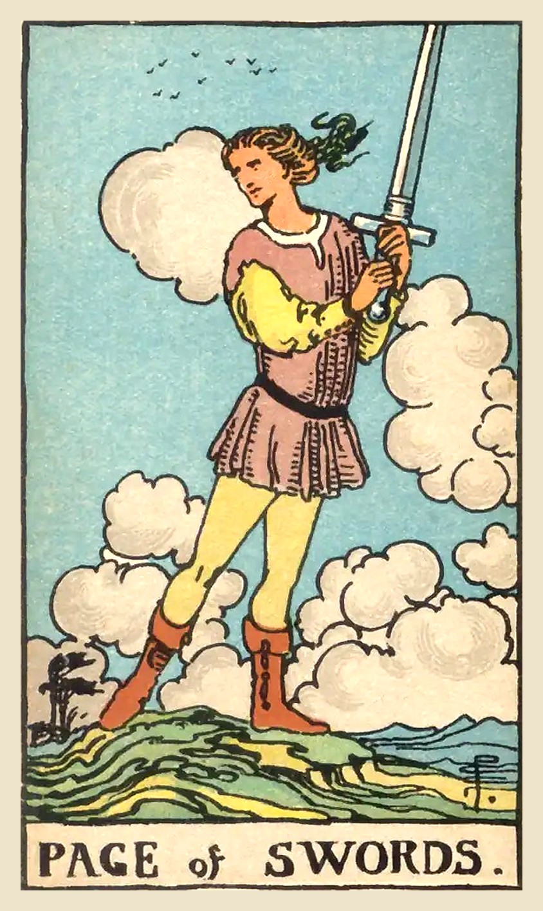

**Upright:** *curiosity, new ideas, alertness, eagerness to learn, honest communication*  
A curious, sharp mind. Ask questions, learn fast and speak the truth.

**Reversed:** *gossip, all talk, hasty words, scattered thinking, defensiveness*  
Words are running ahead of thought. Watch for gossip, haste and empty talk.

**Yes/No:** Yes · **Element:** Earth of Air · **Astrology:** 

### Upright meaning
A young figure stands on a windy hill holding a sword up with both hands, glancing over their shoulder, as clouds rush past and birds fly overhead. The Page of Swords is full of mental energy: curious, alert and eager to learn. It can point to a new idea, a new subject to study, or news arriving. It may also represent someone young at heart who asks a lot of questions and speaks their mind. The card encourages you to stay curious, think for yourself and communicate honestly.

### Reversed meaning
Reversed, the Page of Swords can show mental energy going astray. You might be talking a lot but not following through, spreading or hearing gossip, or saying something hurtful without thinking. It can also show scattered thinking, defensiveness, or jumping to conclusions. The card asks you to slow down: listen before you speak, check your facts, and think about the effect of your words before you send them. A sharp mind is a gift when it's paired with patience, care and a willingness to be wrong.

**Love:** Honest talks, curiosity about someone, or a lively exchange. Be truthful but kind.  
**Work:** Learning, research or new ideas. Stay alert and ask good questions.  
**Advice:** Stay curious and speak honestly.

### Symbolism
- Sword held high: a sharp, active mind ready for action.
- Glance over the shoulder: alertness and watchfulness.
- Wind-blown clouds: fast-moving thoughts and changing circumstances.
- Birds in the sky: ideas and freedom of thought.
- High ground: a wide view of the situation.

### Reflection
- What am I curious to learn right now?
- Am I listening as much as I'm speaking?
- Is there something I need to say honestly?

Waite, 1910

**Upright:** Authority, overseeing, secret service, vigilance, spying, examination, and the qualities thereto belonging.  
**Reversed:** More evil side of these qualities; what is unforeseen, unprepared state; sickness is also intimated.

 

---
## Queen of Swords

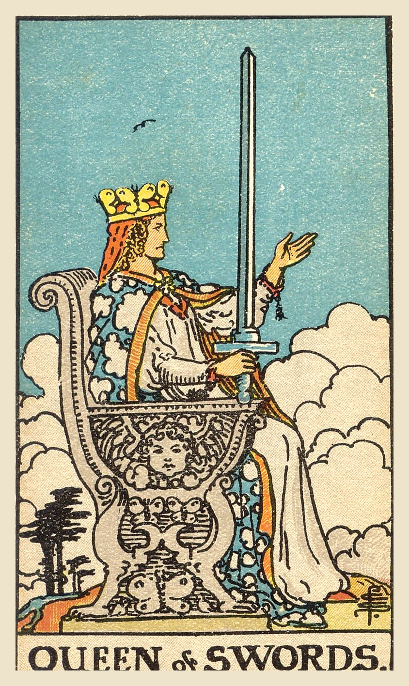

**Upright:** *independence, clear judgment, directness, honesty, wisdom from experience*  
Clear-eyed and honest. See the truth, set boundaries and speak plainly.

**Reversed:** *coldness, bitterness, harshness, cruel words, closed off*  
Clarity has turned cold or bitter. Soften your words without losing your truth.

**Yes/No:** Maybe · **Element:** Water of Air · **Astrology:** Late Virgo to mid Libra

### Upright meaning
A queen sits on a throne carved with butterflies, facing the clouds, her sword held upright in one hand and the other hand raised as if welcoming or warning. The Queen of Swords sees clearly and speaks honestly. Her wisdom often comes from experience, including pain she has moved through. She may represent an independent, perceptive person in your life, or your own ability to cut through confusion and set firm boundaries. This card asks you to trust your judgment, say what you mean, and not be swayed by flattery or drama.

### Reversed meaning
Reversed, the Queen of Swords' sharpness can turn harsh. You might be shutting people out, using words as weapons, or letting past hurts make you cold and suspicious. It can also point to someone around you who is critical or cruel. Sometimes it shows the opposite: clouded judgment, where emotions are blocking clear thinking. The card asks you to keep your honesty but bring back your compassion. Old hurts deserve healing, not a fortress. Boundaries protect you; walls keep everyone out.

**Love:** Honest communication and healthy boundaries. Say what you need, clearly and kindly.  
**Work:** Clear judgment and independence. Make decisions based on facts, not drama.  
**Advice:** Be honest, clear and fair.

### Symbolism
- Upright sword: truth and clear judgment.
- Raised open hand: openness, with a boundary.
- Butterflies on the throne: transformation and the power of the mind.
- Clouds below: seeing above confusion.
- Single bird overhead: independence and clear vision.

### Reflection
- What do I know to be true, even if it's hard?
- Where do I need a clearer boundary?
- Am I protecting myself, or shutting people out?

Waite, 1910

**Upright:** Widowhood, female sadness and embarrassment, absence, sterility, mourning, privation, separation.  
**Reversed:** Malice, bigotry, artifice, prudery, bale, deceit.

 

---
