# Review: Wands

Generated by `tools/build_review.py` from the card files. Edit the YAML files, not this page.

## Ace of Wands

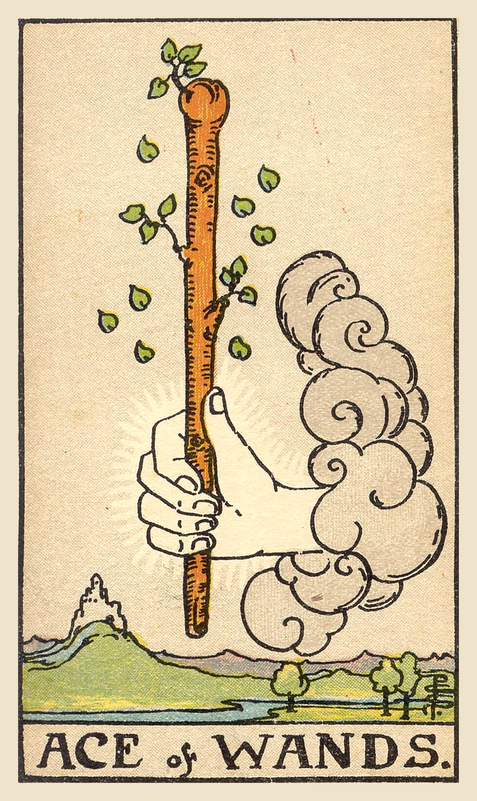

**Upright:** *inspiration, spark, new venture, enthusiasm, creative potential*  
A spark of inspiration. A new passion or project is ready to grow, so act on it.

**Reversed:** *delays, lack of motivation, false start, creative block, hesitation*  
The spark is there but not catching. Find what's blocking your energy.

**Yes/No:** Yes · **Element:** Fire · **Astrology:** Root of the powers of Fire

### Upright meaning
A hand reaches out of a cloud holding a sturdy wand that is sprouting fresh leaves, with a castle on a hill in the distance. The Ace of Wands is a burst of creative energy: a new idea, a passion, a project or an adventure waiting to begin. It's the feeling of excitement that makes you want to start right now. Aces are opportunities, and this one is about drive and inspiration. Don't overthink it. Take the first step while the energy is fresh, and let the idea grow as you go.

### Reversed meaning
Reversed, the Ace of Wands suggests the spark isn't catching. You may have an idea but lack the motivation to start, or you might start something with lots of energy and lose interest quickly. Delays or obstacles may be slowing things down. The card asks what's getting in the way. Is it fear of failure, too many ideas at once, or simply exhaustion? Sometimes the answer is rest; sometimes it's a smaller first step. The spark can be relit once you know what's smothering it.

**Love:** New passion, attraction or excitement. Let the chemistry show.  
**Work:** A new project, idea or business venture. Act while you're inspired.  
**Advice:** Start now, while the spark is fresh.

### Symbolism
- Hand from a cloud: an opportunity being offered.
- Sprouting wand: growth, life and creative energy.
- Falling leaves: energy and possibilities to spare.
- Castle on the hill: a goal you can reach.
- River and trees: fertile ground for new ventures.

### Reflection
- What idea excites me right now?
- What would I start if I weren't afraid?
- What small step could I take today?

Waite, 1910

**Upright:** Creation, invention, enterprise, the powers which result in these; principle, beginning, source; birth, family, origin, and in a sense the virility which is behind them; the starting point of enterprises; according to another account, money, fortune, inheritance.  
**Reversed:** Fall, decadence, ruin, perdition, to perish; also a certain clouded joy.

 

---
## Two of Wands

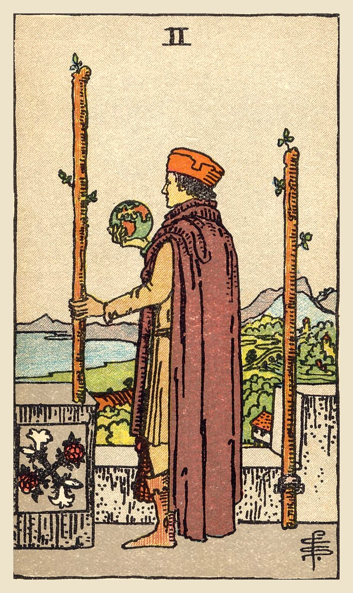

**Upright:** *planning, future vision, decisions, personal power, leaving your comfort zone*  
The world is in your hands. Plan your next move and dare to think bigger.

**Reversed:** *fear of the unknown, playing it safe, poor planning, restlessness, staying put*  
Fear is keeping you in your comfort zone. A bit of planning will make the leap easier.

**Yes/No:** Yes · **Element:** Fire · **Astrology:** Mars in Aries

### Upright meaning
A man stands on a castle wall holding a small globe, one wand in his hand and another fixed beside him, looking out over land and sea. The Two of Wands is about planning your future and thinking bigger. You've made a start, and now you're deciding where to go next. It's a card of vision, ambition and choice: staying where it's safe, or venturing into the wider world. The card encourages you to make a plan, trust your abilities, and step beyond what's familiar.

### Reversed meaning
Reversed, the Two of Wands suggests hesitation about the future. You might be sticking with what's safe because the unknown feels too risky, or making plans that never turn into action. It can also show restlessness: knowing you want more without knowing what. The card asks you to name what you really want, then break it into smaller, less frightening steps. Planning doesn't remove all risk, but it gives you the confidence to begin, and it shows you that the first step is smaller than it looks.

**Love:** Thinking about the future together, or deciding whether to take a relationship further.  
**Work:** Long-term planning, expansion or a career decision. Think bigger.  
**Advice:** Make a plan for the future you want.

### Symbolism
- Globe in his hand: the world of possibilities.
- Two wands: the choice between staying and going.
- Castle wall: security and what's already been built.
- View of land and sea: the wider world waiting to be explored.
- Rose and lily emblem: passion and purity in balance.

### Reflection
- What do I want my life to look like a year from now?
- What's keeping me in my comfort zone?
- What is one step toward a bigger goal?

Waite, 1910

**Upright:** Between the alternative readings there is no marriage possible; on the one hand, riches, fortune, magnificence; on the other, physical suffering, disease, chagrin, sadness, mortification.  
**Reversed:** Surprise, wonder, enchantment, emotion, trouble, fear.

 

---
## Three of Wands

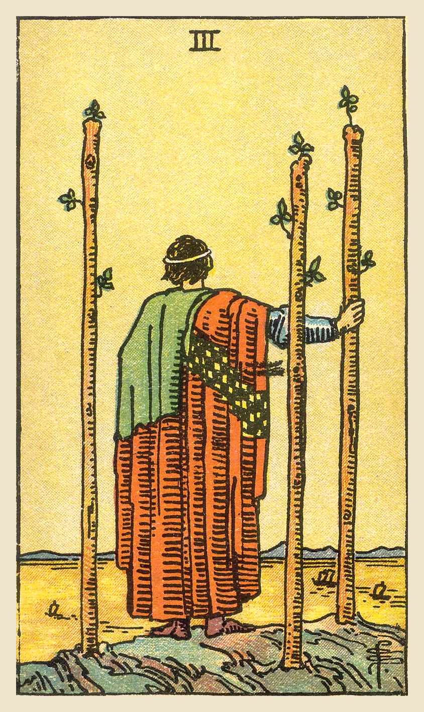

**Upright:** *expansion, foresight, progress, opportunities ahead, waiting for results*  
Your plans are underway and your ships are sailing. Look ahead to growing opportunities.

**Reversed:** *setbacks, frustration, limited vision, slow returns, plans falling short*  
Progress is slower than you hoped. Adjust your plans instead of giving up.

**Yes/No:** Yes · **Element:** Fire · **Astrology:** Sun in Aries

### Upright meaning
A figure stands on a cliff with their back to us, leaning on one of three wands and watching ships sail across a golden sea. The Three of Wands shows plans in motion. You have done the groundwork, and now you're watching your efforts start to pay off. It's a card of expansion, foresight and new opportunities, sometimes involving travel or connections far away. Keep looking ahead. The horizon is wide, and more is coming toward you than you might expect.

### Reversed meaning
Reversed, the Three of Wands suggests your ships are delayed. Plans may be stalled, results slower than expected, or opportunities not as big as you hoped. It can also show short-term thinking, or frustration that makes you want to quit. The card asks you to be patient and flexible. Look at what's causing the delay, and adjust course if needed. Setbacks are part of any real venture, and they often teach you exactly what the next attempt needs. The ships may simply be taking the long way home.

**Love:** A relationship growing, or a long-distance connection. Look ahead together.  
**Work:** Business growth, travel, or results starting to arrive. Keep expanding.  
**Advice:** Keep your eyes on the horizon.

### Symbolism
- Figure looking out to sea: foresight and vision.
- Ships sailing: plans and ventures in motion.
- Three planted wands: a solid foundation built.
- Golden sea and sky: optimism and opportunity.
- High cliff: a broad view of what's possible.

### Reflection
- What efforts of mine are starting to pay off?
- What opportunities lie just over the horizon?
- How can I stay patient while I wait for results?

Waite, 1910

**Upright:** He symbolizes established strength, enterprise, effort, trade, commerce, discovery; those are his ships, bearing his merchandise, which are sailing over the sea. The card also signifies able co-operation in business, as if the successful merchant prince were looking from his side towards yours with a view to help you.  
**Reversed:** The end of troubles, suspension or cessation of adversity, toil and disappointment.

 

---
## Four of Wands

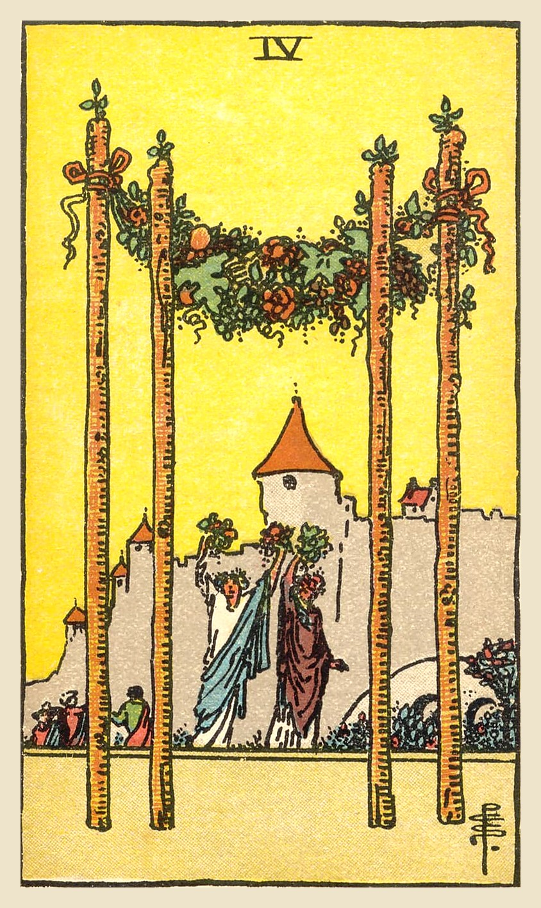

**Upright:** *celebration, homecoming, milestones, stability, community joy*  
A joyful milestone. Celebrate with the people who make you feel at home.

**Reversed:** *cancelled celebration, unstable home, lack of support, transition, feeling unwelcome*  
Celebrations feel strained or home feels unsettled. Find where you truly belong.

**Yes/No:** Yes · **Element:** Fire · **Astrology:** Venus in Aries

### Upright meaning
Four wands hold up a garland of flowers and fruit, and behind it two figures raise bouquets in celebration, with a castle and a crowd beyond. The Four of Wands is a card of joy and arrival: a milestone reached, a homecoming, a wedding, a housewarming or a community celebration. It's a moment to pause and enjoy what you've built. The card also speaks of stability and a sense of belonging. Gather your people and mark the occasion. Happy moments deserve to be celebrated.

### Reversed meaning
Reversed, the Four of Wands can show celebrations that fall flat or plans that are postponed. Home might not feel like a safe or welcoming place right now, or you may be in a transition between homes, jobs or communities. It can also point to a lack of support from the people around you. The card invites you to look for belonging where it truly exists, and to create small moments of joy even when things feel unsettled. Home is often built from people, not places.

**Love:** Celebration, commitment or moving in together. A happy milestone.  
**Work:** A completed project, a launch or a team celebration. Enjoy the win.  
**Advice:** Celebrate what you've built.

### Symbolism
- Four wands with a garland: a stable structure crowned with celebration.
- Raised bouquets: joy and welcome.
- Castle in the background: home and security.
- Crowd gathering: community and shared happiness.

### Reflection
- What milestone have I reached that deserves celebrating?
- Where do I feel most at home?
- Who would I want to celebrate with?

Waite, 1910

**Upright:** They are for once almost on the surface—country life, haven of refuge, a species of domestic harvest-home, repose, concord, harmony, prosperity, peace, and the perfected work of these.  
**Reversed:** The meaning remains unaltered; it is prosperity, increase, felicity, beauty, embellishment.

 

---
## Five of Wands

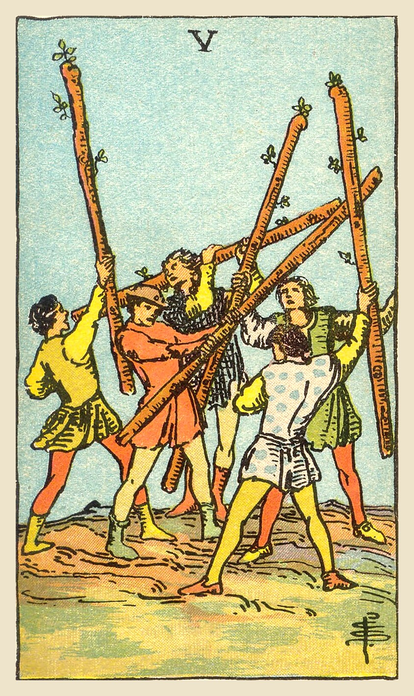

**Upright:** *competition, disagreement, rivalry, clashing ideas, struggle*  
Competing egos and clashing ideas. A little friction can be healthy if it stays fair.

**Reversed:** *avoiding conflict, finding common ground, truce, inner conflict, cooperation*  
The squabbling is settling down. Look for common ground or step away from pointless fights.

**Yes/No:** Maybe · **Element:** Fire · **Astrology:** Saturn in Leo

### Upright meaning
Five young men wave their wands at each other in a chaotic scuffle. Nobody seems hurt; it looks more like a heated game than a war. The Five of Wands is about competition and disagreement: clashing opinions, rivalry, too many voices trying to be heard at once. It can be frustrating, but it isn't always bad. Healthy competition can sharpen ideas and push everyone to improve. The card asks you to keep it fair, listen as much as you argue, and find a way to turn friction into progress.

### Reversed meaning
Reversed, the Five of Wands suggests conflict is easing, or being avoided. You might be finding common ground, calling a truce, or learning to work together. It can also show conflict being swept under the rug because nobody wants to deal with it. Sometimes the struggle is internal: competing wants pulling you in different directions. The card asks you to address conflicts honestly but calmly. Not every disagreement needs a winner, and cooperation can get further than competition. Ask what you're really fighting for.

**Love:** Arguments, competing priorities or rivals. Fight fair and stay on the same team.  
**Work:** Competition, debates or a chaotic team. Let good ideas win, not loud ones.  
**Advice:** Let friction make you better, not bitter.

### Symbolism
- Five figures waving wands: competing ideas and egos.
- No one is hurt: more of a scuffle than a battle.
- Different clothes on each figure: different viewpoints and backgrounds.
- Open ground: plenty of room, if they stopped fighting over it.

### Reflection
- Is this conflict helping me grow or just draining me?
- Am I listening to the other side?
- Where could competition become cooperation?

Waite, 1910

**Upright:** Imitation, as, for example, sham fight, but also the strenuous competition and struggle of the search after riches and fortune. In this sense it connects with the battle of life. Hence some attributions say that it is a card of gold, gain, opulence.  
**Reversed:** Litigation, disputes, trickery, contradiction.

 

---
## Six of Wands

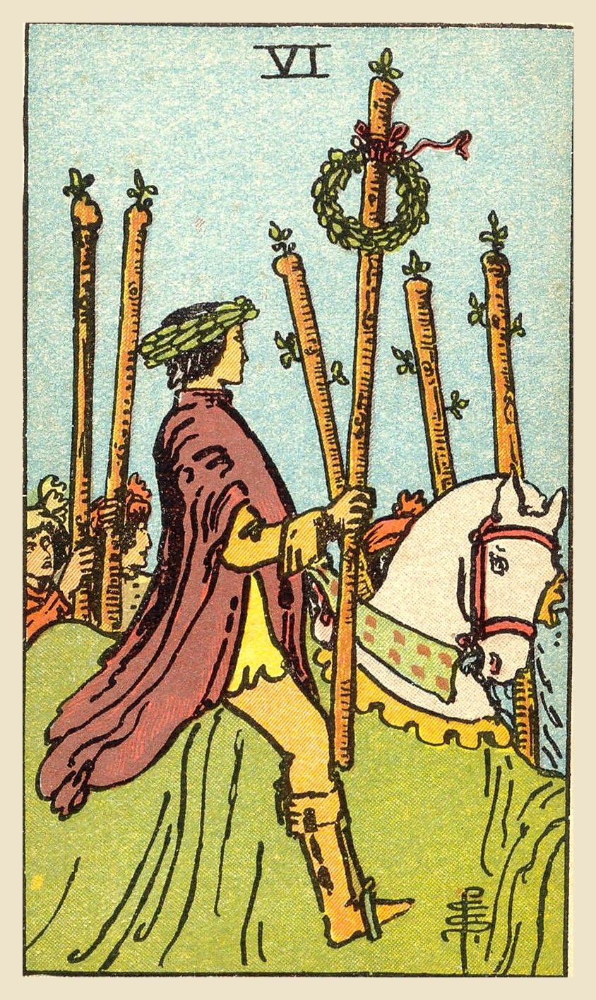

**Upright:** *victory, recognition, public success, confidence, good news*  
Victory and recognition. Your hard work is being noticed, so enjoy the moment.

**Reversed:** *lack of recognition, ego, fall from grace, fear of failure, private success*  
The applause hasn't come, or it's gone to your head. Define success for yourself.

**Yes/No:** Yes · **Element:** Fire · **Astrology:** Jupiter in Leo

### Upright meaning
A rider wearing a laurel wreath rides a white horse through a cheering crowd, holding up a wand topped with another wreath. The Six of Wands is about victory and recognition: a win, a promotion, good news or simply a moment where others see what you've achieved. It brings a boost of confidence and well-earned pride. Enjoy it. You worked for this. The card also reminds you that success is often shared, so thank the people who helped you along the way.

### Reversed meaning
Reversed, the Six of Wands suggests that recognition is missing or misplaced. You may feel your efforts are going unnoticed, or that someone else is getting the credit. It can also show success going to someone's head, or fear of failing in public. The card invites you to define success by your own values instead of outside applause. Celebrate your private wins too. Confidence that depends only on praise is fragile; confidence rooted in your own effort lasts. Notice your quiet progress, too.

**Love:** Feeling proud of each other, or a relationship that others admire.  
**Work:** Recognition, promotion or a public win. Step into the spotlight.  
**Advice:** Own your success, and share the credit.

### Symbolism
- Laurel wreath on his head: victory and achievement.
- Wreath on the wand: success that is public and celebrated.
- White horse: confidence and purity of purpose.
- Cheering crowd: recognition and support from others.

### Reflection
- What achievement am I proud of?
- Who helped me get here?
- How do I define success for myself?

Waite, 1910

**Upright:** The card has been so designed that it can cover several significations; on the surface, it is a victor triumphing, but it is also great news, such as might be carried in state by the King's courier; it is expectation crowned with its own desire, the crown of hope, and so forth.  
**Reversed:** Apprehension, fear, as of a victorious enemy at the gate; treachery, disloyalty, as of gates being opened to the enemy; also indefinite delay.

 

---
## Seven of Wands

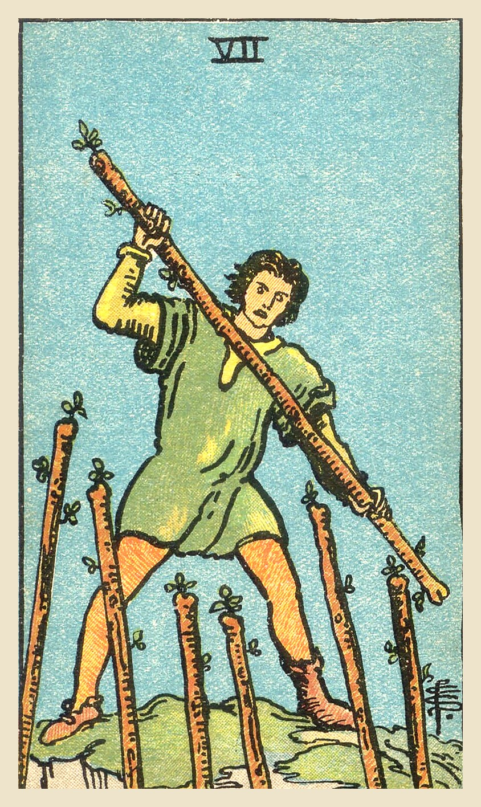

**Upright:** *standing your ground, defending beliefs, perseverance, challenge, protecting your position*  
Stand your ground. You have the higher position, so defend what matters to you.

**Reversed:** *overwhelmed, giving up, exhaustion from defending, yielding, defensiveness*  
You're worn out from fighting. Decide which battles are worth keeping up.

**Yes/No:** Yes · **Element:** Fire · **Astrology:** Mars in Leo

### Upright meaning
A man stands on high ground holding a wand, fending off six wands rising toward him from below. He's outnumbered, but he holds the better position. Notice his mismatched shoes: he didn't have time to get ready. The Seven of Wands is about standing up for yourself, your beliefs or something you've worked hard for. Challenges and criticism may come from several directions. The card says you can hold your ground. Stay confident, stay focused, and don't let pressure push you off the hill.

### Reversed meaning
Reversed, the Seven of Wands suggests the pressure is getting to you. You might feel overwhelmed, tired of defending yourself, or ready to give up. It can also show becoming overly defensive, treating every comment as an attack. The card asks you to pick your battles. Some positions are worth defending; others aren't worth the energy. Rest if you need to, ask for support, and focus your strength on what truly matters to you. A position you no longer believe in isn't worth guarding.

**Love:** Defending your relationship or your boundaries. Stand firm on what matters.  
**Work:** Competition or criticism. Defend your position with confidence.  
**Advice:** Stand your ground on what matters.

### Symbolism
- Man on high ground: the advantage of a strong position.
- Six wands rising from below: challenges, competitors or criticism.
- Mismatched shoes: being caught off guard but rising to it anyway.
- Determined stance: courage and perseverance.

### Reflection
- What is worth defending in my life right now?
- Am I standing firm, or just being defensive?
- Which battles can I let go of?

Waite, 1910

**Upright:** It is a card of valour, for, on the surface, six are attacking one, who has, however, the vantage position. On the intellectual plane, it signifies discussion, wordy strife; in business—negotiations, war of trade, barter, competition. It is further a card of success, for the combatant is on the top and his enemies may be unable to reach him.  
**Reversed:** Perplexity, embarrassments, anxiety. It is also a caution against indecision.

 

---
## Eight of Wands

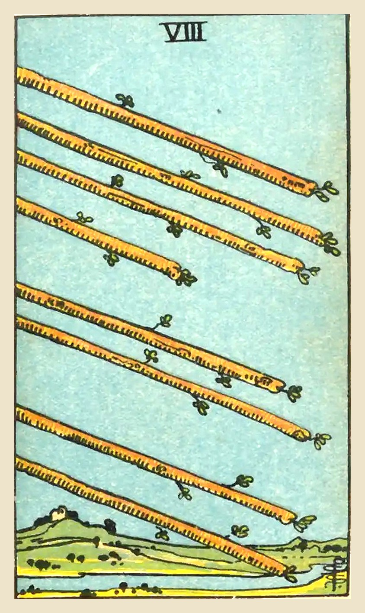

**Upright:** *speed, momentum, swift action, messages, things moving fast*  
Things are moving fast. News, progress and momentum are coming your way.

**Reversed:** *slowdown, frustration, rushing, miscommunication, waiting*  
Plans are stalled or rushed. Slow down, or wait for the right timing.

**Yes/No:** Yes · **Element:** Fire · **Astrology:** Mercury in Sagittarius

### Upright meaning
Eight wands fly through the clear sky in parallel, about to land over a peaceful landscape with a river below. There are no people in this card, only motion. The Eight of Wands is about speed and momentum: news arriving, plans moving quickly, obstacles clearing out of the way. It can point to travel, fast replies or a burst of progress after a slow period. The card encourages you to ride the wave. Act quickly, keep your focus, and let things fall into place.

### Reversed meaning
Reversed, the Eight of Wands suggests the momentum has stalled. Messages may be delayed, plans held up, or travel disrupted. It can also show the opposite problem: rushing so fast that mistakes and miscommunications pile up. The card asks you to check your timing. If things are slow, use the pause to prepare. If you're racing, slow down enough to aim well. Either way, patience now will help the energy flow again when the moment is right. Good things can still arrive on time.

**Love:** Things moving quickly, sudden messages or a whirlwind romance. Enjoy the rush.  
**Work:** Fast progress, quick decisions or travel. Keep up the pace.  
**Advice:** Move with the momentum.

### Symbolism
- Eight wands flying in parallel: swift movement in one direction.
- Clear sky: nothing blocking the way.
- Wands about to land: things arriving soon.
- River below: the flow of events.
- No people: pure energy and motion.

### Reflection
- What is moving quickly in my life right now?
- Am I ready to act when the opportunity arrives?
- Is anything getting lost because I'm rushing?

Waite, 1910

**Upright:** Activity in undertakings, the path of such activity, swiftness, as that of an express messenger; great haste, great hope, speed towards an end which promises assured felicity; generally, that which is on the move; also the arrows of love.  
**Reversed:** Arrows of jealousy, internal dispute, stingings of conscience, quarrels; and domestic disputes for persons who are married.

 

---
## Nine of Wands

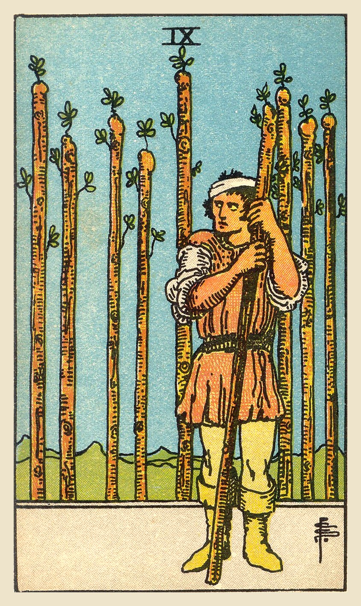

**Upright:** *resilience, persistence, last stretch, guardedness, courage under pressure*  
You're tired but nearly there. Hold on; one last push will get you through.

**Reversed:** *exhaustion, paranoia, giving up, overwhelm, too guarded*  
You're worn out and on guard against everything. Rest, and let someone help.

**Yes/No:** Yes · **Element:** Fire · **Astrology:** Moon in Sagittarius

### Upright meaning
A man with a bandaged head leans on his wand, watching warily, with eight more wands standing behind him like a fence. He has clearly been through battles already. The Nine of Wands is about resilience: you've been tested, you're tired, but you're still standing. The finish line is close. The card encourages you to keep going and to protect your energy. Your wounds show how much you've survived, and that experience is exactly what will carry you through this last stretch.

### Reversed meaning
Reversed, the Nine of Wands suggests your reserves are running low. You may be exhausted, feel like giving up, or be so guarded that you see threats everywhere. Past hurts can make it hard to trust anyone. The card asks you to rest and to accept help. Being strong doesn't mean doing it all alone. Sometimes it also means checking whether the fight is still worth it. You don't have to hold every line forever; choose the ones that truly matter.

**Love:** Feeling guarded after being hurt. Protect your heart, but don't wall it off.  
**Work:** A demanding final stretch. Push through, and pace yourself.  
**Advice:** Hold on; you're almost there.

### Symbolism
- Bandaged head: wounds from past battles.
- Leaning on a wand: tired, but still standing.
- Wary glance: guardedness and readiness for more.
- Eight wands behind him: defenses built from experience.

### Reflection
- What have I already survived that shows my strength?
- Am I protecting myself, or closing myself off?
- Who could help me through this last stretch?

Waite, 1910

**Upright:** The card signifies strength in opposition. If attacked, the person will meet an onslaught boldly; and his build shows that he may prove a formidable antagonist. With this main significance there are all its possible adjuncts—delay, suspension, adjournment.  
**Reversed:** Obstacles, adversity, calamity.

 

---
## Ten of Wands

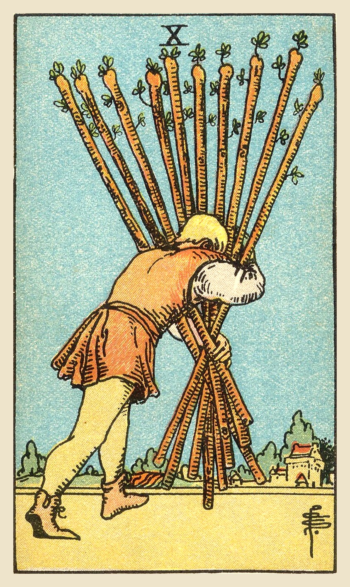

**Upright:** *burden, overcommitment, heavy responsibility, hard work, stress*  
You're carrying too much. Look at what you can put down, share or say no to.

**Reversed:** *delegating, putting it down, breaking point, saying no, release of burdens*  
The load is finally getting lighter, or about to break you. Delegate and let go.

**Yes/No:** No · **Element:** Fire · **Astrology:** Saturn in Sagittarius

### Upright meaning
A man struggles toward a village carrying a bundle of ten heavy wands, so many that they block his view. The Ten of Wands is about burden and overcommitment. You may have taken on too much: work, responsibilities, other people's problems. Even good things become heavy when you carry them all at once. The card asks you to notice how hard you're working and whether it's sustainable. You're close to your goal, but you don't have to carry everything alone. What could you put down or hand to someone else?

### Reversed meaning
Reversed, the Ten of Wands can show the moment you start putting the load down: delegating, saying no, or letting go of responsibilities that were never yours. It can also warn of burnout, a sign that you've been carrying too much for too long. The card encourages you to be honest about your limits. You don't earn rest by exhausting yourself first. Sharing the work isn't failure. It's what lets you finish the journey with something left for yourself, and with energy to enjoy arriving.

**Love:** One partner carrying too much. Share the load more evenly.  
**Work:** Overwork and too many responsibilities. Delegate, prioritize and say no.  
**Advice:** Put some of it down.

### Symbolism
- Ten wands carried in a bundle: too many responsibilities at once.
- Bent back: the strain of overcommitment.
- Wands blocking his view: losing sight of the goal.
- Village ahead: the destination is close.

### Reflection
- What am I carrying that isn't mine to carry?
- What could I delegate or say no to?
- Is my effort sustainable?

Waite, 1910

**Upright:** A card of many significances, and some of the readings cannot be harmonized. I set aside that which connects it with honour and good faith. The chief meaning is oppression simply, but it is also fortune, gain, any kind of success, and then it is the oppression of these things.  
**Reversed:** Contrarieties, difficulties, intrigues, and their analogies.

 

---
## King of Wands

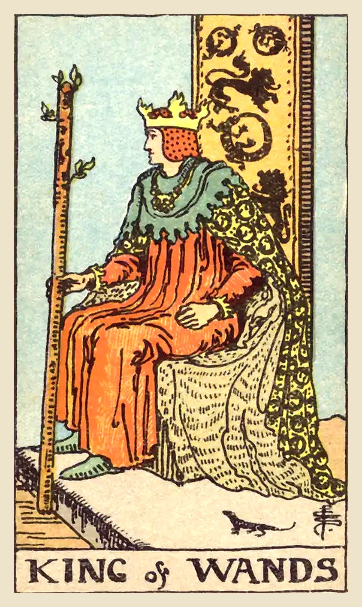

**Upright:** *visionary leadership, entrepreneurship, boldness, inspiration, big picture*  
A bold visionary. Lead with inspiration and turn big ideas into reality.

**Reversed:** *arrogance, impulsiveness, high expectations, domineering, unrealistic goals*  
Vision has tipped into arrogance or impatience. Listen as well as lead.

**Yes/No:** Yes · **Element:** Air of Fire · **Astrology:** Late Cancer to mid Leo

### Upright meaning
A king sits on a throne decorated with lions and salamanders, holding a flowering wand. A small salamander rests at his feet. The King of Wands is a natural leader with big ideas and the drive to make them happen. He inspires others, takes risks and sees the bigger picture. He may represent a visionary, entrepreneurial person in your life, or your own capacity to lead boldly. The card encourages you to take charge of your vision, share it with confidence, and bring others along with you.

### Reversed meaning
Reversed, the King of Wands' confidence can become overbearing. You might be pushing too hard, expecting too much of others, or acting on impulse without thinking things through. It can also show a leader who talks big but doesn't follow through, or who doesn't listen to anyone. The card asks you to balance vision with patience and humility. Great leaders inspire through example and respect, not force. Make room for other people's ideas, and your vision will grow stronger and go further than you could take it alone.

**Love:** A confident, passionate partner, or taking the lead in a relationship.  
**Work:** Leadership, entrepreneurship and bold moves. Lead with vision.  
**Advice:** Lead boldly, and bring others with you.

### Symbolism
- Flowering wand: creative vision that keeps growing.
- Lions and salamanders on the throne: courage, fire and transformation.
- Salamander at his feet: passion that is ready to act.
- Turned to the side: looking toward the future.

### Reflection
- What vision am I ready to lead?
- Am I inspiring others or pushing them?
- How can I turn a big idea into a first step?

Waite, 1910

**Upright:** Dark man, friendly, countryman, generally married, honest and conscientious. The card always signifies honesty, and may mean news concerning an unexpected heritage to fall in before very long.  
**Reversed:** Good, but severe; austere, yet tolerant.

 

---
## Knight of Wands

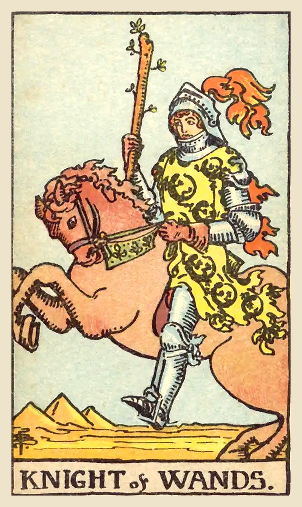

**Upright:** *adventure, passion, boldness, impulsiveness, charisma*  
Bold and fiery, ready for adventure. Chase your passion with confidence.

**Reversed:** *hotheadedness, scattered energy, recklessness, stalled plans, frustration*  
Passion without patience. Cool down before you rush into something.

**Yes/No:** Yes · **Element:** Fire of Fire · **Astrology:** Late Scorpio to mid Sagittarius

### Upright meaning
A knight in armor and a salamander-patterned tunic rides a rearing horse, wand raised, with pyramids in the distance. The Knight of Wands is energy in motion: adventurous, confident, passionate and a little impulsive. It can point to travel, a move, or jumping into something new with excitement. It may represent a charismatic, daring person, or your own urge to chase what you want. The card encourages bold action. Just remember that the horse is rearing: keep enough control to steer.

### Reversed meaning
Reversed, the Knight of Wands' fire can burn out of control. You might be rushing into decisions, starting fights, or charging from one thing to the next without finishing anything. It can also show frustration when plans are delayed or energy has nowhere to go. The card asks you to slow down and channel your passion. Think before you leap, and finish what you've started. Your energy is a gift; give it a direction, and a finish line, so it builds something that lasts.

**Love:** Passionate, exciting romance, but possibly short-lived. Enjoy it with open eyes.  
**Work:** Bold moves, travel or a fresh challenge. Act with confidence and some planning.  
**Advice:** Be bold, but keep hold of the reins.

### Symbolism
- Rearing horse: raw energy and impulsiveness.
- Raised wand: passion and determination.
- Salamanders on the tunic: fire and transformation.
- Pyramids in the distance: adventure and faraway places.
- Flame-like plume: enthusiasm and drive.

### Reflection
- What passion do I want to chase?
- Am I acting boldly, or just impulsively?
- Where does my energy need direction?

Waite, 1910

**Upright:** Departure, absence, flight, emigration. A dark young man, friendly. Change of residence.  
**Reversed:** Rupture, division, interruption, discord.

 

---
## Page of Wands

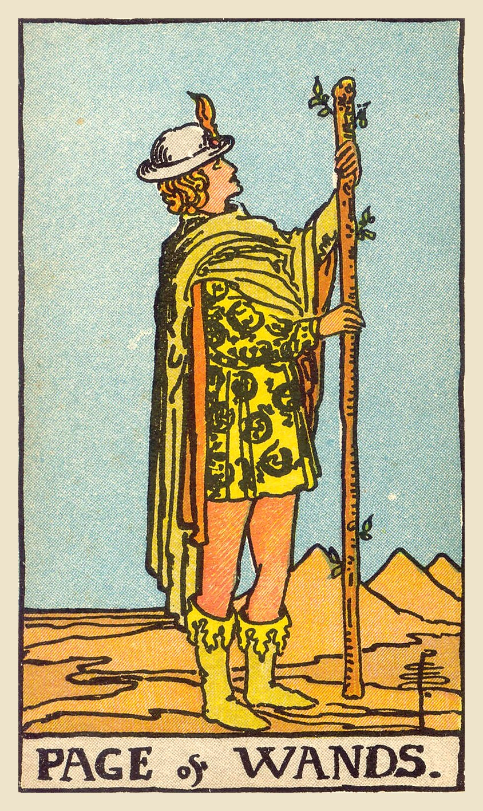

**Upright:** *enthusiasm, exploration, free spirit, discovery, exciting news*  
An eager explorer. Follow your curiosity and say yes to something exciting.

**Reversed:** *lack of direction, procrastination, impatience, half-finished ideas, boredom*  
Lots of excitement, little follow-through. Pick one idea and stick with it.

**Yes/No:** Yes · **Element:** Earth of Fire · **Astrology:** 

### Upright meaning
A young figure in a feathered hat and a tunic patterned with salamanders stands in a desert, gazing at the tip of a tall wand. Pyramids rise in the distance. The Page of Wands is full of enthusiasm and curiosity: the urge to explore, try something new, or follow a passion. It can point to exciting news, a creative idea, or the first steps of an adventure. It may also represent a free-spirited, energetic person. The card encourages you to follow what lights you up, even if you don't know where it leads.

### Reversed meaning
Reversed, the Page of Wands suggests enthusiasm without direction. You may have lots of ideas but start none of them, or start many and finish few. Impatience, procrastination or boredom can creep in when the exciting beginning gives way to steady work. The card asks you to choose one idea and give it real attention. Excitement is a wonderful spark, but projects grow through commitment. Ask which of your passions is worth seeing through, and start there. Small, steady progress keeps the fire burning.

**Love:** Flirty, adventurous energy. Have fun and explore the connection.  
**Work:** A new passion project, course or idea. Explore with an open mind.  
**Advice:** Follow what excites you.

### Symbolism
- Gazing at the wand: fascination with a new idea.
- Salamanders on the tunic: fire, passion and transformation.
- Feathered hat: free spirit and confidence.
- Desert and pyramids: unexplored territory and ancient wisdom.

### Reflection
- What am I curious to explore?
- Which of my ideas deserves real commitment?
- What excites me enough to take a risk?

Waite, 1910

**Upright:** Dark young man, faithful, a lover, an envoy, a postman. Beside a man, he will bear favourable testimony concerning him. A dangerous rival, if followed by the Page of Cups. Has the chief qualities of his suit. He may signify family intelligence.  
**Reversed:** Anecdotes, announcements, evil news. Also indecision and the instability which accompanies it.

 

---
## Queen of Wands

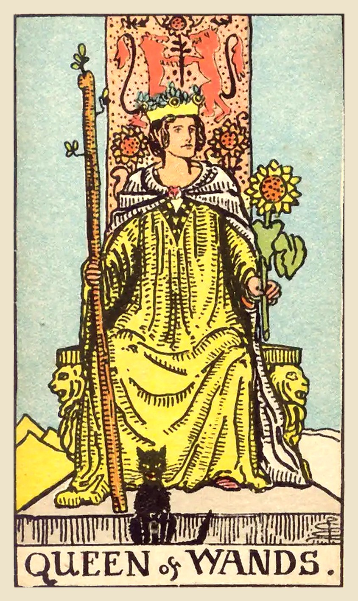

**Upright:** *confidence, warmth, determination, independence, vibrancy*  
Confident, warm and magnetic. Own your power and let yourself shine.

**Reversed:** *jealousy, insecurity, demanding, short temper, comparison*  
Your fire is flickering with doubt or jealousy. Rebuild your confidence from within.

**Yes/No:** Yes · **Element:** Water of Fire · **Astrology:** Late Pisces to mid Aries

### Upright meaning
A queen sits on a throne decorated with lions, holding a wand in one hand and a sunflower in the other. A black cat sits at her feet. The Queen of Wands is confident, warm and full of life. She knows who she is and isn't afraid to be seen. She may represent a vibrant, independent person in your life, or your own ability to lead with enthusiasm and courage. The card encourages you to own your strengths, take up space, and bring warmth and energy to everything you do.

### Reversed meaning
Reversed, the Queen of Wands' fire can turn inward or out of control. You might be doubting yourself, comparing yourself to others, or feeling jealous of someone's success. It can also show a demanding, short-tempered side, or burnout from trying to do everything. The card asks you to reconnect with your own worth. Your value doesn't depend on outshining anyone. Rest, do something that makes you feel like yourself, and let your natural confidence return. The light you admire in others is in you too.

**Love:** Confident, warm attraction. Be yourself; it's your best quality.  
**Work:** Leadership, confidence and visibility. Step forward and take charge.  
**Advice:** Shine without apology.

### Symbolism
- Sunflower: joy, warmth and growth toward the light.
- Lions on the throne: courage and strength.
- Black cat at her feet: intuition and independence.
- Wand in hand: creative power and determination.

### Reflection
- Where can I let myself shine more?
- What makes me feel confident and alive?
- Am I comparing myself to others?

Waite, 1910

**Upright:** A dark woman, country-woman, friendly, chaste, loving, honourable. If the card beside her signifies a man, she is well disposed towards him; if a woman, she is interested in the Querent. Also, love of money, or a certain success in business.  
**Reversed:** Good, economical, obliging, serviceable. Signifies also—but in certain positions and in the neighbourhood of other cards tending in such directions—opposition, jealousy, even deceit and infidelity.

 

---
